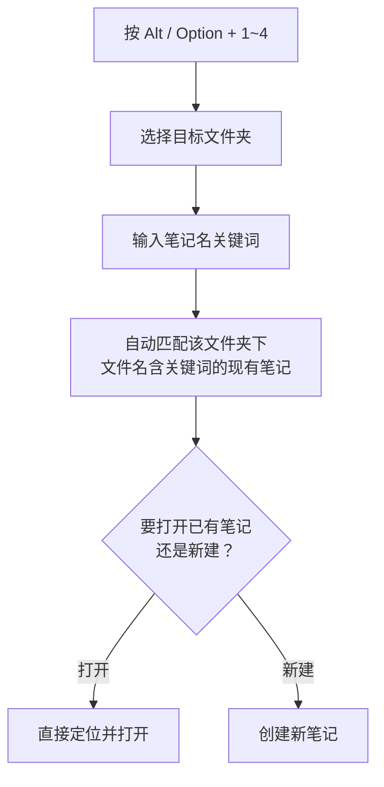

# 如何使用 IOTO 的 4 个核心快捷键

> [!info] 写给刚部署好 IOTO 的你
> 本文把 IOTO 的 4 个核心快捷键讲清楚：分别是什么、怎么用、出错了怎么办，以及如何自定义它们的行为。

---

## 一句话先记住

> IOTO 用 `Alt / Option + 1 / 2 / 3 / 4` 对应 **I·O·T·O** 四类笔记，按字母顺序记住就行。

## 4 个核心快捷键

| 快捷键 | 作用 | 对应分类 |
| --- | --- | --- |
| `Alt / Option + 1` | 创建或打开**输入**笔记 | I — 输入 |
| `Alt / Option + 2` | 创建或打开**输出**笔记 | O — 输出 |
| `Alt / Option + 3` | 创建或打开**任务**笔记 | T — 任务 |
| `Alt / Option + 4` | 创建或打开**成果**笔记 | O — 成果 |

> [!tip] 记忆口诀
> 快捷键按 I·O·T·O 的字母顺序对应 1、2、3、4，再配合 `Alt / Option` 即可。等它变成肌肉记忆，你在 Obsidian 里的效率会明显提升。

这些快捷键在你运行 IOTO Framework Settings 插件的 `初始化IOTO框架` 命令时，会被自动注册和配置好，无需手动绑定。

## 用之前要知道的两件事

### 1. 必须在「已打开的笔记」里使用

这几个快捷键底层调用的是 Templater 的「插入模板」能力，**需要你正处于一个激活的笔记中**才能生效。

> [!warning] 遇到 `No Active Editor` 报错
> 如果使用时看到 Templater 提示 `No Active Editor`，说明你当前没有在任何一个激活的笔记里。先打开（或新建）一个笔记，再按快捷键即可。

### 2. 记不住？还有「快速面板」兜底

考虑到新手可能一时记不住快捷键，IOTO 在初次部署时会默认开启**快速面板**：

- 面板只有在「某个笔记被选中」时才显示，默认出现在笔记下方；
- 面板上有 I·O·T·O 四个字母按钮，点它们和按快捷键效果完全一样；
- 可在 `IOTO Framework Settings → 其他 → IOTO快速面板` 里调整外观、位置、颜色、样式，也可以选择直接隐藏、不启用。

## 自定义：创建后的默认行为

用核心快捷键（或快速面板）新建笔记时，选好目标文件夹后，会弹出一个「后续操作」选择面板：

| 可选操作 | 说明 |
| --- | --- |
| 创建后插入链接 | 在来源笔记插入指向新笔记的链接 |
| 创建后打开笔记 | 创建完成后立即打开新笔记 |
| 创建后在光标处插入链接并打开笔记 | 插入链接 + 打开，一步到位 |
| 创建后不插入链接也不打开笔记 | 只创建，不做其它动作 |
| 创建后添加链接文字 | 创建后附带链接文字 |

如果你每次都用同一个操作（比如最常用的「创建后插入链接」），可以跳过这一步选择：

> [!note] 设置默认行为
> 在 `IOTO Framework Settings` 的 `创建新笔记后的默认后续操作` 中设定即可。该设置**分别在「输入」「输出」「成果」三处设置页各出现一次**，所以你可以给这三类笔记各自指定不同的后续操作。

## 进阶：用快捷键打开已有笔记

核心快捷键主要用来**新建**笔记，但也能用来**打开**指定文件夹下的现有笔记。

这个「边输入边匹配」的设计初衷有三点：

- 提醒你当前文件夹的命名方式；
- 显示已有内容，避免你重建同名文件；
- 提示相似内容，帮你唤起记忆。

> [!tip] 比 `Ctrl / Command + O` 更聚焦
> Obsidian 自带的 `Ctrl / Command + O` 能打开「快速切换面板」，在全库范围匹配笔记名或路径——好用，但候选常常很多。
> 如果你已经确定目标文件夹（比如就在「原始资料」里找），用 `Alt + 1` 选好文件夹后直接输入，匹配更快、结果更准，还能顺带按你设定的行为插入链接或打开笔记。