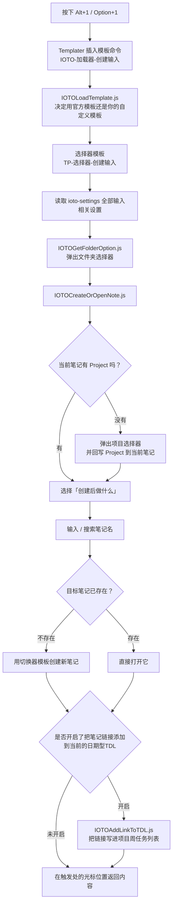
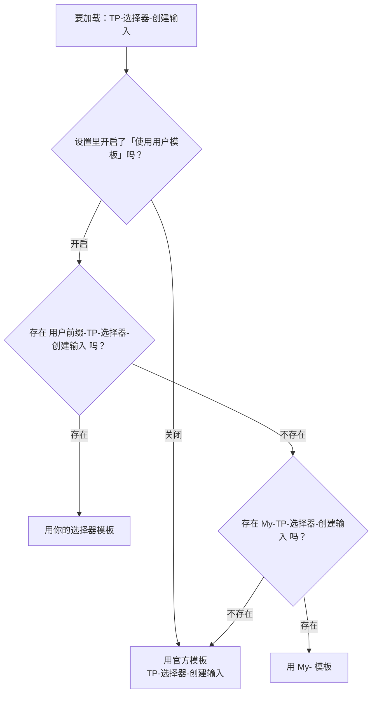
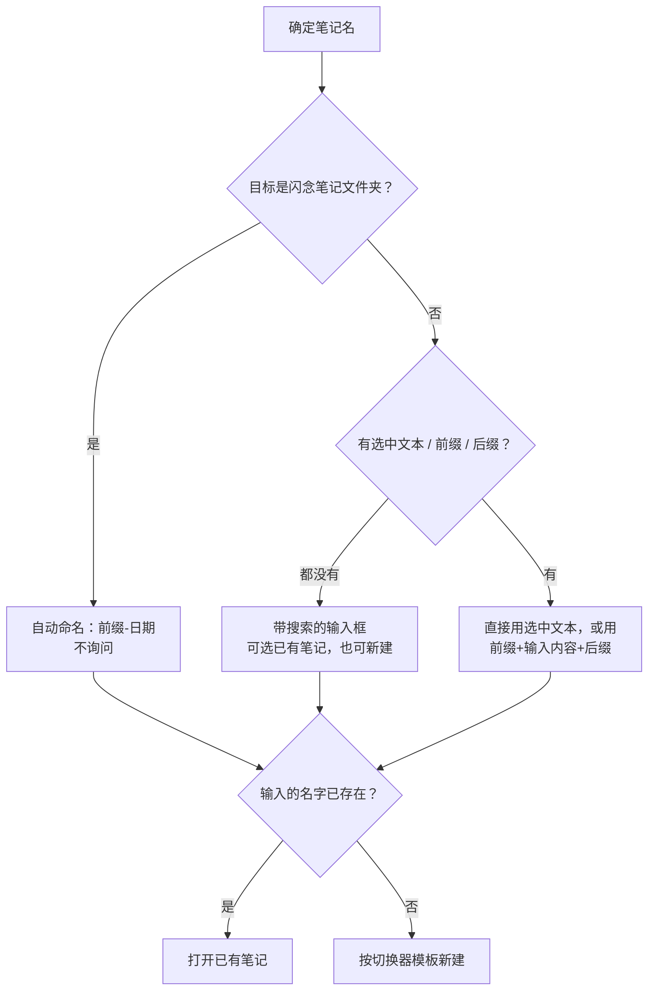

# IOTO的IOO笔记创建和打开流程是如何工作的

> IOO笔记是我对IOTO中输入、输出和成果笔记的简称。

> [!info] 写给谁看
> 写给所有正在用 IOTO 的 Obsidian 用户。读完你会知道：按下 `Alt + 1`（macOS 为 `Option + 1`）之后，IOTO 在背后依次做了哪几件事、每一步分别由哪个文件负责、以及**你可以在哪里改设置去控制每一步的行为**。
> 本文以「创建输入笔记」（`Alt + 1`）为例，`Alt + 2/4` 的流程结构完全一致，只是把「输入」换成「输出  / 成果」。

---

## 一句话先记住

> `Alt + 1` 触发的不是一个「模板」，而是一条**四段式流水线**：
> **加载器**（找入口）→ **选择器**（读设置、选文件夹）→ **切换器**（根据路径，选择模板，决定新笔记长什么样）→ **`IOTOCreateOrOpenNote.js`**（创建或打开笔记，并把结果写回你当前的笔记）。
> 你想改哪一步的行为，就去改那一段对应的设置或模板。

## 全流程总览



## 第 1 段：加载器（Loader）—— 唯一的入口

`Alt + 1` 在 Obsidian 快捷键里绑定的是 Templater 的「插入模板」命令，目标模板是：

```text
0-辅助/IOTO/Templates/Templater/OBIOTO/IOTO-加载器-创建输入.md
```

它的全部内容只有三行：

```js
<%*
const ml = new (tp.user.IOTOMultiLangs(tp))(tp);
tR += await tp.user.IOTOLoadTemplate(tp, tR, this.app, ml.t("IOTODefaultInputSelector"))
_%>
```

它做两件事：

1. 用 [[IOTOMultiLangs.js]] 把「输入选择器」这个**语义名**翻译成当前语言下的模板名（简体中文 = `TP-选择器-创建输入`，英文 = `TP-Selector-CreateInput`）；
2. 把这个名字交给 [[IOTOLoadTemplate.js]] 去加载。

> [!tip] 为什么要多一层加载器？
> 因为加载器是**固定不变的入口**。快捷键永远只绑这一个文件，真正执行的模板可以被你替换。这样你换自定义模板时，不需要重新设置快捷键。

五个加载器与快捷键的对应关系：

| 快捷键 | 加载器模板 | 加载的选择器 |
| --- | --- | --- |
| `Alt + 1` | `IOTO-加载器-创建输入` | `TP-选择器-创建输入` |
| `Alt + 2` | `IOTO-加载器-创建输出` | `TP-选择器-创建输出` |
| `Alt + 3` | `IOTO-加载器-创建任务` | `TP-选择器-创建任务` |
| `Alt + 4` | `IOTO-加载器-创建成果` | `TP-选择器-创建成果` |
| `Alt + 5` | `IOTO-加载器-辅助工具` | 辅助工具面板 |

## 第 2 段：`IOTOLoadTemplate.js` —— 官方模板 vs 你的模板

这是**第一个你能控制流程走向的地方**。它的判断逻辑是三级回退：



对应设置在 **IOTO 设置 → 基本设置**：

| 设置项 | 字段名 | 默认值 | 作用 |
| --- | --- | --- | --- |
| 使用用户模板 | `useUserTemplate` | 开启 | 关掉后永远只用官方模板 |
| 用户模板前缀 | `userTemplatePrefix` | `My` | 你的模板必须以「前缀-」开头才会被识别 |

> [!tip] 定制模板的正确姿势
> **不要直接改官方模板**（升级会被覆盖）。正确做法是：复制一份官方提供的My开头的模板 → 重命名为 `你自己设置的前缀-原名`→ 随便放在库里哪个文件夹都行（靠文件名识别，不靠路径）。

## 第 3 段：选择器（Selector）—— 读设置、选文件夹

被加载的 `TP-选择器-创建输入`类模板（根据设置，决定用用户自定义，还是My开头的，还是官方默认TP开头的） 是整条流水线的「配置中枢」。它一次性从 `ioto-settings` 里取出所有输入相关设置，然后组装成两组参数：

**① 文件夹选择参数 → 交给 [[IOTOGetFolderOption.js]]**

| 你在设置里看到的名字 | 字段名 | 作用 |
| --- | --- | --- |
| 输入笔记文件夹 | `inputFolder` | 从哪个根目录开始列子文件夹（默认 `1-输入`） |
| 输入选择器中排除的文件夹路径 | `inputSelectorExcludesPaths` | 一行一条，不想出现在选项里的路径 |
| 显示选项顺序 | `inputSelectorShowOptionOrder` | 选项前是否加 `1. 2. 3.` 编号 |
| 显示根路径 | `inputSelectorShowBasePath` | 选项显示完整路径还是相对路径 |
| 选择器选项内容模板 | `inputSelectorFolderOptionTemplate` | 选项文案，必须包含 `{{folder}}` |

> [!note] 排除路径的反向用法
> 排除列表里以 `-` 开头的条目含义是**反过来的：只保留**包含该关键词的文件夹。
> 例如写 `-OBIOTO`，选项里就只剩路径包含 `OBIOTO` 的文件夹。

**② 新笔记参数 → 交给 [[IOTOCreateOrOpenNote.js]]**

| 你在设置里看到的名字 | 字段名 | 作用 |
| --- | --- | --- |
| 创建新笔记后的默认后续操作 | `newInputNoteFollowUpAction` | 见下文「后续操作」表 |
| 笔记名称前缀 / 后缀 | `inputNoteNamePrefix` / `inputNoteNamePostfix` | 自动加在笔记名前后 |
| 默认 Excalidraw 模板 | `inputNoteDefaultExcalidrawTemplate` | 在画图文件夹里建笔记时用 |
| 添加新输入笔记到当前TDL | `addNewInputNoteToTDL` | 是否把链接写进项目周任务列表 |
| 新输入笔记加入TDL后的操作 | `newInputNoteAddedToTDLFollowUpAction` | 见下文「TDL 后续操作」表 |

同时它还会调用一次 `IOTOLoadTemplate`，把**切换器模板**（`TP-输入-切换器-创建输入笔记`）解析出来，作为新笔记的内容模板传下去。

> [!tip] 想跳过文件夹选择？
> 选择器模板里有一行 `showSubFolders: true`。复制成你自己的 `用户前缀-TP-选择器-创建输入` 后改成 `false`，就会**直接在 `1-输入` 根目录建笔记，不再弹文件夹选择器**。
> 如果你想修改用户模板，建议是有IOTO提供的模板生成器插件。
> 在S7系列的文档的中，讲过模版生成器的用法。

## 第 4 段：切换器（Switcher）—— 新笔记长什么样

切换器 `TP-输入-切换器-创建输入笔记` 只在**新建**笔记时生效（打开已有笔记时不走这里）。它负责两件事：

**① 按目标文件夹名挑内容模板**

```js
const switchers = [
    { match: "原始资料", template: "TP-输入-原始资料" },
    { match: "碎片笔记", template: "TP-输入-碎片笔记" },
];
```

你选的文件夹名里包含 `原始资料` → 用 `TP-输入-原始资料`；包含 `碎片笔记` → 用 `TP-输入-碎片笔记`；都不匹配（或对应模板不存在）→ 回退到默认模板 `TP-输入-笔记-默认模板`。

> [!tip] 加一种自己的笔记类型
> 把切换器复制成 `你的前缀-TP-输入-切换器-创建输入笔记`，在 `switchers` 数组里加一条自己的映射，再建一个同名内容模板即可。例如加 `{ match: "读书笔记", template: "My-TP-输入-读书笔记" }`。
> 注意：这里挑出来的模板名同样会过一遍 `IOTOLoadTemplate`，所以也支持前缀覆盖。
> 建议：在你不属性Templater的模板语法的情况下，都建议使用IOTO的模板生成器插件来进行模板操作

**② 自动写 frontmatter（属性继承）**

| 属性 | 来源 |
| --- | --- |
| `Project` | 继承自**触发快捷键时所在笔记**的 `Project` |
| `Subject` | 若来源笔记有 `Subject`，则继承 |
| `Plan` | 若来源笔记有 `Plan`，则继承 |
| `Inputs` / `Outputs` / `Outcomes` | 自动回链来源笔记：来源在 `1-输入` 写 `Inputs`，在 `2-输出` 写 `Outputs`，在 `4-成果` 写 `Outcomes` |

这就是 IOTO 里「从哪儿建的笔记，就自动带上哪儿的上下文」的实现位置。

## 第 5 段：`IOTOCreateOrOpenNote.js` —— 真正干活的脚本

这是你实际看到的那几个弹窗的来源。按顺序拆解：

### 5.1 项目检查（可能弹出的第一个额外窗口）

若「添加新输入笔记到当前TDL」开着，而**你当前所在的笔记没有 `Project` 属性**，脚本会先提示你选一个项目文件夹，然后把 `Project` 和 `cssclasses: ["iotoTDL"]` 回写进当前笔记的 frontmatter。

> [!note] 想让某篇笔记永远不触发这个检查
> 在该笔记 frontmatter 加上 `addLinkToTDL: false`；想让它**创建笔记但不写进任务列表**，加 `doNotAddToTDL: true`。

### 5.2 选择「创建后做什么」

只有当「创建新笔记后的默认后续操作」= **显示操作选项**（值 `0`）时才会弹这个窗；否则直接按你设定的值执行。

| 值 | 选项 | 效果 |
| --- | --- | --- |
| 0 | 显示操作选项 | 每次都弹窗让你选 |
| 1 | 在光标处插入链接 | 返回 `[[新笔记]]` |
| 2 | 打开新笔记 | 在新面板打开，原处不插入任何内容 |
| 3 | 插入链接并打开笔记 | 两者都做 |
| 4 | 不执行任何操作 | 只建笔记，原处不留痕 |
| 5 | 插入链接文本 | 返回纯文本笔记名（不带 `[[ ]]`） |
| 6 | 用选中文本作为链接别名 | 返回 `[[新笔记\|选中文本]]`，**仅在有单行选中内容时出现** |

### 5.3 决定笔记名（「创建」还是「打开」在这一步分岔）



几个关键细节：

- **带搜索的输入框**（`SuggestModal`）就是「打开已有笔记」的入口：输入关键词会实时列出该文件夹下的同名候选，选中即打开；顶部的「新建文件：xxx」才是新建。
- **前缀/后缀支持时间戳**：值以 `ts-` 开头会被当作日期格式解析。例如前缀填 `ts-YYYYMMDD`，笔记名就会自动变成 `20260804-你输入的标题`。
- **闪念笔记文件夹**（`fleetingNoteFolder`）下不询问名字，直接用 `闪念前缀-日期格式` 命名。
- **文件夹名含 `draw`**（不区分大小写）→ 创建 Excalidraw 白板；**含 `canvas`** → 创建 `.canvas` 白板。

### 5.4 选中文本的两种处理方式

这是很多人没注意到的行为分叉：

| 选中内容 | 行为 |
| --- | --- |
| 单行文本 | 作为**新笔记的名字**（跳过命名输入框）；若你选了后续操作 6，则改为「搜索已有笔记 + 用选中文本作别名」 |
| 多行文本 | **不作为笔记名**，而是被**写入新笔记正文**（新建时写在 frontmatter 之后；若笔记已存在则追加到末尾） |

## 第 6 段：`IOTOAddLinkToTDL.js` —— 写回项目任务列表


若「添加新输入笔记到当前TDL」为开启，创建/打开完成后会自动把链接追加到项目的日期型任务列表里。

- **目标文件名** = `项目名 + "-" + 日期格式`，日期格式来自 **项目和TDL → TDL 日期格式**（`defaultTDLDateFormat`，如 `YYYY-[Week]-WW` 得到 `OBIOTO-2026-Week-32`）。
- **插入位置** = 该文件中标题为「输入 LEARN」的小节（由 `LTDListInputSectionHeading` 决定，输出/成果各有对应设置），追加一行 `- [ ] [[笔记名]]`。
- **TDL 不存在时**：弹出文件夹选择器，用 `TP-任务-切换器-创建任务列表` 模板自动新建。
- **已存在同名链接时**：不会重复添加。
- **你本来就在这份 TDL 里触发**：跳过写入（因为链接会直接插到光标处）。

加入 TDL 后的后续操作（`newInputNoteAddedToTDLFollowUpAction`）：

| 值 | 选项 | 在触发处返回的内容 |
| --- | --- | --- |
| 0 | 显示操作选项 | 每次询问 |
| 1 | 嵌入TDL中的任务条目 | `![[TDL文件#^tdl-时间戳]]`（原处变成任务条目的实时嵌入） |
| 2 | 默认操作 | 按 5.2 里选的后续操作返回（通常是 `[[链接]]`） |

## 我可以在哪里控制这个流程？（速查）

| 我想改的事            | 去哪里改                                                                   |
| ---------------- | ---------------------------------------------------------------------- |
| 换快捷键             | Obsidian 设置 → 快捷键 → 搜索 `IOTO-加载器`                                      |
| 换根文件夹（`1-输入` 改名） | IOTO 设置 → **基本设置** → 输入笔记文件夹                                           |
| 让某些文件夹不出现在选项里    | IOTO 设置 → **输入** → 输入选择器中排除的文件夹路径                                      |
| 不想每次都弹「创建后做什么」   | IOTO 设置 → **输入** → 创建新笔记后的默认后续操作，选一个具体值                                |
| 笔记名自动加日期         | IOTO 设置 → **输入** → 笔记名称前缀，填 `ts-YYYY-MM-DD-`                           |
| 不要自动写进当前的日期型TDL  | IOTO 设置 → **项目和TDL** → 关闭「添加新输入笔记到当前TDL」；或在单篇笔记加 `doNotAddToTDL: true` |
| 改周任务列表的命名规则      | IOTO 设置 → **项目和TDL** → TDL 日期格式                                        |
| 改新笔记的正文模板        | 复制 `My-TP-输入-笔记-默认模板` 为 `你的前缀-TP-输入-笔记-默认模板` 后修改                       |
| 按文件夹用不同模板        | 复制My开头的切换器为 `你的前缀-TP-输入-切换器-创建输入笔记`，扩展 `switchers` 数组                  |
| 跳过文件夹选择 / 改整体逻辑  | 复制My开头的选择器为 `你的前缀-TP-选择器-创建输入` 后修改                                     |

> [!tip] 一条通用原则
> **能在设置里改的，就不要动模板；必须动模板的，一律先复制成 `你的前缀-` 前缀版本。** 这样官方更新永远不会覆盖你的定制。

## 常见现象与排查

| 现象 | 可能原因 |
| --- | --- |
| 按了快捷键完全没反应 | Templater 未启用；或授权校验未通过（`IOTOLoadTemplate` 静默返回空） |
| 提示「文件夹路径不存在」 | 设置里的 `inputFolder` 与实际目录名不一致 |
| 弹出让我选项目 | 当前笔记 frontmatter 缺 `Project` 属性 |
| 新笔记里没有 `Project` | 触发时所在笔记本身没有 `Project`，切换器无从继承 |
| 明明改了模板却没生效 | 文件名前缀与「用户模板前缀」设置不一致，或「使用用户模板」被关掉了 |
| 新笔记内容是空的只有标题 | 目标文件夹名没命中切换器的 `switchers` 规则，用了默认模板 |