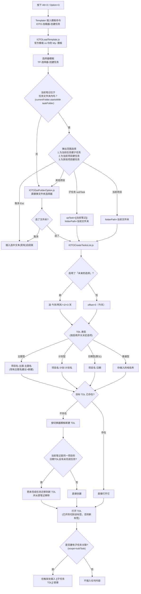
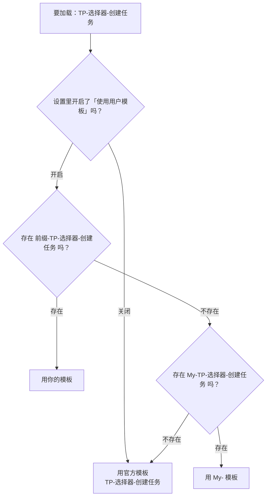
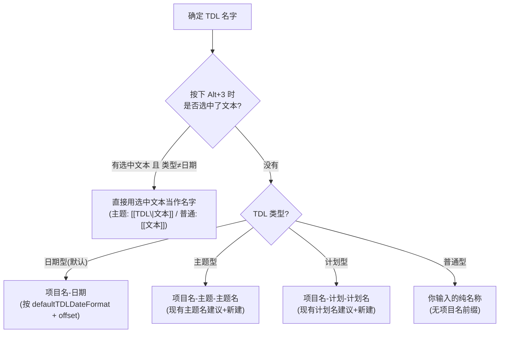

# IOTO的任务笔记创建和打开流程是如何工作的

> [!info] 写给谁看
> 写给所有正在用 IOTO 的 Obsidian 用户。读完你会知道：按下 `Alt + 3`（macOS 为 `Option + 3`）之后，IOTO 在背后依次做了哪几件事、每一步分别由哪个文件负责、以及**你可以在哪里改设置去控制每一步的行为**。
> 本文以「创建 / 打开任务列表（`Alt + 3`）」为例。它与 `Alt + 1/2/4` 走的是同一套「加载器 → 选择器 → 切换器 → 脚本」骨架，但**产物是一个日期 / 主题 / 计划 / 普通型的「任务列表笔记（TDL）」，并且会直接打开**——默认不在触发处插入链接，这是它和 IOO 笔记流程最不一样的地方。

---

## 一句话先记住

> `Alt + 3` 触发的不是「一个模板」，而是一条**四段式流水线**：
> **加载器**（找入口）→ **选择器**（读设置、选文件夹、决定 TDL 类型）→ **切换器**（决定新建 TDL 长什么样）→ **`IOTOCreateTasksList.js`**（决定 TDL 名字、创建或打开、必要时把未完成任务迁移过去）。
> 想改哪一步，就去改那一段对应的设置或模板。

## 全流程总览



## 第 1 段：加载器（Loader）—— 唯一的入口

`Alt + 3` 在 Obsidian 快捷键里绑定的是 Templater 的「插入模板」命令，目标模板是：

```text
0-辅助/IOTO/Templates/Templater/OBIOTO/IOTO-加载器-创建任务.md
```

它的全部内容只有三行：

```js
<%*
const ml = new (tp.user.IOTOMultiLangs(tp))(tp);
tR += await tp.user.IOTOLoadTemplate(tp, tR, this.app, ml.t("IOTODefaultTaskSelector"))
_%>
```

它做两件事：

1. 用 [[IOTOMultiLangs.js]] 把「任务选择器」这个**语义名**翻译成当前语言下的模板名（简体中文 = `TP-选择器-创建任务`，英文 = `TP-Selector-CreateTask`）；
2. 把这个名字交给 [[IOTOLoadTemplate.js]] 去加载并执行。

> [!tip] 为什么要多一层加载器？
> 因为加载器是**固定不变的入口**。快捷键永远只绑这一个文件，真正执行的模板可以被你替换。这样你换自定义模板时，不需要重新设置快捷键。

四个「笔记类」加载器与快捷键的对应关系（`Alt + 5` 走的是另一条轻量路径）：

| 快捷键 | 加载器模板 | 加载的选择器 |
| --- | --- | --- |
| `Alt + 1` | `IOTO-加载器-创建输入` | `TP-选择器-创建输入` |
| `Alt + 2` | `IOTO-加载器-创建输出` | `TP-选择器-创建输出` |
| `Alt + 3` | `IOTO-加载器-创建任务` | `TP-选择器-创建任务` |
| `Alt + 4` | `IOTO-加载器-创建成果` | `TP-选择器-创建成果` |

## 第 2 段：`IOTOLoadTemplate.js` —— 官方模板 vs 你的模板

这是**第一个你能控制流程走向的地方**。它的判断逻辑是三级回退（与 `Alt + 1` 完全一致）：



对应设置在 **IOTO 设置 → 基本设置**：

| 设置项 | 字段名 | 默认值 | 作用 |
| --- | --- | --- | --- |
| 使用用户模板 | `useUserTemplate` | 开启 | 关掉后永远只用官方模板 |
| 用户模板前缀 | `userTemplatePrefix` | `My` | 你的模板必须以「前缀-」开头才会被识别 |

> [!tip] 定制模板的正确姿势
> **不要直接改官方模板**（升级会被覆盖）。正确做法是：复制一份官方模板 → 重命名为 `你的前缀-原名`→ 随便放在库里哪个文件夹都行（靠文件名识别，不靠路径）。选择器、切换器、笔记模板都是同一套覆盖规则。

## 第 3 段：选择器（Selector）—— 读设置、选文件夹、决定类型

被加载的 `TP-选择器-创建任务`（`0-辅助/IOTO/Templates/Templater/OBIOTO/IOTO选择器模板/TP-选择器-创建任务.md`）是整条流水线的「配置中枢」。它一次性从 `ioto-settings` 里取出所有任务相关设置，组装成两组参数，最后调用 [[IOTOCreateTasksList.js]]。

**① 文件夹选择参数 → 交给 [[IOTOGetFolderOption.js]]**

| 你在设置里看到的名字 | 字段名 | 作用 |
| --- | --- | --- |
| 任务文件夹（基本设置） | `taskFolder` | 从哪个根目录开始列子文件夹（默认 `3-任务`） |
| 任务选择器中排除的文件夹路径 | `taskSelectorExcludesPaths` | 一行一条，不想出现在选项里的路径 |
| 显示选项顺序 | `taskSelectorShowOptionOrder` | 选项前是否加 `1. 2. 3.` 编号 |
| 显示根路径 | `taskSelectorShowBasePath` | 选项显示完整路径还是相对路径 |
| 选择器选项内容模板 | `taskSelectorFolderOptionTemplate` | 选项文案，必须包含 `{{folder}}` |

> [!note] 排除路径的反向用法
> 排除列表里以 `-` 开头的条目含义是**反过来的：只保留**包含该关键词的文件夹。
> 例如写 `-OBIOTO`，选项里就只剩路径包含 `OBIOTO` 的文件夹。

**② 新建 TDL 参数 → 交给 [[IOTOCreateTasksList.js]]**

| 你在设置里看到的名字 | 字段名 | 作用 |
| --- | --- | --- |
| TDL 的默认日期格式（项目和TDL） | `defaultTDLDateFormat` | TDL 名字里的日期部分，默认 `YYYY-MM-DD` |
| 项目名称格式（项目和TDL） | `projectNameFormat` | 由文件夹名推算项目名的方式 |
| 启用主题任务（任务 / 任务选择器笔记选项设置） | `taskSelectorEnableSubjectTask` | 开启后类型选择里出现「主题型」 |
| 启用计划任务（同上） | `taskSelectorEnablePlanTask` | 开启后类型选择里出现「计划型」 |
| 启用普通任务（同上） | `taskSelectorEnableNormalTask` | 开启后类型选择里出现「普通型」 |
| 启用未来的选择（任务 / 任务选择器其他设置） | `taskSelectorEnableFutureDaysChoices` | 开启后可建未来几天的 TDL |
| 切换器模板（代码内部解析） | `IOTODefaultTaskSwitcherTemplate` | = `TP-任务-切换器-创建任务列表` |

同时它还会调用一次 `IOTOLoadTemplate`（传 `false`，只取名字不展开），把**切换器模板**（`TP-任务-切换器-创建任务列表`）解析出来，作为新 TDL 的内容模板传下去。

### 范围选择：你「在哪里」按下了 `Alt + 3`

选择器先判断你当前所在的笔记**是否在任务文件夹内**（`currentFolder.startsWith(taskFolder)`）：

- **不在任务文件夹内**：直接进入文件夹选择器（`IOTOGetFolderOption`），让你挑一个项目文件夹（默认列 `taskFolder` 下的子文件夹）。
- **已经在任务文件夹内**：先弹一个**范围选择**：
  - `1. 为当前任务创建子任务`（subTask）：新建的 TDL 会通过 `UpTask` 指回当前笔记，并在当前笔记里插入 `[[子任务TDL]]` 链接——这是 IOTO 里「父任务 → 子任务」关联的入口。
  - `2. 为当前项目创建任务`（currentProject）：直接在当前文件夹下建 TDL，不再弹文件夹选择。
  - `3. 为其他项目创建任务`（otherProject）：弹出文件夹选择器，让你挑别的项目。
  - 按 `Esc` 取消：若有选中文本则把选中文本插回，否则什么都不做。

> 简言之：**只要不在任务文件夹里，第一步永远是「选项目文件夹」；在任务文件夹里，则多一个「子任务 / 当前项目 / 其他项目」的范围选择。**

### 类型选择：TDL 是哪一种

范围确定后，选择器根据你在设置里**启用的类型开关**列出可选项：

- 永远有 `创建日期型任务`（date）；
- 开了「启用主题任务」→ 多出 `创建主题型任务`（subject）；
- 开了「启用计划任务」→ 多出 `创建计划型任务`（plan）；
- 开了「启用普通任务」→ 多出 `创建普通任务`（normal）。

如果只启用了「日期型」（其余全关），则**跳过选择、直接用日期型**；否则弹一个带编号的选择器。取消同样会回退到「选中文本 / 什么都不做」。

> [!note] 关于「为TDL指定主题」这个旧开关
> 旧设置 `taskSelectorUseCustomTdlNames` 现在会随「启用主题任务」自动同步，实际的行为由上面三个「启用 XX 任务」开关控制。想要主题型 TDL，请直接开「启用主题任务」。

## 第 4 段：切换器（Switcher）—— 新建的 TDL 长什么样

切换器 `TP-任务-切换器-创建任务列表`（`0-辅助/IOTO/Templates/Templater/OBIOTO/IOTO切换器模板/TP-任务-切换器-创建任务列表.md`）只在**新建** TDL 时生效（打开已有 TDL 时不走这里）。它负责两件事：

**① 按 TDL 名字挑内容模板**

TDL 名字有四种形态，分别用不同笔记模板：

| TDL 名字形态 | 命中条件               | 使用的内容模板           | 最终骨架                                |
| -------- | ------------------ | ----------------- | ----------------------------------- |
| 日期型（默认）  | 名字不含 `-主题-`/`-计划-` | `TP-日期任务-笔记-默认模板` | 输入 LEARN / 输出 THINK / 成果 DO 三段式任务列表 |
| 主题型      | 名字含 `-主题-`         | `TP-主题任务-笔记-默认模板` | 主题型任务的三段式结构                         |
| 计划型      | 名字含 `-计划-`         | `TP-计划任务-笔记-默认模板` | 计划型任务的三段式结构                         |
| 普通型      | 名字不以「项目名-」开头       | `TP-普通任务-笔记-默认模板` | 普通任务的内容结构                           |

> 切换器里还有一条 `match: "Demo"` 的映射（`My-TP-任务-Demo`），演示「按文件夹名用不同模板」的扩展方式。默认任务文件夹名不会命中它，所以走上面四种标准形态。

> [!tip] 加一种自己的 TDL 类型
> 把 My 开头的任务切换器复制成 `你的前缀-TP-日期任务-切换器-创建任务列表`，在 `switchers` 数组里加一条映射（如 `{ match: "周会", template: "My-TP-任务-周会" }`），再建一个同名笔记模板即可。挑出来的模板名同样会过 `IOTOLoadTemplate`，支持前缀覆盖。

**② 自动写 frontmatter（属性继承）**

| 属性 | 来源 |
| --- | --- |
| `Project` | 由**目标文件夹名**通过 `IOTOCreateProjectName.js` 推算（受「项目名称格式」设置影响） |
| `cssclasses` | 固定 `["hideProperties", "iotoTDL"]`，让 TDL 用上 IOTO 的任务列表样式 |
| `Subject` / `Plan` / `UpTask` | 仅主题型 / 计划型 / 子任务型 TDL 才写入，用于把主题、计划、上级任务互相链接起来 |

这就是 IOTO 里「TDL 自带项目上下文，并能互相回链」的实现位置。

## 第 5 段：`IOTOCreateTasksList.js` —— 真正干活的脚本

这是你实际看到的弹窗与最终那个 TDL 的来源。按顺序拆解（文件在 `0-辅助/IOTO/Scripts/IOTOCreateTasksList.js`）：

### 5.1 日期偏移（是否建未来的 TDL）

只有当「启用未来的选择」（`taskSelectorEnableFutureDaysChoices`）开启时才会弹这个窗，选项是：今天 / 明天 / 后天 / 大后天（+0/+1/+2/+3 天）。关掉该设置则固定为「今天」（`offset = 0`）。

### 5.2 TDL 命名（四种模式，在这一步分岔）

脚本按你选的类型（以及是否先选中了文本）决定 TDL 名字 `tdlName`：



几个关键细节：

- **项目名**：来自 `IOTOCreateProjectName(folderPath, projectNameFormat)`，受「项目名称格式」设置控制（默认用文件夹名最后一个 `-` 之后的文本）。
- **主题 / 计划 命名**：会弹出一个带搜索的输入框（[[IOTOCreateTasksList.js]] 里的 `NameInputModal`）。它会**自动列出该文件夹里已有的主题 / 计划名**供你选择，也可以直接输入新名新建；不输入或取消则回退到日期模式。
- **日期模式**：名字形如 `OBIOTO-2026-08-04`，日期格式完全由「TDL 的默认日期格式」设置决定（例如改成 `YYYY-[Week]-WW` 就变成 `OBIOTO-2026-Week-32`）。
- **选中文本快捷方式**：若你在按下 `Alt+3` 前选中了一段文字，且类型不是「日期型」，这段文字会**直接作为 TDL 名字**（不会再弹命名框）；并且触发处会被插入一个对应的链接。

### 5.3 迁移未完成任务（只有「日期 TDL → 新日期 TDL」时触发）

脚本会判断：你**当前所在的笔记**是不是同一个项目的「日期型 TDL」——即它的父文件夹等于目标文件夹、`basename` 以项目名开头、且不含 `-主题-`/`-计划-`。如果是，并且里面还有**未勾选（`- [ ]`）的任务**，就会：

1. 把未完成任务（连同其所在的小节标题）抽取出来，作为**新 TDL 的内容**；
2. 从当前笔记里**移除**这些未完成任务。

效果就是：你今天没做完的事，按下 `Alt + 3` 建一个明天的 TDL 时会被自动「滚」到明天，今天的列表自动清空。若目标 TDL 已存在或当前笔记不是日期型 TDL，则跳过迁移。

### 5.4 创建或打开（标签切换）

- 若 `tdlName` 对应的 TDL **已存在**：直接打开它，**不会**重建或覆盖内容。
- 若不存在：用切换器模板（第 4 段）新建。
- 打开方式：如果该 TDL 已经在某个标签页打开，就**切到那个标签**；否则在**新标签页**打开。

### 5.5 返回值（是否插入链接）

与 `Alt + 1/2/4` 不同，`Alt + 3` **默认不在触发处插入任何内容**：

- 普通日期型 / 主题型 / 计划型 / 普通型（无选中文本、非子任务）：返回空字符串 → 触发处原样不动，只是打开了 TDL。
- **子任务型**（范围选了「为当前任务创建子任务」）：返回 `[[子任务TDL名字]]` → 这个链接会被插入到你当时所在的父任务笔记里，形成「父任务 → 子任务」的回链。
- 有选中文本的情况：日期型返回 `选中文本[[TDL]]`、主题 / 计划型返回 `[[TDL|选中文本]]`、普通型返回 `[[选中文本]]`——即把选中的文字变成指向新 TDL 的链接。

## 我可以在哪里控制这个流程？（速查）

| 我想改的事                  | 去哪里改                                                                                       |
| ---------------------- | ------------------------------------------------------------------------------------------ |
| 换快捷键                   | Obsidian 设置 → 快捷键 → 搜索 `IOTO-加载器-创建任务`（命令 id 形如 `templater-obsidian:.../IOTO-加载器-创建任务.md`） |
| 改任务根文件夹（默认 `3-任务`）     | IOTO 设置 → **基本设置** → 任务文件夹                                                                 |
| 让某些文件夹不出现在任务选择器里       | IOTO 设置 → **任务** → IOTO 任务选择器 文件夹选项设置 → 任务选择器中排除的文件夹路径                                     |
| 选项显示完整路径               | IOTO 设置 → **任务** → IOTO 任务选择器 文件夹选项设置 → 显示根路径                                              |
| 选项显示 `1. 2. 3.` 编号     | IOTO 设置 → **任务** → IOTO 任务选择器 文件夹选项设置 → 显示选项顺序                                             |
| 改选项文案                  | IOTO 设置 → **任务** → IOTO 任务选择器 文件夹选项设置 → 选择器选项内容模板（必须含 `{{folder}}`）                        |
| 不想每次都弹文件夹选择            | 复制选择器为 `My-TP-选择器-创建任务`，把 `showSubFolders` 改为 `false`                                      |
| 出现「主题型 / 计划型 / 普通型」选项  | IOTO 设置 → **任务** → 任务选择器笔记选项设置 → 启用主题任务 / 启用计划任务 / 启用普通任务                                  |
| 子任务回链（父 → 子）           | 在任务文件夹里按 `Alt+3` → 选「为当前任务创建子任务」                                                           |
| 改 TDL 名字里的日期格式         | IOTO 设置 → **项目和TDL** → TDL 的默认日期格式                                                         |
| 改项目名称的取法               | IOTO 设置 → **项目和TDL** → 项目名称格式                                                              |
| 创建未来几天的 TDL            | IOTO 设置 → **任务** → 任务选择器其他设置 → 启用未来的选择                                                     |
| 改 TDL 里「输入/输出/成果」小节的标题 | IOTO 设置 → **项目和TDL** → TDL 列表输入/输出/成果部分的标题                                                 |
| 改 TDL 小节标题级别           | IOTO 设置 → **项目和TDL** → 默认 TDL 标题级别                                                         |
| 改 TDL 正文模板（默认三段式）      | 复制 `My-TP-日期任务-笔记-默认模板` 为 `你的前缀-TP-日期任务-笔记-默认模板` 后修改                                       |
| 给某种 TDL 用不同模板          | 复制切换器为 `你的前缀-TP-任务-切换器-创建任务列表`，扩展 `switchers` 数组                                           |
| 改整体流程逻辑                | 复制选择器为 `你的前缀-TP-选择器-创建任务` 后修改                                                              |

> [!tip] 一条通用原则
> **能在设置里改的，就不要动模板；必须动模板的，一律先复制成 `你的前缀-原名` 前缀版本。** 这样官方更新永远不会覆盖你的定制。

## 常见现象与排查

| 现象 | 可能原因 |
| --- | --- |
| 按了快捷键完全没反应 | Templater 未启用；或 `ioto-update` 授权校验未通过（`IOTOLoadTemplate` 静默返回空） |
| 弹窗让我选项目 / 项目名不对 | 「项目名称格式」设置与你的文件夹命名习惯不匹配；或触发处的文件夹不在任务文件夹下 |
| 新 TDL 名字多了/少了日期 | 「TDL 的默认日期格式」被改过，或开了「主题任务 / 计划任务」并选了对应类型 |
| 今天的任务被「搬走」了 | 你在今天的日期 TDL 里按 `Alt+3` 建了新 TDL，触发了未完成任务迁移（预期行为） |
| 明明改了模板却没生效 | 文件名前缀与「用户模板前缀」设置不一致，或「使用用户模板」被关掉了 |
| 打开的是已有 TDL 而不是新建 | 同名的 TDL 已经存在（脚本会直接打开，不覆盖） |
| 子任务输入框里没有候选 | 该文件夹下还没有任何 `-主题-` 命名的 TDL，直接输入新主题名即可；普通 / 计划名同理 |
| 想建子任务却没出现回链 | 只有在任务文件夹内按 `Alt+3` 并选「为当前任务创建子任务」才会写 `UpTask` 并插入链接 |