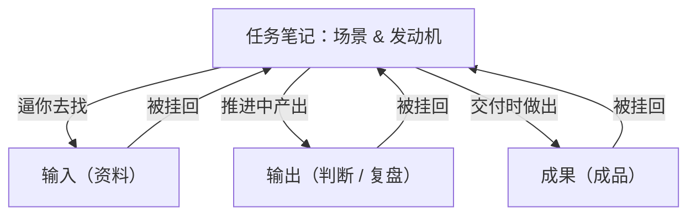
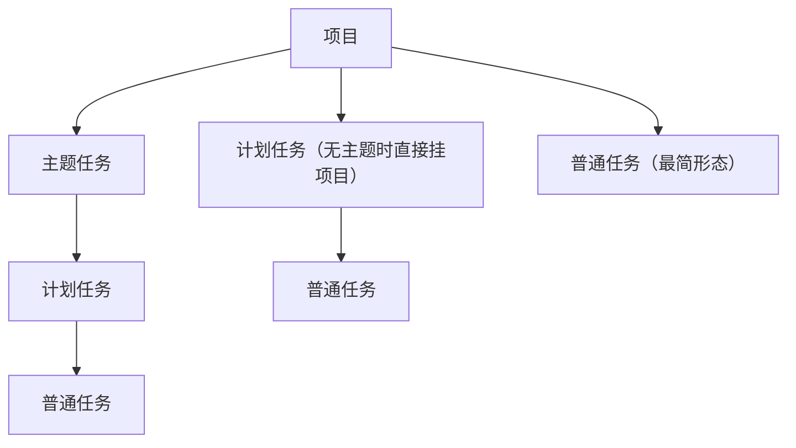
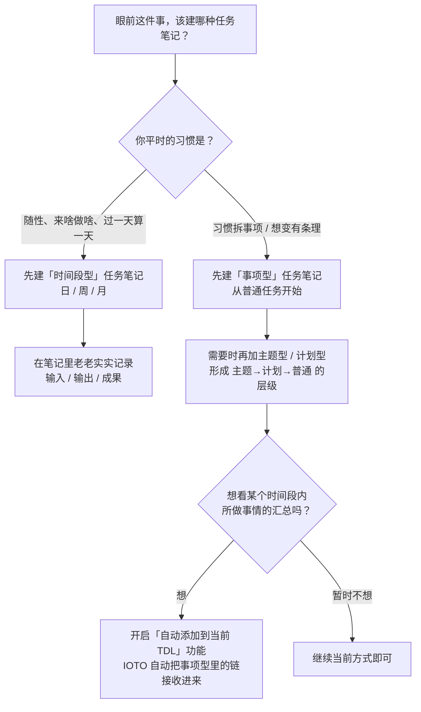
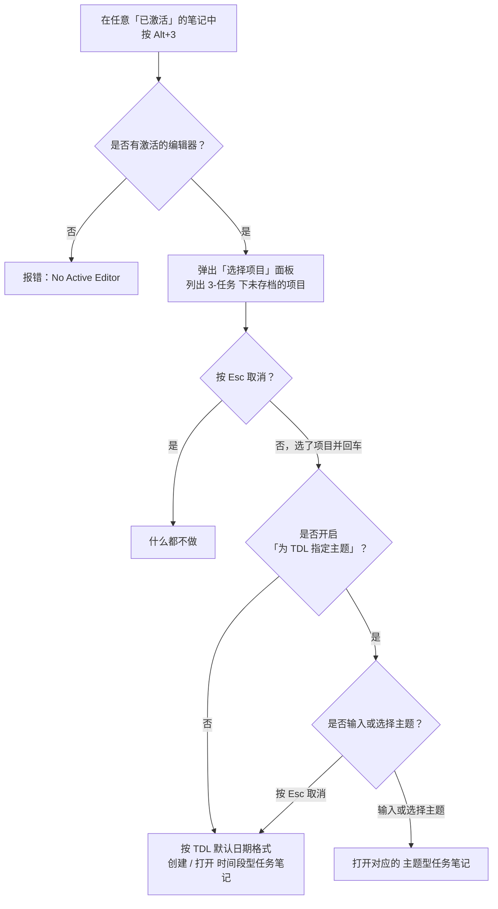
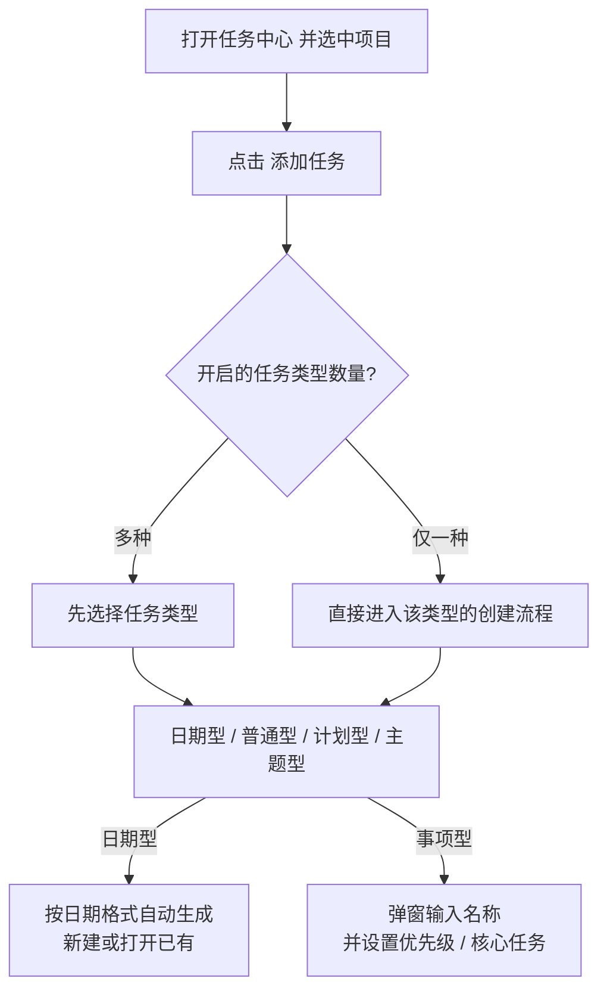
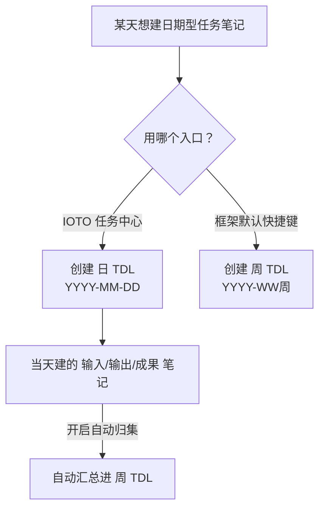
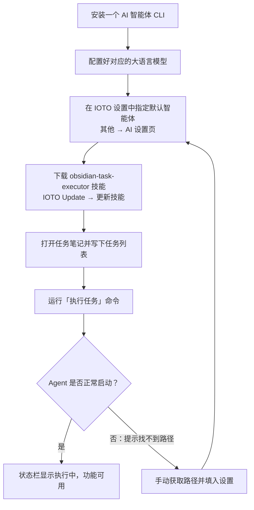

# 一文教你成为 IOTO 的任务使用高手

> [!info] 写给想把 IOTO 任务玩明白的你
> 这篇上手指南把「任务笔记」这件事一次讲透：它为什么是 IOTO 的 C 位、分哪几类、怎么用两种最高效的方式创建、类型怎么选、任务中心怎么用、模板怎么自定义，以及进阶的 AI 执行。读完你就能独立用任务笔记驱动自己的项目。原始讲解见 [[S3-IOTO中的任务笔记为何关键]] 系列。

---

## 一句话先记住

> [!note]
> **任务笔记不是 IOTO 里的一类普通笔记，而是整个系统的驱动中心。** 每个真正的任务，单独开一篇任务笔记；它只负责把三类东西放一起——要交付什么（成果）、需要什么资料（输入）、形成了什么判断（输出）。只要「任务 → 输入 → 输出 → 成果」这条通路在，知识管理就是把事搞定的副产品。

## 一、为什么任务笔记是 C 位

IOTO 是「以项目为中心、以任务为驱动、以成果为导向」的框架。任务笔记的关键，不在它是一类笔记，而在它的**角色**。

- **把任务当发动机，不是知识管理的一环**：别先停下来做知识管理再干活。正确做法是在做事过程中，顺手把资料（输入）、判断（输出）、交付（成果）挂回同一篇任务笔记——知识管理会自动发生。
- **双链是路标，任务才是发动机**：双链解决「能连接」，不解决「会被调用」。差的那一环是情境，只有任务会逼你做三件事：为完成它去找输入、为推进它产出输出、为交付它做出成果。
- **任务把「输入—输出—成果」串成闭环**：给场景（知识在任务里变具体）、做筛选（能推进现在的事就留）、逼交付（从「我懂了」推到「我做出来了」）、产复利（每次留下可复用判断/坑/模板）。
- **结构上也站 C 位**：项目建在 `3-任务` 下，任务笔记自动带上 `Project` 属性，并继承给自己的输入、输出、成果。「项目—任务—IOO」被一条线串起来，任务文件夹是整个工作流的起点与枢纽。
- **你和 AI 协作的共享工作台**：给 AI 一段散乱聊天，它只能给「看起来合理」的建议；给它一篇任务笔记，它立刻拿到三个锚点——要交付什么、现在有什么材料、已经想到什么。



> [!tip] 落地的最简动作
> 每开始一件正经的事，先开任务笔记，再动手。你不需要更美的图谱，只需要这条始终存在的通路。

## 二、任务笔记分两类：横轴时间，纵轴事项

IOTO 把任务笔记分成两大类：**按时间分** 和 **按事项分**。时间是横轴，事项是纵轴；两者交错，覆盖你推进一个项目时的所有具体事情。

### 维度一：按「时间段」分（横轴）

以你喜欢的某个时间段为单位，把这段时间里的所有事塞进一篇笔记。

| 类型 | 命名示例 | 适合 |
| --- | --- | --- |
| 日任务 | `项目A-2026-07-20` | 记录当天所有相关事情 |
| 周任务 | `项目A-2026-WW30` | 记录一周的推进 |
| 月任务 | `项目A-2026-07` | 月度回顾与规划 |

- **优点**：直观、好操作，打开就知道某天/某周干了啥。
- **局限**：同一段时间事一多，难看出彼此怎么分类关联；很多事项跨时长，只散落在时间段笔记里就串不起脉络。

### 维度二：按「事项」分（纵轴）

当事情需要长期跟进、跨时间段，就围绕一个事项建一篇笔记，在里面持续记录推进。IOTO 提供三层细分：

```text
项目
 └─ 主题任务    （一个大方向 / 一个主题）
     └─ 计划任务 （主题下的某个具体计划）
         └─ 普通任务 （计划里的一个具体动作）
```

- **主题任务**：项目下的某个主题或方向。
- **计划任务**：某个主题里你决定要做的计划。
- **普通任务**：计划里拆解出的一个个具体动作；也可以直接挂在项目下。



### 两种维度怎么组合

不是死规矩，按项目复杂度和事情性质自由搭配：

```text
组合 A（最完整）：  项目 → 主题任务 → 计划任务 → 普通任务
组合 B（中等）：    项目 → 计划任务 → 普通任务
组合 C（最简单）：  项目 → 普通任务
```

多数日常推进用纵轴；想做日/周/月复盘时，再用横轴切一份。

## 三、创建任务笔记的两种方式

建任务笔记的本质，就是在 `3-任务/所选项目` 文件夹下新建一个笔记。但创建是高频操作，IOTO 提供两种更省事的方式：

| 对比项 | 方式一：模板快捷键 | 方式二：任务中心创建 |
| --- | --- | --- |
| 依赖插件 | Templater | IOTO 任务中心插件 |
| 触发入口 | `Alt/Option + 3` 或 快速面板 T | 任务中心内「添加任务」按钮 |
| 是否需要先打开任务中心 | 不需要 | 需要 |
| 适用场景 | 随时、随手建任务 | 在任务中心里整理时顺手建 |

> [!note] 两种不冲突，可以同时使用
> 最终产出的都是符合 IOTO 规范的任务笔记，按习惯选即可。建议先熟悉方式一（最通用），已在用任务中心就混用方式二。

## 四、30 秒决定：眼前这件事建哪种类型

> [!abstract] 先给结论
> - **放养式（来啥做啥、过一天算一天）** → 先建**时间段型**（日/周/月）。
> - **习惯拆事项，或想变有条理** → 直接建**事项型**，从「普通任务」开始。
> - **两种都想要** → 都建，IOTO 自动把事项型里的 IOO 链接收进时间段型，不用手动搬运。
>
> **先动起来比选对类型更重要。两类笔记都能反悔、都能切换。**



| 你的状态 | 推荐起步 | 具体动作 |
| --- | --- | --- |
| 随性、放养、来啥做啥 | **时间段型** | 建日/周/月任务，记录输入/输出/成果 |
| 习惯拆事项、或想变有条理 | **事项型** | 从「普通任务」开始，逐步加计划/主题 |
| 想兼顾梳理与复盘 | **建事项型** + 开启自动归集 | IOTO 自动把事项型里的 IOO 链接收进时间段型 |

## 五、用默认快捷键 `Alt+3` 创建

- **Windows / Linux**：`Alt + 3`；**macOS**：`Option + 3`。
- 本质触发 Templater 的「插入模板」命令，自动完成项目选择、任务笔记定位。

> [!warning] 硬前提：必须先有一个「激活的」笔记
> 该快捷键要求在一个已激活的编辑器里运行。没打开任何笔记时按会报错 `No Active Editor`。解决：先点开任意笔记（哪怕空白），再按快捷键。

标准流程（在已激活笔记中按 `Alt+3`）：



- **两种走向**由「为 TDL 指定主题」开关决定：未开启→直接按日期格式建/开时间段型；已开启→先让你输入或选择主题型（主题选项仅在该项目已有主题时才出现）。
- **例外**：正身处一篇「主题型任务笔记」里再按 `Alt+3`，会先问你要建计划还是任务列表——建计划会新建计划笔记并在原主题笔记留链接。

## 六、用 IOTO 任务中心创建

> [!warning] 任务中心默认不随 IOTO 安装
> 用 **IOTO Update** 命令安装/更新后才会出现「IOTO Tasks Center：打开任务中心」命令。

1. 打开任务中心（可设快捷键随时打开），它会自动加载 `3-任务` 下的项目。
2. 先在**任务类型设置**里勾选要开启的类型（至少一种）：

| 任务类型 | 形态 | 命名规则 |
| --- | --- | --- |
| 日期任务 | 时间段型 | 按设置的日期格式自动生成 |
| 普通任务 | 事项型 | 你输入的内容 |
| 计划任务 | 事项型 | `项目名-计划-你输入的内容` |
| 主题任务 | 事项型 | `项目名-主题-你输入的内容` |

3. 选中项目 → 点「添加任务」。只开了一种直接走对应流程；开了多种会先让选类型。



**给任务加子任务**有两种方式：在任务条目上**右键**「为该任务创建子任务」；或在任务笔记中**选中一段文字**，用「将选中的文字转为子任务」命令（需该任务笔记处于激活状态）。

## 七、任务中心怎么用才高效

任务中心的存在就是让你**更简单地管理项目和任务**——一眼看清「在做哪些项目、还有哪些任务没完成」，把创建、管理、查看集中到一个可视化界面。

- **创建任务**：见上节。
- **管理任务**：靠右键菜单和拖拽完成（拖拽设父级、右键加/移除优先级或核心任务）；状态由任务清单完成度**自动同步**，不用手维护；刻意不做成全功能 PM 工具，保持轻量。
- **查看任务**：
  - 看单个：点任务默认右侧分屏打开；按住 `Alt/Option` 点则在当前标签组新开页。
  - 看一批：内置视图标签——核心任务 / 今天 / 未完成 / 已完成 / 全部；右上角还能分组、排序、过滤，并支持**标题+内容**搜索。
  - 看关联：直接跳转父任务、子任务，以及任务里的输入/输出/成果出链。

> [!tip] 别怕点错，先动手
> 任务中心几乎全在可视化界面里完成。最好的学习方式就是打开它，试试右键菜单、拖一拖任务、切一切视图——几分钟摸清核心交互。

## 八、自定义你的任务笔记模板

IOTO 有两套模板机制，**各管一种创建方式**，自定义时永远别直接改 `My` 开头的默认模板（IOTO Update 一键部署会覆盖它们），要用你自己的用户前缀建副本。

| 创建方式 | 模板机制 | 改模板在哪改 |
| --- | --- | --- |
| 默认快捷键 / 快速面板 T | IOTO 框架内置 Templater 模板 | Framework Settings（用户模板前缀 + 复制默认模板） |
| 任务中心「添加任务」 | 任务中心自带模板逻辑 | 任务中心设置 → `任务模板` |

- **快捷键方式**：在 Framework Settings → 基本设置改「用户前缀」（如 `JL`），再把 `My-TP-任务/主题/计划-笔记-默认模板` 各复制一份改前缀（如 `JL-TP-任务-笔记-默认模板`），改副本即可。
- **任务中心方式**：在设置 → `任务模板` 给四种类型分别指定模板文件或直接填内容。
- **模板里既能改正文也能改属性**，例如加上 `DDL`、`负责人` 字段，创建时自动带进去。

> [!warning] 日期型模板：别手改文件里的标题
> 自动把输入/输出/成果链接塞进 TDL 的功能，靠的是 **Framework Settings 里的「标题内容 + 标题层级」** 来定位插入位置，而不是模板文件里的文字。手改标题文字或层级会导致链接插错或插不进。**官方推荐**：直接在 Framework Settings 的设置里改标题层级和文字，模板自动跟着变，完全不用碰模板代码。

两个常见坑：

1. **普通任务没有默认快捷键模板**——框架侧目前无法用快捷键建普通任务，需自己建 `用户前缀-TP-普通任务` 并在任务中心把它指给普通任务。
2. **日期型格式建议两套分开**——框架设周（`YYYY-WW周`），任务中心设天（`YYYY-MM-DD`）；开启自动归集后，当天建的笔记链接会自动汇总进周 TDL。



## 九、进阶：让 AI 帮你执行任务

IOTO 的「AI 执行任务」= 你写一个任务清单 + 选好一个已安装的 AI 智能体 CLI，IOTO 自动调用它把清单一项项跑完。



- **装智能体**：Claude Code / OpenAI Codex / OpenCode / MimoCode / Hermes / Codebuddy Code，挑顺手的装并配好模型。
- **指定默认智能体**：Framework Settings → 其他 → AI。
- **装技能**：IOTO Update 的「更新技能」下载 `obsidian-task-executor`。
- **运行**：在任意任务笔记写任务列表，运行「执行任务」命令；提示找不到路径时，用 `which claude`（macOS）/ `Get-Command claude`（Windows）拿到路径填回设置。
- 这是进阶能力，细节见 [[S3-如何快速上手IOTO的AI执行任务功能]] 系列。

## 给新手的推荐流程

1. **先动起来**：随手 `Alt+3` 建一个时间段型 TDL，在里面老老实实记输入/输出/成果。
2. **想有条理**：从「普通任务」起步，慢慢往上叠计划型、主题型，自然长出层级。
3. **集中管理**：装好任务中心，用核心/今天/未完成等视图一眼看进度。
4. **自定义**：用用户前缀副本改模板，别碰 `My` 开头；日期型标题去设置里改。
5. **进阶提效**：配好 AI 智能体，把重复任务交给 AI 执行。

## 延伸阅读

- [[S3-IOTO中的任务笔记为何关键]] —— 任务笔记为什么是驱动中心
- [[S3-IOTO中是如何对任务进行分类的]] —— 时间段型 vs 事项型，及组合
- [[S3-IOTO中创建任务笔记时选择哪种类型更合适]] —— 30 秒选型决策
- [[S3-使用IOTO的默认快捷键创建任务笔记]] —— `Alt+3` 全流程
- [[S3-使用IOTO任务中心去创建任务笔记]] —— 任务中心建任务与子任务
- [[S3-IOTO任务中心的定位和使用]] —— 任务中心高效用法
- [[S3-IOTO中任务笔记的模板如何去自定义]] —— 两套模板机制与避坑
- [[S10-如何在IOTO中管理项目]] —— 同系列：项目管理上手指南