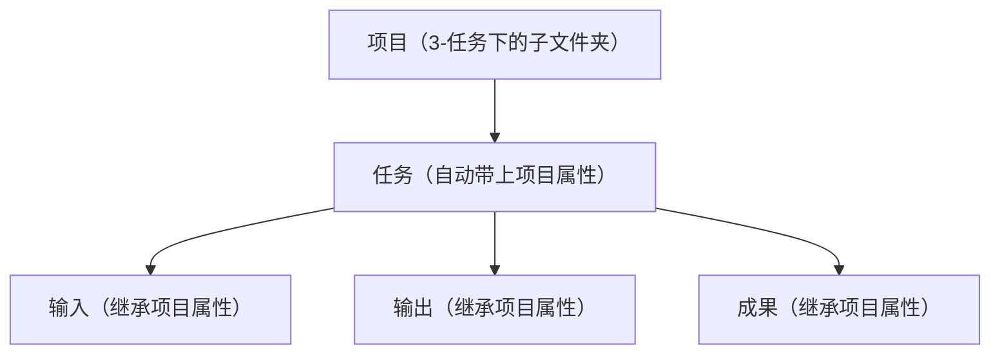
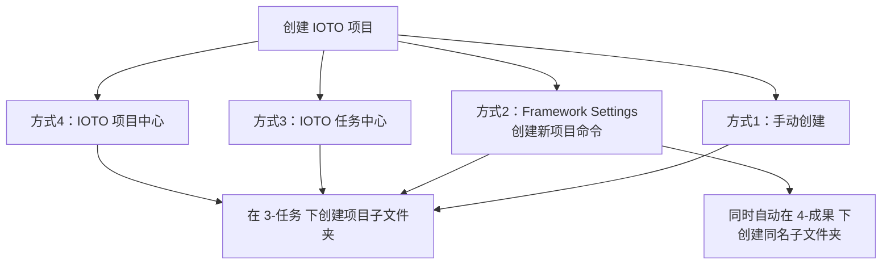
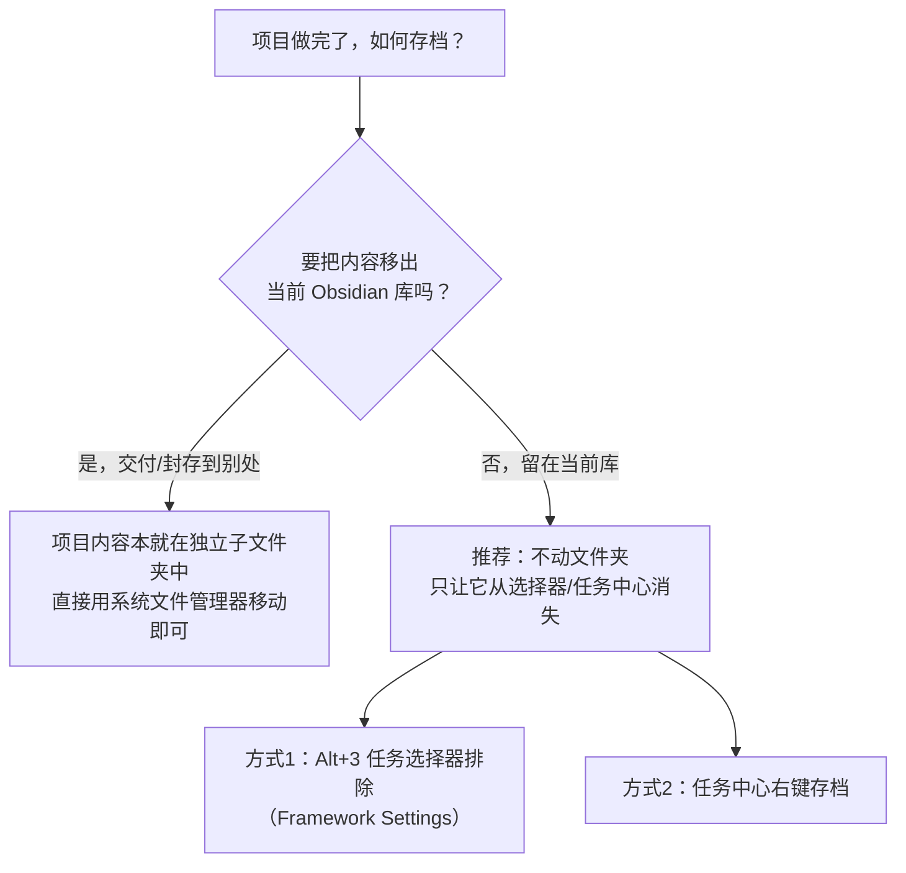

# 如何在 IOTO 中管理项目

> [!info] 写给想用 IOTO 搭起自己项目管理流程的你
> 这篇上手指南把「项目」这件事一次讲透：它是什么、为什么建在 `3-任务` 下、有哪些创建方式，以及改名 / 归档 / 删除该怎么做。读完你就能在 IOTO 里独立管理自己的项目。原始讲解见 [[S2-IOTO中的项目到底是什么]] 系列。

---

## 一句话先记住

> [!note]
> **项目，就是你对未来的一次投射。** 在 IOTO 里管理项目，只需记住一句心法：**以项目为中心，以任务为驱动。** 而「创建一个项目」本质上只有一件事——**在 `3-任务` 下建一个以项目命名的子文件夹。**

## 项目是什么：别被名字吓退

很多人一听「项目」，就想到甘特图、WBS、项目经理……其实在 IOTO 里，项目简单得多：

- **它是你对未来的一个期待，也是你为未来要做的事做的一次汇总。**
- 判断「这是不是项目」的两条尺子：
  1. **面向未来**——指向还没发生的事；
  2. **有时间跨度**——哪怕不是明确截止日期，也至少是一段你心里默认的跨度。

IOTO 故意把「项目」放宽、减轻：它不一定有死线，可以是一个有终点的交付，也可以是一个你长期推进、暂无终点的方向（比如「IOTO 研发」本身）。**别把笔记软件硬拗成 PM 工具**——知识管理里的项目，不等于业务项目。

> [!tip] 无项目，不管理
> 不管你用 `3-任务` 承载项目，还是只用一张任务清单汇总未来的事，只要你脑子里有「项目」这个概念，你就在管理你的未来。项目不需要复杂。

## 为什么项目建在 `3-任务` 文件夹下

刚上手的人常卡在这里：创建项目不是在「项目」文件夹下，而是在 `3-任务` 下建子文件夹。原因是一套「数据思维」——IOTO 的几个文件夹对应的是数据库里的几张表：

| 文件夹 | 角色 | 对应的「数据表」 |
|--------|------|------------------|
| `1-输入` | 外部获取的资料、素材、摘录 | 输入表 |
| `2-输出` | 个人思考、推演、理解沉淀 | 输出表 |
| `4-成果` | 可交付、可发布的成品 | 成果表 |
| `3-任务` | 具体要做的一件件事 | **任务表（C 位）** |

四类数据里，**任务被操作得最高频**——我们靠「一个个任务的完成」把项目走完。所以任务表站 C 位，在你的库里就是 `3-任务`。

项目不再是「装所有东西的大抽屉」，而成了贯穿四张表的**主线**。这就是「以项目为中心，以任务为驱动」的核心工作流入口。

## 创建项目的 4 种方式

核心动作只有一个：**在 `3-任务` 下建项目子文件夹**。四种入口最终都回到这一行，区别只在于「顺手多帮你做一件事」。

| 方式 | 入口 | 是否自动建 `4-成果` 项目文件夹 |
|------|------|-------------------------------|
| 1. 手动 | 文件管理器 | 否，`Alt+4` 时自动补，或手动加 |
| 2. Framework Settings 命令 | 命令面板 `创建新项目` | 是（立刻建） |
| 3. 任务中心 | IOTO 任务中心 | 否，`Alt+4` 时自动补，或手动加 |
| 4. 项目中心 | IOTO 项目中心 | 否，`Alt+4` 时自动补，或手动加 |

> [!note] 成果文件夹会自动补齐
> 用方式 3 / 4 时，`4-成果` 下可能暂时没有项目文件夹——没关系。当你在该项目的**任务笔记**里按 `Alt+4` 创建成果笔记时，IOTO 会自动检查并补齐 `4-成果/项目名` 及成果类型子文件夹（建什么由你的 Framework Settings 决定）。**你不必在创建项目时手动搭好结构。**

## 改项目名：文件夹 + 属性，缺一不可

改项目名会出现在三个地方：

1. `3-任务` 下的项目文件夹名；
2. `4-成果` 下的同名文件夹（若已产出成果）；
3. 所有相关笔记的 `Project` 属性值。

> [!warning] 改名 = 改文件夹 + 改所有相关笔记的 `Project` 属性
> 只改文件夹、忘改 `Project` 属性，会留下「断头」——后续任务清单、汇总、仪表盘都会对不上。

三种改法任选其一（本质是纯文本里的查找—替换）：

- **Obsidian 插件**：批量查找替换 / 批量改 frontmatter 的社区插件；
- **代码编辑器**：VS Code、Cursor、CodeBuddy 等在 vault 根目录全局替换 `Project: ["旧名"]` → `Project: ["新名"]`，再重命名两个文件夹；
- **AI 智能体**：交给 OpenCode / Claude Code / Codex / Hermes 等，说一句「把项目 X 改名为 Y，同步 `Project` 属性和文件夹名」即可。

> [!note] 为什么没有「一键改名」命令
> IOTO 刻意不提供：立项应是慎重的事；改名需求现成工具已能满足；更重要的是——**你的项目，就是你的注意力的防火墙**，不该太随便。一个好习惯，比一个便捷功能更重要。

## 归档已完成的项目：推荐「原地隐藏」

项目做完了，先分清两种完全不同的情形：

- **移出当前库**：直接用地系统文件管理器操作 `3-任务/项目名/` 和 `4-成果/项目名/` 子文件夹即可，IOTO 不掺和。
- **留在当前库（推荐）**：不建 Archive 文件夹，就让它留在原位。你真正要的「存档」效果只有一个——`Alt+3` 创建任务列表、或任务中心项目列表里**不再看到它**：
  - **方式 1**：Framework Settings → 任务设置 → `任务选择器中排除的文件夹路径`，加入项目名；
  - **方式 2**：任务中心项目列表里右键项目 →「存档」。

两种方式不冲突：方式 1 管 `Alt+3` 选择器，方式 2 管任务中心。**想两边都看不见就都做。** 日后要重启，把项目名从排除列表移除、或在项目中心「取消存档」即可。

## 删除项目：能存档，就别删

> [!warning] 删除前先问自己：要的是「删除」还是「存档」？
> 删除是单向操作，存档是低成本保险。**能存档，就别删。**

删除不能「一删了之」，因为 `Project` 属性是串联整个项目的纽带——相关资料还散落在 `1-输入`、`2-输出` 各处。标准步骤（Framework Settings 的 `删除项目` 命令就是自动做这两步）：

1. 删除 `3-任务/项目名` 文件夹；
2. 删除 `4-成果/项目名` 文件夹（若存在）。

这步删掉的是项目在 `3-任务`、`4-成果` 下的「骨架」。`1-输入`、`2-输出` 里靠 `Project` 属性关联的笔记不会跟着消失——**我的建议是这些资料和思考最好留着**，不占空间，却是你的积累。若铁了心要彻底抹掉，交给 AI 智能体按 `Project` 属性批量定位删除即可。

> [!danger] 任何批量删除前，先备份
> Obsidian 里都是本地文件，删了没有回收站兜底。动手前先复制一份 vault，或提交一次 git。

## 给新手的推荐流程

1. **立项**：用 Framework Settings 的 `创建新项目` 命令（最省心，自动建好 `4-成果` 同名文件夹），或直接使用任务中心 / 项目中心。
2. **推进**：在 `3-任务/项目名/` 下建任务，靠任务驱动，输入 / 输出 / 成果自动继承项目属性。
3. **收尾**：做完先**归档**而非删除；真要改名记得连 `Project` 属性一起改。
4. **备份习惯**：任何结构性改动前，先备份 vault。

## 延伸阅读

- [[S2-IOTO中的项目到底是什么]] —— 项目到底是什么
- [[S2-IOTO中的项目为什么是先建在任务文件夹下的]] —— 为什么入口是 `3-任务`
- [[S2-IOTO中的4种项目创建方式]] —— 4 种创建方式详解