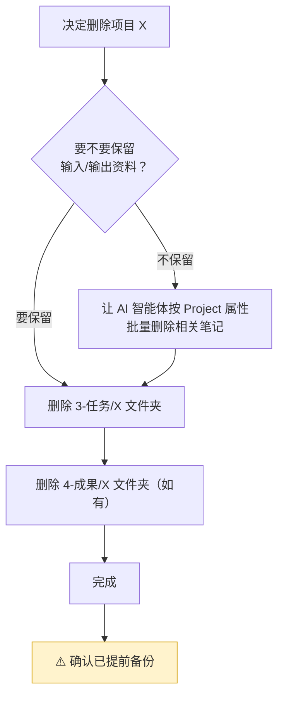

# IOTO 中删除项目应该如何做

如果你是谨慎立项的，那「删除项目」这个操作，大概率都用不上几次。

一个认真立起来的项目，做完之后，我们更可能选择把它**存档**——毕竟那里有你的经验和积累。我们在 Obsidian 里管理它们，本来就是为了将来某天或许还能再用上，而不是做完就一把火烧掉。

所以，在动手删之前，先问自己一句：**你要的到底是「删除」，还是「存档」？**

## 先想清楚：删除，还是存档？

- 如果你只是不想再看到这个项目、又想保留它的内容，请直接去 [[S2-IOTO中完成的项目如何归档]]，把项目归档就好。
- 只有当你确定这些内容再也不会用到、并且你愿意承担「删了就找不回来」的后果时，才考虑删除。

> 一句话：删除是单向操作，存档是低成本保险。能存档，就别删。

## 为什么删除不能「一删了之」

这一点和 [[S2-如何修改IOTO中的项目名]] 是同一套逻辑：在 IOTO 里，**`Project` 属性是串联一个项目所有笔记的纽带**。

IOTO 的项目文件，并不是规整地待在某一个「项目文件夹」里。它们分散在 vault 的几个顶层文件夹中：

- `3-任务/` 下的项目子文件夹——项目的主入口，里面有周任务、计划、主题笔记；
- `4-成果/` 下的项目子文件夹——如果这个项目产出过成果；
- 而 `1-输入`、`2-输出` 里大量相关资料，是通过 `Project` 属性「挂」在项目名下的，它们散落在各处，并不在某个项目文件夹里。

所以，想「删干净一个项目」，只删一个文件夹是远远不够的。

## 删除项目的标准步骤

如果你已经决定要删，至少要做下面两步：

1. 在 `3-任务` 文件夹下，删除你的项目子文件夹；
2. 在 `4-成果` 文件夹下，删除同名项目子文件夹（如果它存在）。

```text
3-任务/
└── 我的项目/        ← 删除这个文件夹
4-成果/
└── 我的项目/        ← 如果存在，也删掉
```

> 注意：只删这两个文件夹，等于只删掉了项目在 `3-任务` 和 `4-成果` 下的「骨架」。`1-输入`、`2-输出` 里那些通过 `Project` 属性关联的资料和思考，并不会跟着消失——它们会留下来。

IOTO Framework Settings插件提供了一个`删除项目`的命令，其实就是帮你自动完成了这两步。


## 建议保留的部分：1-输入 与 2-输出

我的建议是：**`3-任务` 和 `4-成果` 里的项目文件夹可以删，但 `1-输入`、`2-输出` 下的资料和你的思考，最好留着。**

原因很简单：那些素材和推演，很可能将来换个场景还能用上。它们不占什么空间，却实实在在是你的积累。删掉容易，哪天想回忆当时为什么这么做、踩过什么坑，可就找不回来了。

## 如果你连 输入 / 输出 也想一起删

如果你铁了心要把一个项目从 vault 里彻底抹掉，那就不能只动文件夹了——还得处理那些散落在 `1-输入`、`2-输出` 里、靠 `Project` 属性关联的笔记。

最省事的办法，是把这件事交给你的 AI 智能体：

> 告诉它：「把 vault 里所有 `Project` 属性中包含『你想删除的项目』的笔记，全部删掉。」

这和 [[S2-如何修改IOTO中的项目名]] 用的是同一个思路——`Project` 属性就是枢纽。让 AI 去按属性批量定位、批量删除，比你自己一个一个找要靠谱得多。



## 最后一条铁律：任何批量删除前，先备份

不管你是手动删文件夹，还是让 AI 批量删笔记，都请记住一件事：

> **Obsidian 里的都是本地文件，删了就是删了，没有回收站兜底。**

所以，做任何批量删除操作之前，先给整个 vault 做一次备份（复制一份、或提交一次 git）。小心一点，总是更稳妥的。