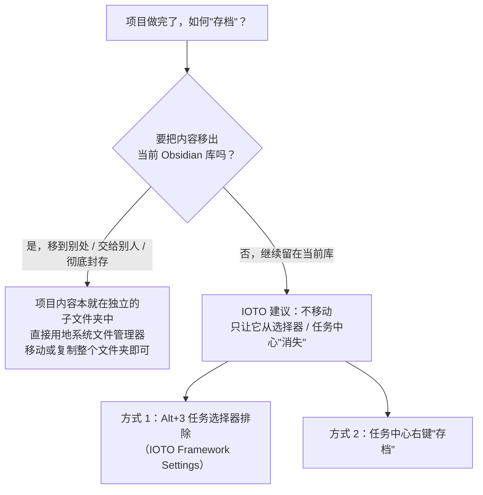
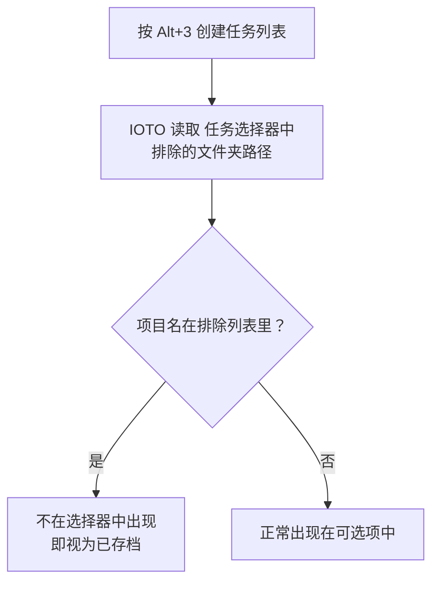
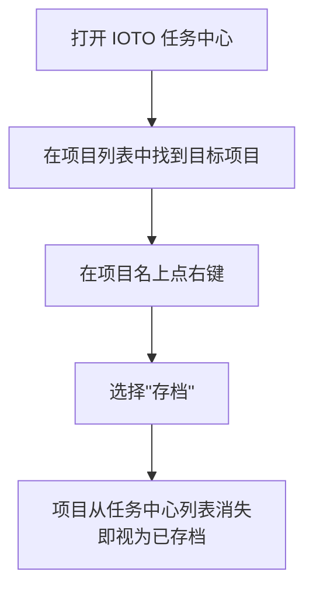
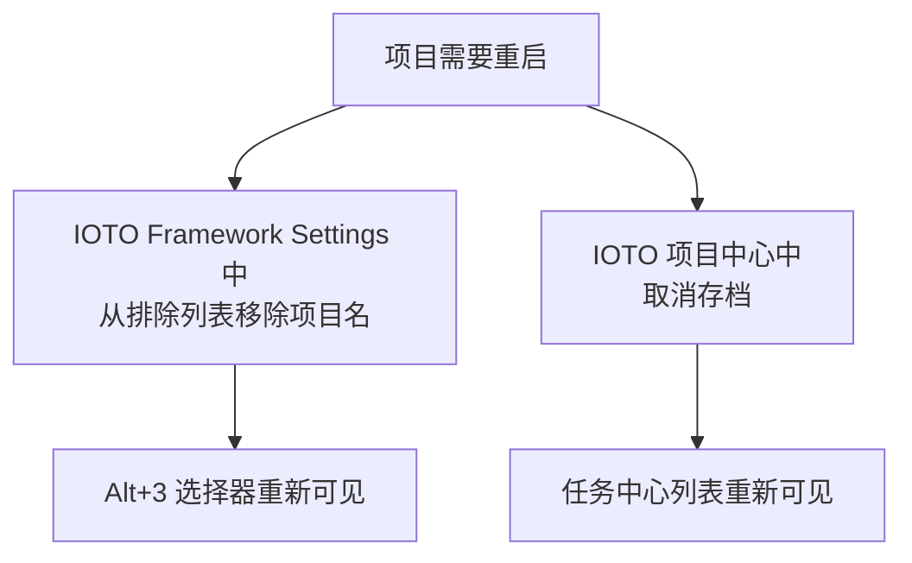

# IOTO 中完成的项目如何归档

一个项目做完了，要怎么把它「存档」？

先别急着建文件夹。在动手之前，得先分清两种完全不同的情形——因为**它们对应的是两种完全不同的操作**。

## 先判断：你要把项目移到库外，还是留在库里

下面分别说明。

## 情形一：把项目移出当前 Obsidian 库

如果你准备把整个项目的内容移出当前的 Obsidian 库——比如交付给别人、归档到别处、或者单纯不再想要它——

那事情最简单。因为 IOTO 里，一个项目的任务和成果，**都集中在一个独立子文件夹里**（`3-任务/项目名/` 和 `4-成果/项目名/`）。而你的整个 Obsidian 库，本质上就是你电脑硬盘上的一个文件夹。

所以你完全不需要在 Obsidian 里做任何「设置」，直接用电脑的文件管理器去操作那个子文件夹就行：剪切、复制、打包、移动到任意位置，随你。

> 一句话：库外迁移 = 普通文件操作，IOTO 不掺和。

## 情形二：项目仍留在当前 Obsidian 库（推荐以此为准）

这是更常见、也更值得讲清的情形：项目做完了，但你**还想把它留在当前库里**，方便将来回看。

### 为什么不建一个 Archive 文件夹

很多人会本能地想到 PARA 的做法：建一个叫 `Archive`（或「存档」）的文件夹，把项目整个挪进去。

但我更建议你**不要这么做，就让它留在原来的位置**。

原因很直白：你在 Obsidian 里建一个「存档文件夹」，本质上**还是把它留在了 Obsidian 库里**——它并没有真正离开，只是换了个目录。既然如此，直接留在原位，它同样是「存档」，而且更省事。

我们真正想要的「存档」效果其实只有一个：

- 以后用 `Alt+3` 创建任务列表时，**不要再在选项里看到这个项目**；
- 或者说，在 IOTO 任务中心的项目列表里，**不再显示这个项目**。

要做到这点，你**只需要做一个设置**，连文件夹都不用动。

### 方式 1：用 Alt+3 任务选择器排除（IOTO Framework Settings）

如果你习惯用 `Alt+3` 选择项目来创建任务列表，那么让某个项目「不再出现」只需一步：

1. 打开 **IOTO Framework Settings** 插件；
2. 进入 **任务设置** 标签页；
3. 找到 **`任务选择器中排除的文件夹路径`** 这一项；
4. 把你想存档的项目名字加进去。

之后，`Alt+3` 的任务选择器就会自动跳过它。

### 方式 2：在 IOTO 任务中心右键「存档」

如果你使用 **IOTO 的任务中心插件**，操作更直接：

在任务中心的**项目列表**里，找到那个项目，在它的名字上**点右键 → 选择「存档」**。

它会立刻从任务中心的项目列表中消失，不再显示。

> 两种方式不冲突：方式 1 管的是 `Alt+3` 任务选择器，方式 2 管的是任务中心列表。想两边都「看不见」，就两个都做；只想在某一处隐藏，做对应的那一个即可。

## 日后想重启这个项目怎么办

存档不是删除。哪天你发现这个项目又要重启了，把它「解冻」回来同样简单：

1. 去 **IOTO Framework Settings** 中，从 `任务选择器中排除的文件夹路径` 里**移除**之前加的项目名；
2. 在 **IOTO 项目中心**中，找到之前存档的项目，**取消存档**。

---