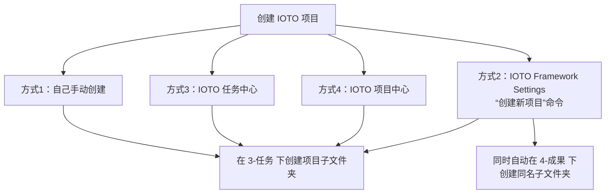
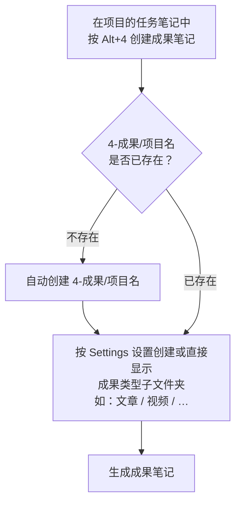

# IOTO中的4种项目创建方式

在使用 IOTO 的时候，去「创建一个项目」，本质上只有一件事要做：

> **在 `3-任务` 文件夹下，创建一个以项目命名的子文件夹。**

只要这个子文件夹建好，项目就「存在」了。其余的一切（周任务、计划、主题笔记……）都可以在这个子文件夹里继续生长。关于为什么项目要先建在任务文件夹下，详见 [[S2-IOTO中的项目为什么是先建在任务文件夹下的]]。

目前你有 **4 种方式** 来完成这件事，它们最终都会回到上面那一行：



虽然入口不同，但核心动作完全一致——区别只在于「顺手帮你多做了一件事」。下面逐一说明。

## 方式1：自己手动创建

最朴素的方式。直接在 Obsidian 的文件管理器里，于 `3-任务` 下新建一个文件夹，名字就是你的项目名。

```text
3-任务/
└── 我的项目/        ← 手动新建的文件夹
```

## 方式2：使用 IOTO Framework Settings 的「创建新项目」命令


在命令面板（`Ctrl/Cmd + P`）中运行 **IOTO Framework Settings** 提供的 `创建新项目` 命令：

```text
> IOTO Framework Settings: 创建新项目
```

它会做两件事：

1. 在 `3-任务` 下创建项目子文件夹；
2. **同时**在 `4-成果` 下创建同名子文件夹。

```text
3-任务/
└── 我的项目/
4-成果/
└── 我的项目/        ← 方式2 自动帮你建好
```

为什么要多做这一步？因为使用 IOTO Framework Settings 插件的人，一定是在用 IOTO 框架。既然在用框架，多半也会产出成果，所以我贴心地帮你把 `4-成果` 下的项目文件夹也建好，省得你之后再补。

## 方式3：在 IOTO 任务中心中创建


IOTO 任务中心插件，是可以**脱离 IOTO 框架**、在任何 Obsidian 库里单独使用的。所以它在创建项目时，只做最通用的那件事——在 `3-任务` 下建好项目子文件夹，**不会**自动去 `4-成果` 下建同名文件夹。

但这并不影响你在 IOTO 框架下使用它。因为 `4-成果` 的项目文件夹，会在你真正需要的时候被自动补齐（见下方「成果文件夹如何自动补齐」）。

## 方式4：在 IOTO 项目中心中创建


IOTO 项目中心同样以 `3-任务` 下的项目子文件夹为创建入口，适合从「项目总览」的视角去新建和管理项目。具体用法与项目中心的整体交互保持一致，这里不展开。

## 成果文件夹如何自动补齐（Alt+4 机制）

如果你用的是方式3或方式4，一开始 `4-成果` 下可能没有对应的项目文件夹——没关系。

当你在 IOTO 框架下，于某个项目的**任务笔记**中按 `Alt+4` 创建成果笔记时，IOTO 会先检查 `4-成果` 下有没有该项目文件夹：

- 没有 → 自动创建 `4-成果/项目名` 文件夹，并按你的 **IOTO Framework Settings** 设置，创建对应的成果类型子文件夹；
- 已有 → 直接使用。



也就是说，**成果类型子文件夹建什么，是由你的 IOTO Framework Settings 设置决定的**。你完全不必在创建项目时手动去 `4-成果` 下把结构搭好。

## 小结

| 方式                       | 入口           | 是否自动建 `4-成果` 项目文件夹       |
| ------------------------ | ------------ | ------------------------ |
| 1. 手动                    | 文件管理器        | 否，但 `Alt+4` 时自动补，或者自己手动加 |
| 2. Framework Settings 命令 | 命令面板 `创建新项目` | 是（立刻建）                   |
| 3. 任务中心                  | IOTO 任务中心    | 否，但 `Alt+4` 时自动补，或者自己手动加 |
| 4. 项目中心                  | IOTO 项目中心    | 否，但 `Alt+4` 时自动补，或者自己手动加 |

一句话总结：**不管用哪种方式，只要你先在 `3-任务` 下建好项目的子文件夹，后面的操作就可以继续了。** 你当然可以自己手动去 `4-成果` 下也建好那个项目文件夹，但并没有这个必要。

相关阅读：
- [[S2-IOTO中的项目到底是什么]] —— 项目究竟是什么
- [[S2-IOTO中的项目为什么是先建在任务文件夹下的]] —— 为什么入口是 `3-任务`