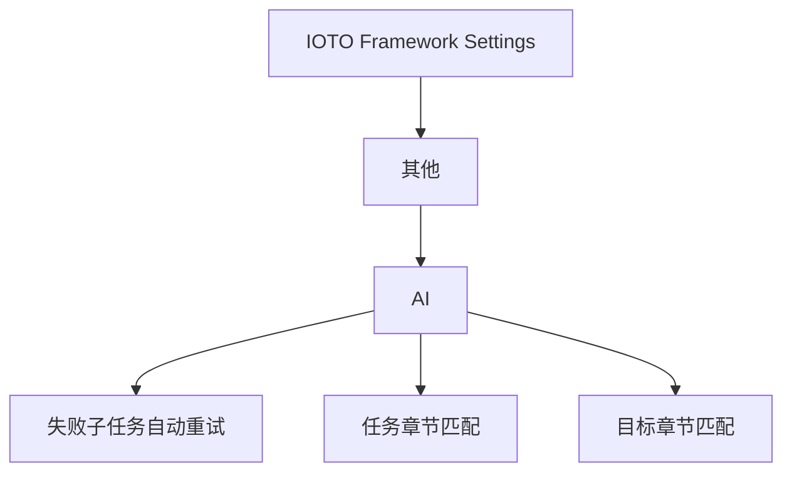

# IOTO AI执行任务的使用技巧

> [!info] 写给正在使用 IOTO「AI 执行任务」功能的你
> 这篇文档整理了 5 个能让你用得更顺手的小技巧：用 `@` 标注交付物、让失败任务自动重试、只跑指定章节的任务、把目标写进子任务的提示词，以及用「插入当前笔记中的出链」快速引用已有链接。读完你就知道怎么让 AI 更精准地理解你要什么、少走弯路。
>
> **适用版本**：`ioto-settings` v2.3.1（V231）及以上。前面四个技巧在 V231 里都有增强，新增的第五个技巧来自 2.3.3，已标 `*2.3.3更新*`。

---

## 一句话先记住

> [!tip]
> 想让 AI 帮你干活更精准，关键是**把信息直接喂给它**：用 `@` 告诉它交付物在哪，用设置告诉它该跑哪些任务、该带着什么目标。别让 AI 自己从任务描述里猜。

---

## 技巧一：用 `@` 明确指明任务的交付物

在任务描述里，需要 AI 创建或更新的文件链接前加上 `@`，IOTO 会自动把这些文件提取成「交付物链接」并封装进提示词。

> [!note] 效果
> AI 能立刻定位你的交付物是什么，而不用从一大段任务描述里自己判断。

**写法示例**

```text
把[[某个笔记]]转成用户文档，内容写入@[[目标笔记]]
```

`[[目标笔记]]` 前的 `@` 就是明确的交付物标注，AI 会优先处理它。

**三种写法** *2.3.1更新*

| 写法 | 什么时候用 |
| --- | --- |
| `@[[目标笔记]]` | 绝大多数情况 |
| `@[[真实笔记\|显示名]]` | 想让条目里显示成更口语的名字，插件取的仍是**真实笔记** |
| 一条里写多个 `@[[…]]` | 这一条要同时产出 / 更新多篇笔记 |

> [!tip] 隐藏作用：`@` 同时是验收凭据 *2.3.1更新*
> V231 新增的「完成验证」会拿你在 `@[[…]]` 里标的笔记当**验收依据**——AI 说做完了还没用，笔记真的存在 / 真的更新了才打勾。
> 也就是说，**`@` 不只是告诉 AI 往哪写，还是它「做完」的凭据**。详见 [[S3-如何让AI的「做完了」真的算数]]。

> [!warning] 只有写在 `- [ ]` 同一行的 `@` 才算数
> 写在条目下方缩进行的链接只是「补充描述」，不会被识别成交付物。完整的控制标记写法见 [[S3-如何用ioto标签在一行任务里下达控制指令]]。

---

## 技巧二：让失败的任务自动重试

在 IOTO Framework Settings 的 `其他 → AI` 下，打开 `失败子任务自动重试`，子任务编排模式下（并行或串行都生效）某个子任务失败时，IOTO 会自动重新执行它。

> [!note] 重试次数
> 默认重试 `1` 次，你也可以在同一设置里改成其他次数。

> [!warning] 这两种情况不会重试 *2.3.1更新*
> - **你主动停止**（killed）——是你喊停的，插件不会自作主张接着跑；
> - **spawn 级错误**（exit -1，比如 CLI 根本没装）——重跑多少次都一样，只会白烧轮次。
>
> 另外，V231 起「完成验证」失败也算一种失败：它会把「交付物不存在 / 未更新」这个原因回喂给 AI，并**并入同一份重试预算**重跑，不会额外再烧一轮。所以想让这条链路跑通，**「失败子任务自动重试」要开着**。详见 [[S3-如何让AI的「做完了」真的算数]]。

---

## 技巧三：只执行指定章节下的任务

在 `其他 → AI` 的 `任务章节匹配` 里填上章节标题名，子任务编排模式下 IOTO 只会执行该章节下的未完成任务。

> [!warning] 必须是 1 号标题
> 匹配的是一级标题（`# 标题`）。比如填 `任务`，那么只有 `# 任务` 下的未完成任务会跑，`# 待定` 下的任务会被忽略。

> [!note] 子标题不影响
> `# 任务` 下二级或更深层级的标题里的任务，同样会被执行。

---

## 技巧四：把目标注入子任务的提示词

在 `其他 → AI` 的 `目标章节匹配` 里填上目标标题名，子任务编排模式下，如果对应一级标题下有目标描述，这些描述会被构建进每个子任务的提示词。

> [!tip] 价值
> AI 不只是知道「做什么」，还知道「为什么做」，执行起来更有方向。

例如填 `目标`，那么 `# 目标` 下的描述在子任务编排时就会注入到各个任务的提示词中。

> [!note] frontmatter 的 Project / Subject 也会一起注入 *2.3.1更新*
> 注入的不只是 `# 目标` 的正文，任务文件 frontmatter 里的 `Project` 和 `Subject` 也会一并进入每条子任务的提示词——AI 因此知道「这批活属于哪个项目、什么主题」。
> 这两项 IOTO 的模板本来就会自动带上，你不用额外做什么；要改口径，直接改 frontmatter 即可。

> [!tip] 三层公共背景，写一次全批受益 *2.3.1更新*
> V231 起，一条子任务实际收到的「公共背景」有三层：项目规范（`_project.md` 正文）+ 目标与 frontmatter + 历史进展。拆得越细，越值得先把这几层写清楚。完整结构见 [[S3-如何把任务文件当成AI的调度台来写]]。

---

## 技巧五：用「插入当前笔记中的出链」快速引用已有链接 *2.3.3更新*

写任务描述时，经常要引用当前笔记里已经写过的某个出链笔记——比如把 `[[某笔记]]` 当作 `@[[…]]` 交付物，或在提示词里点名某篇参考笔记。

直接用 Obsidian 自带的 `[[` 会从**整个库**匹配链接，链接一多就难找；而你想引用的，往往就是当前笔记里已经存在的那个。

IOTO 在 2.3.3 版新增了 `插入当前笔记中的出链` 命令，默认快捷键 `Alt+L` / `Option+L`：

> [!note] 效果
> 触发后会弹出一个**只包含当前笔记出链**的面板，你可以快速筛选、定位想引用的笔记，确认后链接直接插到光标处——不用再从全库里大海捞针。

**怎么用**

1. 把光标停在要插入链接的位置（比如 `@[[` 后面）；
2. 按 `Alt+L`（macOS 为 `Option+L`），或运行 `插入当前笔记中的出链` 命令；
3. 在面板里搜索 / 筛选出目标出链，回车确认，链接即插入到光标所在处。

> [!tip] 和 AI 执行任务的关系
> 写 `@[[交付物]]`、在提示词里点名参考笔记时，用这个命令能更快、更准地引用当前笔记里已有的出链，少打字也少出错。配合 [[S3-如何用ioto标签在一行任务里下达控制指令]] 的写法一起用更顺。


---

## 五个技巧速查

其中三个技巧都藏在 IOTO Framework Settings 的 `其他 → AI` 下：



| 技巧 | 对应设置 / 写法 | 作用 |
| --- | --- | --- |
| 用 `@` 标注交付物 | 任务描述内的 `@[[链接]]` 写法 | 直接告诉 AI 交付物位置，**也是完成验证的验收依据** *2.3.1更新* |
| 失败自动重试 | `其他 → AI` → `失败子任务自动重试` | 子任务失败后自动重跑（主动停止 / CLI 不存在时不重试） *2.3.1更新* |
| 只跑指定章节 | `其他 → AI` → `任务章节匹配` | 只执行匹配章节下的任务 |
| 注入目标 | `其他 → AI` → `目标章节匹配` | 把目标写进子任务提示词（frontmatter 的 `Project` / `Subject` 也一起注入） *2.3.1更新* |
| 快速引用已有链接 | 命令 `插入当前笔记中的出链`（`Alt+L` / `Option+L`） | 弹窗只列当前笔记出链，快速插入到光标处，写 `@[[…]]` / 点名参考时更省力 *2.3.3更新* |

---

## 延伸阅读

- [[S3-如何用ioto标签在一行任务里下达控制指令]] — `@[[…]]` 只是入口，同一行还能写依赖、Agent / 模型、fan-out
- [[S3-如何让AI的「做完了」真的算数]] — 让 `@` 标注变成真正的验收凭据
- [[S3-如何让后面的任务看到前面任务的成果]] — 标了 `@` 的成果才会传给后面的条目
- [[S3-如何把任务文件当成AI的调度台来写]] — 目标、frontmatter、任务清单怎么配合成一份完整调度单
- [[S3-IOTO中AI执行任务功能的三种不同模式]] — 这些技巧哪些只在子任务编排模式下生效
- [[S3-IOTO AI执行任务的设置项速查]] — 全部 AI 相关设置项的默认值与建议

---