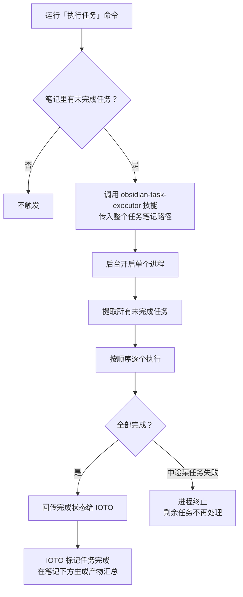
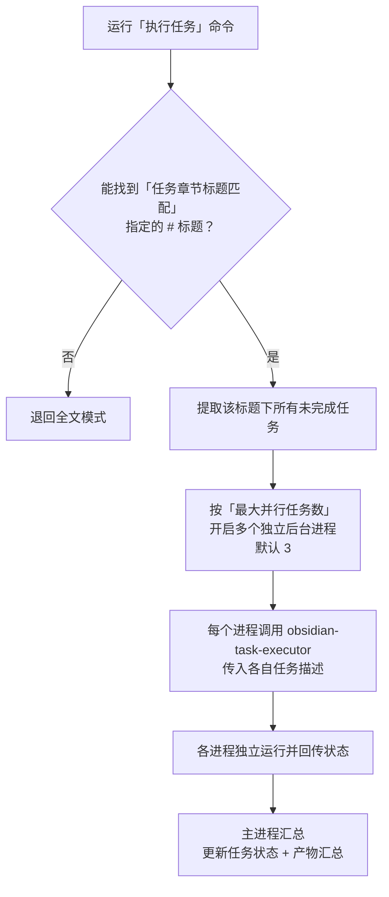
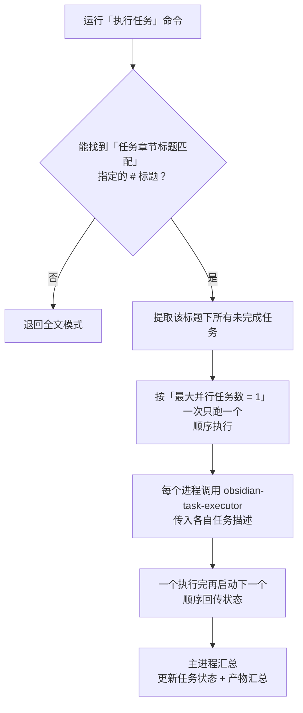
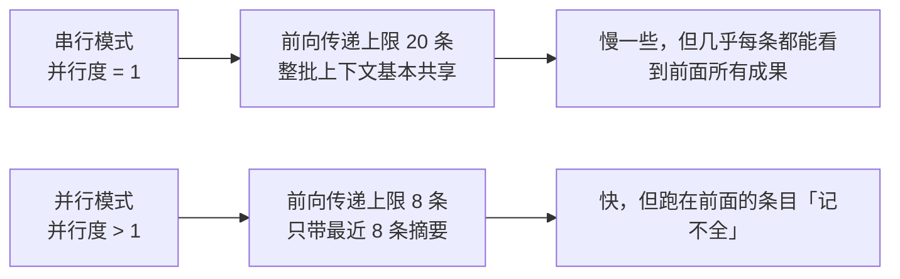

# IOTO AI 执行任务功能的三种不同模式

> [!info] 写给想搞清楚「AI 执行任务」到底怎么跑任务的你
> 这篇文档讲清楚 IOTO 的「AI 执行任务」功能有 **三种** 运行模式：**全文模式**（默认）、**子任务串行编排模式**、**子任务并行编排模式**。读完你就知道它们各自怎么跑、有何区别、什么时候该用哪种。
>
> **适用版本**：`ioto-settings` v2.3.1（V231）。串行模式的价值、模式切换器的行为在 V231 里有更新，新增处已标 `*2.3.1更新*`。

---

## 一句话先记住

> [!tip] 核心结论
> - **全文模式**（默认）：一条进程、按顺序跑完整篇任务，中途失败就中断。
> - **子任务串行编排模式**：同样先拆成独立子任务，但把 `最大并行任务数` 设为 `1`，一个接一个跑。它的真正价值不只是「保证顺序」，而是**成果传递上限从 8 条放大到 20 条、整批几乎共享上下文** *2.3.1更新*。
> - **子任务并行编排模式**：同样先拆子任务，但按 `最大并行任务数`（默认 3）多进程并行跑，单个失败不影响其他。
> 三种模式可在状态栏的「任务模式切换器」里一键切换；只有**少数几条**有先后要求时，别切串行，在条目上写 `depends：` 更划算 *2.3.1更新*。

## 三种模式总览

| 对比项 | 全文模式（默认） | 子任务串行编排模式 | 子任务并行编排模式 |
| --- | --- | --- | --- |
| 是否需手动开启 | 否，默认即此模式 | 是，在状态栏切换为该模式 | 是，在状态栏切换为该模式 |
| 进程数量 | 单个进程 | 多个进程但一次只跑 1 个（`最大并行任务数 = 1`） | 多个进程并行，数量 =「最大并行任务数」（默认 3） |
| 传给 Agent 的内容 | 整个任务笔记的路径 | 一条条单独的任务描述内容 | 一条条单独的任务描述内容 |
| 任务执行方式 | 按笔记顺序逐个执行 | 按笔记顺序一个个执行 | 多进程并行执行 |
| 单任务失败的影响 | 进程终止，未处理的任务不再执行 | 只该任务状态不变，后续任务继续 | 只该任务状态不变，其他照常推进 |
| 成果传递（前向传递） *2.3.1更新* | 不适用（单进程从头跑到尾） | 上限 **20** 条，整批基本共享上下文 | 上限 **8** 条，只带最近 8 条的摘要 |
| 适用场景 | 任务少、追求简单 | 每条都要看前面所有条的成果 | 任务多、彼此独立、想提速 |

## 如何切换三种模式

在 **IOTO Framework Settings** 插件的 `其他 → AI` 设置下，把 `在状态栏中显示任务模式切换器` 设为开启。开启后，你就能在 Obsidian 状态栏里快速切换这三种任务模式。

> [!note] 切换器只决定「走哪条路」
> 选了子任务编排类模式后，IOTO 仍会去任务笔记里找「任务章节标题匹配」指定的 `# 标题`；若找不到，会自动退回全文模式。

> [!tip] 切到串行再切回来，不用手记并行度 *2.3.1更新*
> 状态栏切换器在切到**串行**时，会把你原来的 `最大并行任务数` **记下来**；等你切回**并行**，它自动恢复成原来那个数字——不用你自己记「我之前设的是 3 还是 5」。
> 所以临时想让一批任务排队跑，放心切串行，切回去就是原来的样子。

## 全文模式

IOTO 的 AI 执行任务功能**默认就是全文模式**。当你的任务笔记里存在未标记为完成的任务列表时，运行「执行任务」就会进入全文模式。

流程要点：

1. IOTO 调用默认的 `obsidian-task-executor` 技能，并把**整篇任务笔记的路径**作为提示词的一部分交给你选定的智能体。
2. 智能体在后台开一个进程，分析任务笔记里的任务情况。
3. 把所有未完成的任务提取出来，按顺序一个个执行。
4. 全部执行完成后，把完成状态回传给 IOTO。
5. IOTO 把已执行的任务标记为完成，并**在任务笔记下方按产物归类生成一份产物汇总**。

> [!warning] 单点失败会中断整批
> 因为全文模式下所有任务都在同一个进程里处理，一旦某个任务执行失败、进程终止，还没处理的任务就不会再被继续处理。

## 子任务并行编排模式

在状态栏把模式切到「子任务并行编排」后，IOTO 会先去任务笔记里匹配子任务章节，再用多个进程并行执行。

### 进入此模式的前提

- 已在状态栏切换到「子任务并行编排」模式；
- 任务笔记里存在「任务章节标题匹配」设置项所指定的那一号标题（例如你设的是 `任务`，就要有 `# 任务` 这个一级标题）。

> [!note] 标题不存在会自动降级
> 如果笔记里找不到匹配的一级标题，IOTO 会自动退回全文模式，不会报错。

### 与全文模式的关键差异

- **并行执行**：根据 `最大并行任务数` 开启对应数量的后台进程（默认 3）。每个进程独立调用 `obsidian-task-executor`，但传入的不是整篇笔记路径，而是**一条条单独的任务描述内容**。
- **故障隔离**：所有进程独立运行，完成后各自把状态回传主进程；主进程统一更新任务笔记状态与产物汇总。

> [!tip] 单任务失败不影响整体
> 某个进程里的任务失败时，其他进程照常推进。最终只有完成的任务会被标记完成，失败的任务状态保持不变。并行模式下各任务彼此独立，没有先后依赖关系。

## 子任务串行编排模式

子任务串行编排模式与并行模式**几乎一样**，唯一区别是把 `最大并行任务数` 改成了 `1`。

在串行模式下，匹配到的子任务会**按照笔记里的顺序一个接一个执行**。它适合「后续任务要用到前面任务的产物作为处理对象」的情况——因为是串行的，前一个任务的产物在跑后一个任务时已经就绪，不会出现并行时抢不到依赖的问题。

> [!note] 只是「少数几条」有依赖时，不必切串行 *2.3.1更新*
> V231 起可以在条目上写 `depends：` 单独排队，保持并行度不变，通常比重整批切串行更划算。串行留给「几乎每条都要看前面成果」的场景，见下方两条 tip。

### 串行真正的红利：成果传递上限放大到 20 *2.3.1更新*

串行模式最容易被忽略的一点，是它同时把**结果前向传递的上限从 8 条放大到 20 条**：

原因是：前向传递的内容会**写进每一条的提示词**，条目越多、`in` token 越贵。并行模式下并发会放大这份开销，所以只带最近 8 条；串行本来就是一条一条跑，没有并发放大效应，才放宽到 20。

> [!tip] 串行 = 「全量上下文但慢」与「快但失忆」之间的中间态
> 全文模式（Legacy）让一个进程读完整份文件，上下文最全但最慢、且中途失败全批中断；并行快，可每条都是失忆的新会话。串行夹在中间：**速度慢一点，换来整批基本共享上下文**。

> [!tip] 怎么选串行还是并行
> 子任务之间相互独立、谁先谁后无所谓 → 用**并行**（更快）。
> **只是少数几条**有先后要求 → **保持并行**，在条目上写 `depends：` 只让这几条排队，见 [[S3-如何让AI按你规定的先后顺序执行任务]]。
> **几乎每一条**都要读前面所有条的成果 → 用**串行**（更稳，上下文共享最多）。

## 该用哪种模式

> [!tip] 选择口诀
> - 任务少、追求简单、希望「全部跑完才算数」→ 用**全文模式**（什么都不用配，默认即是）。
> - 子任务多、彼此独立、希望「挂一个不影响其余、还想提速」→ 用**子任务并行编排模式**，记得在笔记里准备好对应的 `# 任务` 标题。
> - **只有少数几条**有先后依赖 → **仍用并行**，在条目上写 `depends：` 让它们排队（比重整批切串行划算得多） *2.3.1更新*。
> - **几乎每条**都要看前面所有条的成果 → 用**子任务串行编排模式**（前向传递上限 20，整批共享上下文） *2.3.1更新*。

---

## 延伸阅读

- [[S3-如何让AI按你规定的先后顺序执行任务]] — 保持并行度、只让有依赖的几条排队的写法
- [[S3-如何让后面的任务看到前面任务的成果]] — 8 / 20 两条上限背后的三种「记忆」通道
- [[S3-如何用ioto标签在一行任务里下达控制指令]] — 只有在子任务编排模式下，条目上的控制标记才会被解析
- [[S3-如何把任务文件当成AI的调度台来写]] — 一份配得上并行 / 串行编排的任务文件长什么样
- [[S3-IOTO AI执行任务的设置项速查]] — `最大并行任务数`、`最大任务轮数` 等编排相关设置项
- [[S3-使用IOTO的AI执行任务功能时常见的坑有哪些]] — 切换了模式却一条都没跑时的排查

---