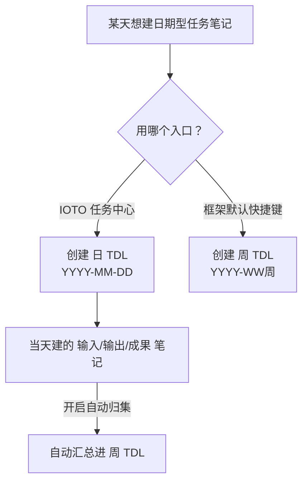

# IOTO 中任务笔记的模板如何去自定义

> [!info] 写给想自定义任务笔记模板的你
> 如果你已经在用 IOTO 创建任务笔记，想让模板更贴合自己的习惯（比如加上 `DDL`、`负责人`，或调整正文结构），这篇文档就是为你写的。读完你就能搞清楚：IOTO 有**两套模板机制**、分别怎么改、以及两个容易踩的坑。

---

## 一句话先记住

> [!abstract] 核心结论
> IOTO 有两种创建任务笔记的方式，它们**各用一套模板机制**：默认快捷键走 IOTO 框架的 Templater 模板；IOTO 任务中心走自己的模板设置。自定义时**永远不要直接改 `My` 开头的默认模板**，而要用你自己的用户前缀建副本。

---

## 两套模板机制速览

| 创建方式              | 模板机制                        | 改模板在哪改                                   |
| ----------------- | --------------------------- | ---------------------------------------- |
| 默认快捷键 / 快速面板 T 按钮 | IOTO 框架内置的 Templater 模板加载流程 | IOTO Framework Settings（用户模板前缀 + 复制默认模板） |
| IOTO 任务中心「添加任务」   | 任务中心自带的模板加载机制               | 任务中心设置 → `任务模板`                          |

> [!note] 为什么要分两套
> 任务中心被刻意设计成**与 IOTO 框架解耦**——你可以在任意一个 Obsidian 库中单独使用它。所以它不依赖框架的 Templater 流程，而是有自己独立的模板加载逻辑。

---

## 方式一：用默认快捷键（Templater 流程）

按 `Alt+3`（或快速面板的 T 按钮）创建任务笔记时，会触发 IOTO 框架的 Templater 模板。不同任务类型默认用不同的模板：

| 任务类型     | 默认模板                 |
| -------- | -------------------- |
| 时间段型任务笔记 | `My-TP-日期任务-笔记-默认模板` |
| 主题型任务笔记  | `My-TP-主题任务-笔记-默认模板` |
| 计划型任务笔记  | `My-TP-计划任务-笔记-默认模板` |
| 普通型任务笔记  | `My-TP-普通任务-笔记-默认模板` |

### 怎么自定义

> [!warning] 千万别直接改 `My` 开头的模板
> 当 IOTO 更新时，最省事的做法是用 **IOTO Update 插件的「一键部署」命令**。这个命令会**覆盖所有 `My` 开头的模板**，你直接改的内容会被冲掉。不自定义就放心用默认；要自定义，请用自己的前缀建副本。

正确做法是三步：

1. 在 **IOTO Framework Settings → 基本设置** 里，修改「用户模板前缀」。
   - 例如 Johnny 用的是 `JL`（Johnny Learns 首字母）。
2. 把上面的默认模板各复制一份，改名为你的前缀版本：
   - `JL-TP-日期任务-笔记-默认模板`
   - `JL-TP-主题任务-笔记-默认模板`
   - `JL-TP-计划任务-笔记-默认模板`
   - `JL-TP-普通任务-笔记-默认模板`
3. 直接改这些副本的内容即可。

---

## 方式二：用 IOTO 任务中心

任务中心不走框架的 Templater 流程，改模板更轻量——只在它的设置里操作：

1. 打开 **IOTO 任务中心 → 设置 → `任务模板`** 页。
2. 给四种任务类型分别指定模板，方式任选其一：
   - **指定一个模板文件**：选你自己的模板（如主题任务就选 `你的前缀-TP-主题-笔记-默认模板`）；
   - **直接填写模板内容**：在模板输入框里手写。

```text
任务中心「任务模板」设置项
├─ 时间段型任务 → 指定模板 / 直接输入
├─ 主题型任务   → 指定模板 / 直接输入
├─ 计划型任务   → 指定模板 / 直接输入
└─ 普通任务     → 指定模板 / 直接输入
```

---

## 一个容易踩的坑

### 日期型任务的格式建议「两套分开」

在任务中心里，你可以把日期型任务格式设得和框架设置里的默认 TDL 一模一样，然后指定成 `你的前缀-TP-任务-笔记-默认模板`。但**更推荐用不同日期粒度**，各管一段：

```text
IOTO Framework Settings：日期型 = YYYY-WW周   （按周建 TDL）
IOTO 任务中心：        日期型 = YYYY-MM-DD   （按天建 TDL）
```

这样做的好处是：某天想建「日 TDL」，就用任务中心；只要开启了「把输入/输出/成果笔记自动添加到当前 TDL」，当天创建的笔记链接会**自动汇总进按周的 TDL** 里。



---

## 模板里能改什么

不管用哪种方式，自定义模板时你**既能改正文，也能改属性**。例如想让每张任务笔记都带 `DDL`、`负责人`，只要在模板的属性区加上这两个字段，创建时就会自动带进去。

```yaml
---
DDL: 
负责人: 
---
```

---