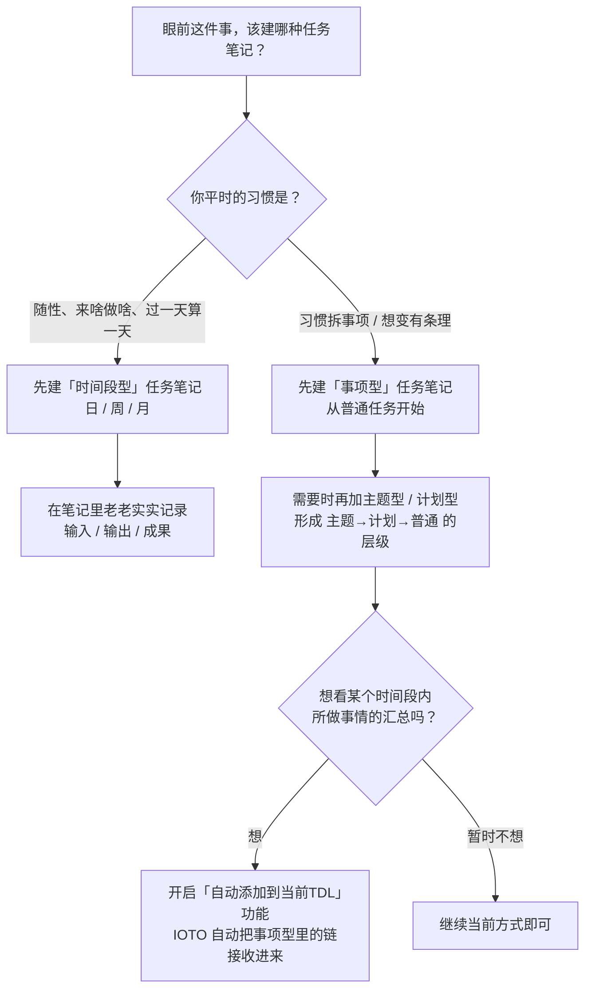

# IOTO 中创建任务笔记时选择哪种类型更合适

> [!info] 写给刚上手 IOTO 的你
> 你已经知道任务笔记分「时间段型」和「事项型」两类（详见 [[S3-IOTO中是如何对任务进行分类的]]）。
> 但真要动手建的时候还是会卡住：眼前这件事，到底该建哪一种？
> 这篇就是帮你**30 秒做决定**的，不绕弯子，直接给结论和流程图。

---

## 先给结论（30 秒读懂）

- **以前学习/工作是"放养式"——来啥做啥、过一天算一天** → 先别纠结，直接建 **时间段型** 任务笔记（日 / 周 / 月）。
- **已经习惯把项目按事项细分，或想往这个方向成长** → 直接建 **事项型** 任务笔记，从最简单的「普通任务」开始。
- **两种都想要** → 都建，IOTO 会自动把事项型笔记里的输入/输出/成果链接，收进时间段型笔记里，不用你手动搬运。

记住一句话：**先动起来比选对类型更重要。两类笔记都能反悔、都能切换。**

---

## 决策流程图 



> [[A3-如何开启把IOO链接自动添加到当前的TDL|点击查看]]如何开启把创建的输入、输出和成果笔记的链接添加到所属项目当前的时间段型任务列表中

---

## 情况一：你是「放养型」——先建时间段型

如果你过去一直是没有计划地推进，猛地转到"主题 → 计划 → 普通任务"那条完整路线，很可能会水土不服。

**那就别拧着自己，直接建一个时间段型任务笔记：**

- 命名就按时间：`项目A-2026-07-20`（日）/ `项目A-2026-WW30`（周）/ `项目A-2026-07`（月）
- 在那一篇里，老老实实记录这个时间段内的 **输入、输出、成果** 三类内容。

> [!tip] 别小看这一步
> 只要你真的坚持"按项目建时间段型任务列表 + 在里面记录输入/输出/产出"，用不了多久就能感觉到这种方式的帮助。我自己和很多 IOTO 用户，都是这样起步的。

---

## 情况二：你是「拆解型」——先建事项型

如果你本来就习惯把项目拆成一件件具体事项，或者你希望自己往这个方向成长，那就从 **事项型任务笔记** 开始。

最简路径：

```text
项目
 └─ 普通任务   ← 先建这个，最简单
     └─（需要了再加）计划任务
         └─（再需要）主题任务
```

- 先建一个个 **普通任务**，把眼前的事记下来；
- 慢慢再往上加 **计划型**、**主题型**，自然长出"主题 → 计划 → 普通"的层级。

拿不准时：**先从「普通任务」开始**——它最轻量，需要再往上叠层级。

---

## 情况三：两种都想要——都建，IOTO 自动汇总

既想用事项型去梳理推进，又想用时间段型去做日 / 周 / 月复盘，会不会重复劳动？

**不会。** IOTO 提供了自动功能：你在事项型任务笔记里创建的输入、输出、成果链接，会被自动加入对应的时间段型任务笔记。你只管在各自合适的笔记里写，汇总交给 IOTO。

这也是最推荐的成熟期用法：

```text
纵轴（事项型）：主题 → 计划 → 普通任务   —— 管"做哪件事"
横轴（时间段型）：日 / 周 / 月任务       —— 管"什么时候做"
两者交错 = 项目理得清，复盘也方便
```

---

## 快速对照表

| 你的状态         | 推荐起步                                        | 具体动作                         |
| ------------ | ------------------------------------------- | ---------------------------- |
| 随性、放养、来啥做啥   | **时间段型**                                    | 建日/周/月任务，记录输入/输出/成果          |
| 习惯拆事项、或想变有条理 | **事项型**                                     | 从「普通任务」开始，逐步加计划/主题           |
| 想兼顾梳理与复盘     | **建事项型**<br>然后<br>**开启自动把IOO链接添加到当前TDL**的功能 | IOTO 自动把事项型任务笔记中的IOO链接收进时间段型 |

---

## 别纠结：类型可以换、可以补

- 先建了时间段型，后来想拆事项？随时再建事项型，不冲突。
- 先建了普通任务，事变复杂要归类？往上叠计划型、主题型即可。