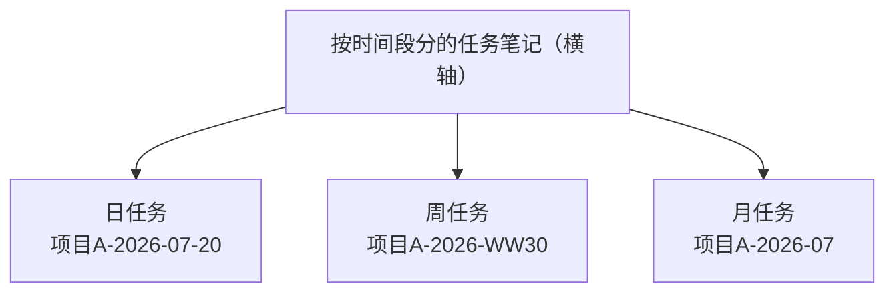
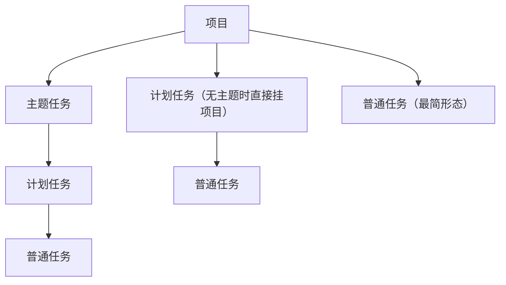

# IOTO 中是如何对任务进行分类的

> [!info] 写给刚接触 IOTO 的你
> 你建了一堆任务笔记，但慢慢发现有点乱：有的按日期排，有的按主题排——任务笔记到底有几种？眼前这件事又该建哪一种？
> 这篇文档帮你用一张图看懂 IOTO 对任务笔记的**两种基本分类思路**，以及它们怎么组合。读完你就能判断"这件事，该建哪种任务笔记"。

---

## 一句话先记住

> IOTO 把任务笔记分成两大类：**按时间分** 和 **按事项分**。
> 时间是横轴，事项是纵轴；两者交错，就覆盖了你推进一个项目时的所有具体事情。

---

## 维度一：按「时间段」分（横轴）

最直观的建法：以你喜欢的某个时间段为单位，把这段时间里的所有事塞进一篇笔记。

| 类型 | 命名示例 | 适合 |
| --- | --- | --- |
| 日任务 | `项目A-2026-07-20` | 记录当天所有相关事情 |
| 周任务 | `项目A-2026-WW30` | 记录一周的推进 |
| 月任务 | `项目A-2026-07` | 月度回顾与规划 |



**优点**：直观、好操作，打开就知道"某天 / 某周干了啥"。
**局限**：
- 同一段时间内事情一多，就难看出这些事彼此怎么分类、怎么关联；
- 很多事项时间跨度很长，如果只散落在各个时间段笔记里，就串不起它的来龙去脉。

---

## 维度二：按「事项」分（纵轴）

当事情需要长期跟进、跨时间段，就别再按日期切了，改成**围绕一个事项**建一篇笔记，在里面持续记录推进它的点点滴滴。

IOTO 提供三层细分，满足不同颗粒度：

```text
项目
 └─ 主题任务    （一个大方向 / 一个主题）
     └─ 计划任务 （主题下的某个具体计划）
         └─ 普通任务 （计划里的一个具体动作）
```

- **主题任务**：项目下的某个主题或方向。
- **计划任务**：某个主题里你决定要做的计划，你也可以跳过主题，直接把计划挂在项目下。
- **普通任务**：计划里拆解出来的一个个具体动作；也可以直接挂在项目下。



---

## 两种维度怎么组合？

不是死规矩。按项目复杂度和事情性质自由搭配：

```text
组合 A（最完整）：  项目 → 主题任务 → 计划任务 → 普通任务
组合 B（中等）：    项目 → 计划任务 → 普通任务
组合 C（最简单）：  项目 → 普通任务
```

选哪种，取决于这件事要不要长期跟、要不要细分。多数日常推进用纵轴；当你想做日 / 周 / 月复盘时，再用横轴切一份。

---

## 给新手的判断口诀

- 这件事**要跟很久、要拆细**？→ 用纵轴：建主题 / 计划 / 普通任务。
- 想**复盘某天 / 某周干了啥**？→ 用横轴：建日 / 周 / 月任务笔记。
- 拿不准？**先从「普通任务」开始**——它最简单，需要再往上加层级。

记住核心：**任务笔记不是只有一种。横轴管"什么时候做"，纵轴管"做哪件事"，两者配合，项目才理得清。**