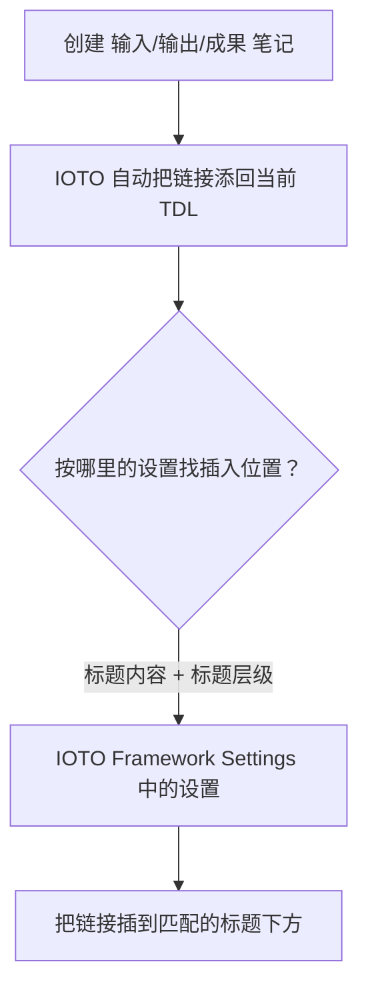

# IOTO 中默认日期型任务笔记模版的定制

> [!info] 写给想要改默认日期型任务笔记模板的你
> 本文讲清楚：为什么默认的日期型任务笔记模板看着「头大」、为什么**不要手改模板里的标题**、以及用最简单、官方推荐的方式怎么定制它。

---

## 一句话先记住

> 想改日期型任务笔记模板，**别去手改模板文件里的标题文字和层级**，而是去 **IOTO Framework Settings** 的设置里改。否则「自动把笔记链接塞进 TDL」的功能会找不到插入位置。

## 为什么默认模板看着「头大」

你第一次打开 IOTO 默认的日期型任务笔记模板（`[[My-TP-任务-笔记-默认模板]]`）时，很可能被一堆代码吓到。

原因是：这个模板里写的是 **Templater 插件**支持的代码写法，不是普通的 Markdown。

更重要的是——模板里的标题、层级等内容，**并不是写死在模板文件里的，而是动态从 `IOTO Framework Settings` 插件的设置中获取的**。

## 怎么定制（推荐做法）

定制默认日期型任务笔记模板，有两条路：

| 方式 | 做法 | 推荐度 |
| --- | --- | --- |
| 自定义前缀 | 用之前讲过的「自定义前缀」方式另起一套 | 可用，但更麻烦 |
| 改设置（官方推荐） | 在 `IOTO Framework Settings` 的设置里直接改**标题层级**和**标题内容** | ⭐ 更简单、更推荐 |

> [!tip] 最简单的一条路
> 打开 `IOTO Framework Settings`，找到日期型任务笔记模板对应的设置项，**直接修改其中的标题层级（几级标题）和标题文字内容**。模板会自动跟着变，你完全不需要碰模板文件里的代码。

设置界面示意：

## 为什么必须在这里改，而不是手改模板

这是最关键的一点，也是新手最容易踩坑的地方。

IOTO 有一个功能：**在你创建输入 / 输出 / 成果笔记时，自动把它们的链接添加进当前 TDL 的对应标题下**。

这个功能靠什么判断「该把链接塞到哪个标题下面」？

> **它依赖的是 `IOTO Framework Settings` 里设置的「标题内容」和「标题层级」**，而不是模板文件里你手写的文字。

> [!warning] 手改模板的坑
> 如果你在自己创建的日期型任务笔记模板里，**手写的标题文字或层级**跟 `IOTO Framework Settings` 里的设置不一致，那么自动添加链接时就会**找不到正确的位置**——链接要么插错地方，要么插不进去。
>
> 所以：标题的文字和层级，**以设置里的为准**，模板文件本身尽量别手动改标题。