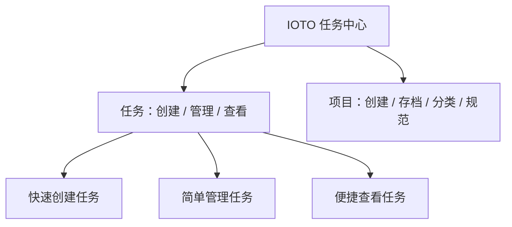
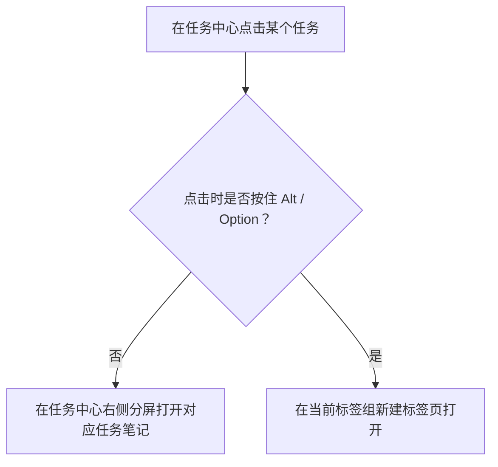

# IOTO 任务中心的定位和使用

> [!info] 写给刚接触 IOTO 任务中心的你
> 如果你还不太清楚「任务中心到底是干啥的、我该用它做什么」，这篇文档就是为你写的。读完你会明白：任务中心的存在是为了让你**更简单地管理项目和任务**，以及它具体提供了哪些能力。

注意第一次部署IOTO时，IOTO任务中心插件并没有自动安装。

你可以使用IOTO Update插件的命令去安装或更新IOTO任务中心插件。

---

## 一句话先记住

> [!abstract] 核心定位
> IOTO 任务中心的存在，就是为了让用户**更简单地管理项目和任务**——一眼看清「我在做哪些项目、还有哪些任务没完成」，并把任务的创建、管理、查看都集中在一个可视化界面里。
> 整个任务中心的操作几乎都通过可视化界面完成，所以**上手它最好的方式就是自己动手试试**。

---

## 任务中心在 IOTO 里的定位

任务中心主要围绕两件事展开：**任务** 和 **项目**。因为任务和项目本就息息相关，所以任务中心在管任务的同时，也顺带提供了一套基础的项目管理功能。

它的设计目标很朴素：**让用户一眼看到自己正在做的项目有哪些、有哪些任务还没完成**。围绕这个目标，任务中心把能力收敛成三条主线——创建任务、管理任务、查看任务。

---

## 主线一：快速创建任务

任务中心让创建任务变得很快，具体的创建方式看 [[S3-使用IOTO任务中心去创建任务笔记]] 里的介绍。

---

## 主线二：简单管理任务

这里的「简单」有两层含义。

### 1. 操作上的简单

和任务管理相关的操作，基本都能靠**右键菜单**和**拖拽**完成：

- **拖拽**：在任务列表里拖动任务，就能设置或移除它的父级任务；
- **右键菜单**：可以一键添加 / 移除优先级，或标记 / 取消核心任务。

### 2. 模式上的简单

- IOTO 的任务管理**以知识管理为主要目的**，所以只提供「优先级、核心任务」这类基本设置，不做臃肿的项目管理；
- 任务状态是**动态**的——由任务笔记里任务清单的完成状态自动决定，你不用手动维护；
- 很多专项项目管理工具的功能，任务中心**刻意没有加入**，就是为了保证轻量。

> [!note] 为什么不做成「全功能项目管理工具」
> IOTO 的核心场景是知识管理，而不是替代 Jira、Asana 这类专业 PM 工具。把任务能力控制在「优先级 + 核心任务 + 状态自动同步」这一层，既够用，又不会让界面变复杂。

---

## 主线三：便捷查看任务

查看任务分三种场景：看单个、看一批、看和任务相关的其他笔记。

### 看单个任务

作为 Obsidian 插件，任务中心直接复用了 Obsidian 优秀的分屏和标签页能力：

这样既能随手对照，也能在不打乱当前布局的情况下快速查阅。

### 看一批任务

任务列表页自带几个默认视图标签，点一下即可切换：

| 视图 | 显示内容 |
| --- | --- |
| 核心任务 | 仅显示被标记为核心任务的任务 |
| 今天 | 仅显示今天创建的任务 |
| 未完成 | 显示还包含未完成任务清单的任务 |
| 已完成 | 显示所有任务清单都已完成的任务 |
| 全部 | 显示所有任务 |

除此之外，列表右上角的设置按钮还提供**分组、排序、过滤**等常用选项，点一下就能生效。

> [!tip] 想精确找任务？用搜索
> 任务中心支持搜索过滤：输入关键词时，会**同时在任务标题和任务内容里匹配**，比单纯按视图翻找更高效。

### 看与任务相关的其他笔记

在任务中心，你还能清楚便捷地查看和当前任务关联的其他笔记：

- 父级任务
- 子任务
- 任务中的**输入**笔记出链
- 任务中的**输出**笔记出链
- 任务中的**成果**笔记出链

这些都可直接在任务中心里跳转查看，不用再手动去翻链接。

---

## 项目相关功能

因为任务和项目紧密绑定，任务中心也提供了一套基础的项目管理：

| 功能     | 说明                                      |
| ------ | --------------------------------------- |
| 创建项目   | 详见 [[S2-IOTO中的4种项目创建方式]]                |
| 项目存档   | 详见 [[S2-IOTO中完成的项目如何归档]]                |
| 项目分类   | 在项目中心给项目分类后，任务中心的项目列表就能按分类分组查看          |
| 项目规范编辑 | 打开项目的 `_project.md`，为 AI 执行任务提供项目级个性化规范 |

### 项目规范有什么用

你有两种方式打开某个项目的 `_project.md`：

- 在项目中心，点击第一列的项目规范编辑图标；

- 在任务中心的项目列表里，右键对应项目 → 选择「编辑项目规范」。

这个文件的重点是：**为 IOTO 的 AI 执行任务功能提供每个项目的个性化规范**。当你用 AI 去完成该项目下任务笔记里的任务时，这些规范会被**自动加载到提示词中**，让 AI 按你定的规矩办事。

---

## 功能清单总览

任务中心的基本功能可以分成「项目类」和「任务类」两大块：

### 项目类

- 创建项目
- 存档项目
- 项目分类
- 项目规范编辑
- 项目基本信息（未来会丰富）
- 项目列表控制：分组 / 排序

### 任务类

- 创建任务
- 删除任务
- 子任务设置：通过属性 / 通过拖动 / 批量编辑模式
- 优先级设置：通过属性 / 右键菜单 / 批量编辑模式
- 核心任务设置：通过属性 / 右键菜单 / 批量编辑模式
- 任务笔记状态自动更新：无任务 / 待开始 / 进行中 / 已完成
- 不同视图查看任务：核心任务 / 今天 / 未完成 / 已完成 / 全部
- 任务列表控制：排序 / 分组 / 过滤
- 任务搜索：同时在标题与内容中匹配关键词
- 任务列表显示强化：显示出链计数并提供链接、显示子任务数量并提供链接
- 任务批量创建功能

---

## 给新手上手的建议

> [!tip] 别怕点错，先动手
> 任务中心几乎全部操作都在可视化界面里完成，没有隐藏的命令行或复杂配置。**最好的学习方式就是打开它，试试右键菜单、拖一拖任务、切一切视图**——几分钟就能摸清它的核心交互。