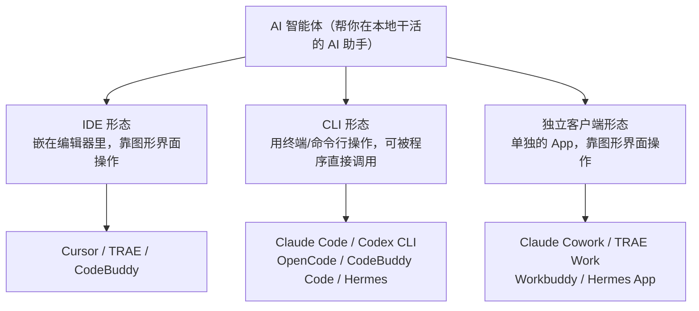
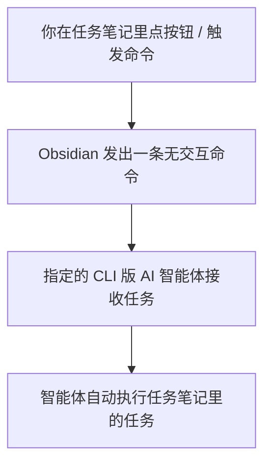

# IOTO 的 AI 执行任务功能，为什么需要你安装 CLI 版的 AI 智能体

> [!info] 写给准备用 IOTO「AI 执行任务」功能的你
> 这篇文档帮你搞懂一件事：为什么 IOTO 让你去装一个「命令行（CLI）版」的 AI 智能体，而不是用你更熟悉的图形界面工具。读完你就知道该装哪个、以及为什么装它。

---

## 一句话先记住

> IOTO 的「AI 执行任务」本质是：**Obsidian 直接发一条命令给 AI 智能体，让它自动干活**。要做到「自动发命令、不用你手动操作」，只能靠支持「无交互模式」的 **CLI 版** 智能体——图形界面（GUI）的工具做不到这一点。

## AI 智能体有三种「长相」

不管什么形态，AI 智能体的本质都一样：用一套驾驭机制去调用大模型，完成你下发的任务。区别在于**你拿它干活时，面对的是什么样的界面**。

## 关键差异：CLI 才有「无人值守」能力

IDE 和独立客户端都依赖图形界面（GUI）：你必须打开对应程序，在窗口里手动操作。CLI 版则可以在电脑的终端（如 PowerShell、Terminal）里用命令行或 TUI 交互。

对不太懂技术的朋友来说，CLI 一开始确实不如图形界面直观、上手难一点。但它有一个 GUI 工具没有的关键优势——**无交互模式**：

> 你可以从一个「能发起命令的程序」里，直接把指令甩给指定的 AI 智能体，它**自己就去执行了，不需要你在旁边一步步点**。

| 对比项          | 图形界面形态（IDE / 独立客户端）                           | CLI 形态               |
| ------------ | --------------------------------------------- | -------------------- |
| 操作入口         | 打开对应程序，在窗口里手动操作                               | 终端命令行，或**被其他程序直接调用** |
| 能否「无人值守」自动执行 | 基本不行，得有人盯着点 或者使用定时触发功能 但是在AI执行任务这个场景行不通 | **可以**，支持无交互模式       |
| 上手难度         | 直观、低                                          | 对新手偏高，但装好一次就省心       |

## 为什么 IOTO 偏偏要 CLI

因为 **Obsidian 本身就有「发命令」的能力**。

IOTO 的「AI 执行任务」功能，靠的正是这一点：你在一篇任务笔记里点一下按钮、或触发一条命令，Obsidian 就会向指定的 CLI 版 AI 智能体发送当前任务笔记里的内容，智能体**直接去执行**。这条链路成立的前提，就是智能体能被「无交互地」调用——而这只有 CLI 形态具备。

> [!note] 一句话总结
> 不是 IOTO 故意让你折腾命令行，而是「点一下就自动跑」这件事，天然只能建立在 CLI 智能体上。

## 目前支持的智能体

IOTO 的 AI 执行任务功能，已支持以下 CLI 版智能体（安装基本都是「一条命令」搞定）：

| 智能体              | 说明 / 安装文档                                          |
| ---------------- | -------------------------------------------------- |
| Claude Code      | https://code.claude.com/docs/zh-CN/overview        |
| Codex CLI        | https://github.com/openai/codex                    |
| OpenCode         | https://opencode.ai/docs/zh-cn/#%E5%AE%89%E8%A3%85 |
| MimoCode         | https://mimo.xiaomi.com/coder                      |
| Hermes           | https://hermes-agent.nousresearch.com/docs         |
| CodeBuddy Code   | https://www.codebuddy.cn/docs/cli/quickstart       |
| DeepSeek Harness | https://www.deepseek.com/harness/                  |
| Pi Agent         | https://pi.dev/docs/latest/usage                   |
| Oh My Pi         | https://omp.sh/docs/cli                            |
| Qoder CN         | https://docs.qoder.cn/cli/installation             |
| Qoder 国际版        | https://docs.qoder.com/cli/installation            |

> [!warning] 注意网络与配置
> 个别智能体的安装或使用需要特殊网络环境或额外配置。如果你只是第一次尝试，建议避开这些坑。

## 给新手的推荐

> [!tip] 第一次用，直接装 CodeBuddy Code
> 如果你还没装过任何 CLI 版智能体，按我之前的建议：**直接用 CodeBuddy Code 就行**。安装最简单，坑最少，能最快跑通 IOTO 的「AI 执行任务」体验。等熟悉了，再按需换其它智能体。

## 实际使用说明

在实际使用中，你是可以CLI版和APP版同时使用的。

比如，你可以同时使用CodeBuddy Code和Workbuddy。你可以用IOTO的AI执行任务的命令去调用CodeBuddy执行你任务笔记的任务，也可以用Workbuddy加载你的Obsidian的库去执行一些定时任务，或者借用它其他的功能完成更复杂的任务。

这两个并不冲突。