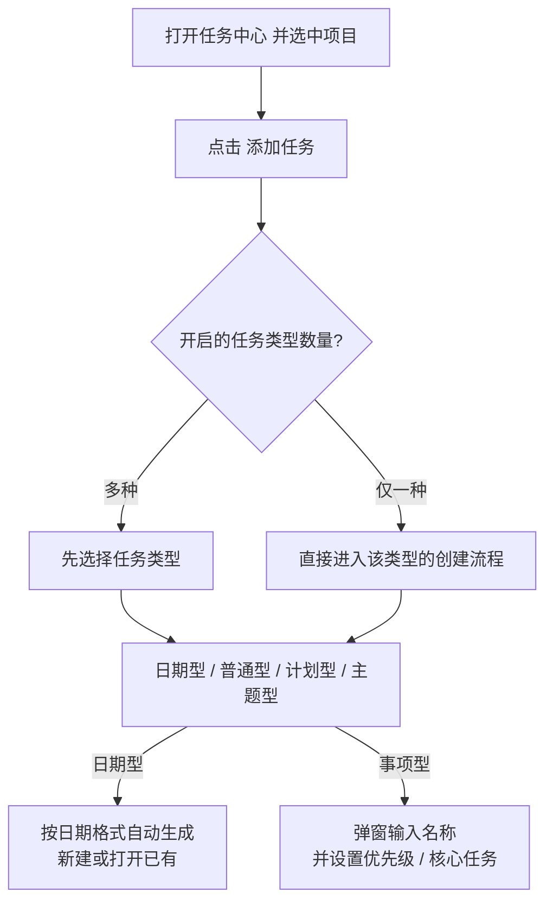

# 使用 IOTO 任务中心去创建任务笔记

> [!info] 写给想用「任务中心」建任务的你
> 本文告诉你：IOTO 任务中心是什么、怎么装、怎么用它创建不同类型的任务笔记，以及如何给任务加子任务。

---

## 一句话先记住

> [!tip]
> 装好「IOTO 任务中心」插件后，打开任务中心、选中项目、点「添加任务」即可建任务。任务类型（日期 / 普通 / 计划 / 主题）由你在设置里开启，名字规则各不相同。

## 一、任务中心是什么

从 IOTO 2.0.8 起新增了「IOTO 任务中心」插件。它会自动加载 `3-任务` 下的项目，并按条件展示项目里的任务，让你在界面里集中管理和创建任务。

> [!warning] 默认不安装
> 任务中心插件默认不随 IOTO 一起安装。请使用 **IOTO Update** 命令去安装或更新；装好后才会出现 **IOTO Tasks Center：打开任务中心** 这条命令。


## 二、打开与基本用法

1. 用 **IOTO Tasks Center：打开任务中心** 命令打开面板。(你可以把这个命令设置成一个快捷键，在需要的时候随时打开)
2. 任务中心会自动加载 `3-任务` 下的项目。
3. 选中某个项目后，点击 **添加任务** 即可在该项目下创建任务。

## 三、先选要开启的任务类型

在「IOTO Tasks Center」插件的 **任务类型设置** 里，可以勾选要开启的任务类型。一共有四种：

| 任务类型 | 形态 | 命名规则 |
| --- | --- | --- |
| 日期任务 | 时间段型 | 按设置的日期格式自动生成 |
| 普通任务 | 事项型 | 你输入的内容 |
| 计划任务 | 事项型 | `项目名-计划-你输入的内容` |
| 主题任务 | 事项型 | `项目名-主题-你输入的内容` |

> [!note]
> - 至少需要开启一种。
> - 若开启了**多于一种**，点「添加任务」会先让你选类型；只开了一种则直接走对应流程。


## 四、任务创建流程




## 五、创建不同类型任务的差异

### 日期型任务

- 任务名由你在任务中心设置里定义的**日期格式**自动生成，无需手输。
- 点击后会**自动新建或打开**已有任务（同名日期已存在则直接打开）。
- 该日期格式可与「IOTO Framework Settings」里日期型 TDL 的格式**一致，也可不一致**，两者互不强制。

### 事项型任务（主题 / 计划 / 普通）

创建这三类时都会弹出一个对话框，让你输入笔记名，并可设置**优先级**与是否标记为**核心任务**。


创建的任务笔记的笔记名，会遵循以下规范。

```text
主题型：项目名-主题-你输入的内容
计划型：项目名-计划-你输入的内容
普通型：你输入的内容
```

## 五、给任务加子任务

有两种方式：

### 方式一：右键创建

在任务列表的任意任务条目上**右键**，在面板里选择「为该任务创建子任务」。子任务的类型同样取决于你在任务中心开启的任务类型。


### 方式二：选中文字转为子任务

在任意任务笔记中，**选中一段文字**，使用 **IOTO Tasks Center：将选中的文字转为子任务** 命令，即可为当前任务创建一个**普通型**子任务，并以选中文字作为标题。

> [!warning] 注意
> 这个命令只有在某篇任务笔记处于激活状态时才能用。


如果你需要比较频繁地实用这个功能，可以给这个命令设置一个快捷键，比如我会使用`Alt+Shift+3`。