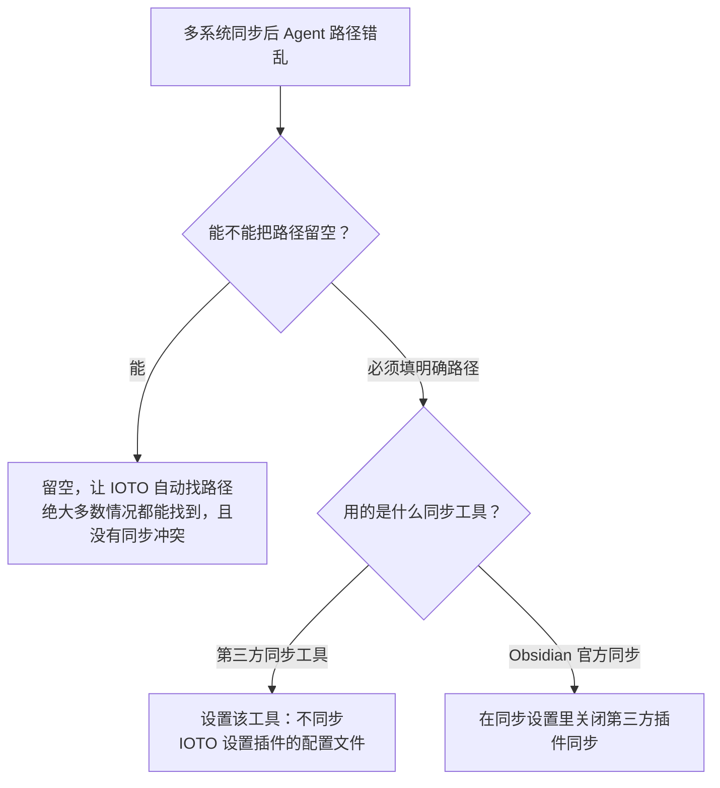
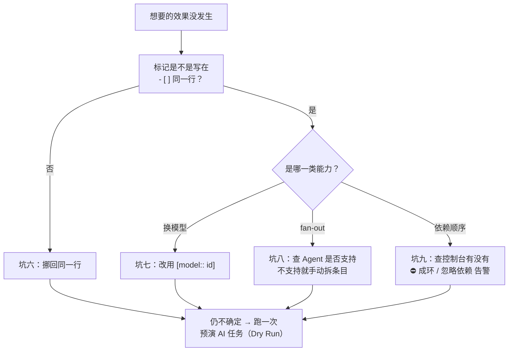

# 使用 IOTO 的 AI 执行任务功能时，常见的坑有哪些

> [!info] 写给正在或准备使用 IOTO「AI 执行任务功能」的你
> 如果你遇到"配置明明都对，任务却跑不起来 / 跑一半就退 / Agent 找不到技能"这类问题，本文按现象逐一给出排查与解决办法。
>
> **适用版本**：`ioto-settings` v2.3.1（V231）。**坑六～坑九**是 V231 新增写法专属的四个新坑，已标 `*2.3.1新增*`。

---

## 一句话先记住

> 大多数问题都不是你操作错了，而是下面几类原因。先对照下表定位现象，再往下看对应解法。

| 现象 | 根因 | 一句话解法 |
| --- | --- | --- |
| 换系统后 Agent 路径变成另一台电脑的 | 多系统同步把路径配置也带过去了 | 路径留空让 IOTO 自动找，或设置不同步配置文件 |
| 任务跑几分钟就自己退出了 | 默认超时只有 5 分钟 | 在「AI 设置」里把超时时间调大 |
| 配置都对，任务却总失败 | API 额度用完 / 免费模型被暂停 | 检查额度或换可用模型 |
| Hermes 找不到 IOTO 下载的技能 | Hermes 默认不读项目级技能目录 | 把 `.hermes/skills` 加到 `skills.external_dirs` |
| Obsidian CLI 加载失败 | Obsidian 版本低于 1.12 | 升级并重装 Obsidian，开启 CLI 注册 |
| 控制标记写了却完全没效果 *2.3.1新增* | 写在条目下方的缩进行里 | 挪回 `- [ ]` 的同一行 |
| 换模型的标签写了，模型没变 *2.3.1新增* | 模型 ID 含 `.`，标签在 `.` 处被截断 | 改用 `[model:: <id>]` |
| fan-out 写了却没见 AI 拆活 *2.3.1新增* | 该 Agent 不支持会话内子代理 | 换 Agent，或手动拆成多个条目 |
| 依赖顺序突然不起作用了 *2.3.1新增* | 依赖成环，静默降级 | 看控制台的 `⛔ …成环` 提示，解开环 |

---

## 坑一：不同系统下 Agent 路径同步冲突

如果你同时使用 Mac 和 Windows，两个系统里 AI 智能体的**安装路径是不一样的**。一旦 Obsidian 库完成同步，就可能把 Windows 上的路径同步到 Mac（或反过来），导致 Agent 找不到。

按下面的优先级排查：



> [!tip] 最省心的做法
> 第一招「路径留空、让 IOTO 自动找」能解决绝大多数情况，也彻底绕开同步冲突，优先试它。

---

## 坑二：任务还没执行完就退出了（超时）

IOTO 设置里，**AI 执行任务默认的超时时间是 5 分钟**。一旦你跑的任务比较耗时（比如让 Agent 生成 PPT），就很容易超时退出。

> [!fix] 解决办法
> 打开 `IOTO Framework Settings → 其他 → AI 设置`，把 **超时时间** 调大即可。

```text
IOTO Framework Settings
  └─ 其他
       └─ AI 设置
            └─ 超时时间  ← 把这个值调大
```

---

## 坑三：配置都对，但任务总是失败（额度 / 模型）

这种情况，八成不是配置问题，而是**钱或模型**的问题：

- 你购买的 API 服务**预算花完了**。大多数 AI 智能体执行任务时是要扣费的，额度一空就失败。
- 或者你用的是**免费模型被暂停了**，例如 OpenCode 的免费模型。

> [!warning] 排查顺序
> 先去 API 服务商后台看余额 / 额度，再确认所用模型是否仍处于可用状态。

---

## 坑四：Hermes 找不到 IOTO 提供的技能

IOTO 的「更新技能」功能（来自 IOTO Update）会把技能下载到 Obsidian 库下的 `.hermes/skills` 隐藏文件夹。但 **Hermes 默认不支持项目级配置**，不会去读这个目录，于是就"找不到技能"。

两种解决方式：

| 方案 | 做法 | 推荐度 |
| --- | --- | --- |
| 复制到全局 skills 文件夹 | 把下载到的技能手动复制一份到 Hermes 的全局 Skills 目录 | ⚠️ 不推荐：技能一更新，你又得再复制一次 |
| 添加 `external_dirs` | 在 Hermes 配置文件里，把 Obsidian 库下的 `.hermes/skills` 路径加入 `skills.external_dirs`，让 Hermes 运行时也去外部目录加载技能 | ✅ 推荐：一次配置，自动跟随更新 |

> [!note] 不会改配置也没关系
> 既然你已经在用 Hermes，直接让它帮你把 `你的Obsidian库的绝对路径/.hermes/skills` 加到 `skills.external_dirs` 即可。

---

## 坑五：Obsidian CLI 加载失败

IOTO 的 AI 执行任务功能在运行时，**会优先使用 Obsidian 官方的 CLI 能力**来操作你的笔记。但这个能力是 **Obsidian 1.12 之后**才提供的，官方也要求安装版本必须在 1.12 以上。

如果你的 Obsidian 版本过低，就加载不了这个 CLI 能力。

> [!fix] 解决办法
> 1. 卸载当前的 Obsidian；
> 2. 下载最新版安装包，重新安装；
> 3. 在 Obsidian 设置里**开启 CLI 能力**，按提示把它注册到系统路径（确认即可完成注册），之后才能正常使用。

---

## 坑六：控制标记写在缩进行，完全不生效 *2.3.1新增*

这是 V231 里**最容易踩、也最难自查**的一个坑。很多人喜欢把任务条目的控制信息换行写得整齐一点——结果一个都不生效。

```markdown
❌ 不生效
- [ ] 汇总本周进展，放入 [[周报]]
        @[[周报]]
        #ioto/fanout/3

✅ 生效
- [ ] 汇总本周进展，放入 @[[周报]] #ioto/fanout/3
```

> [!warning] 解析器只读 `- [ ]` 那一行
> 插件在解析时**只看任务条目所在的那一行文本**。写在下方缩进里的 `@[[…]]`、`#ioto/…`、`depends：`、`[model:: ]` 全部只是普通文字，会被当成「任务补充描述」原样塞进提示词，功能一个都不生效。
>
> 更麻烦的是：它**不报错、不告警**，看起来就像「这个功能有 bug」。

自查三步：

1. **看行号**：所有控制标记是不是都挤在 `- [ ]` 那一行？
2. **看控制台**：无效标签会打出「忽略无效标签 #…」这类提示；
3. **跑一次预演**：用「预演 AI 任务（Dry Run）」看渲染出来的 `交付物` / `Agent` / `模型` / `依赖` 行对不对。

> [!tip] 想写补充要求，才用缩进行
> 缩进续行是**专门给补充要求**用的（口径、范围、禁止事项），不是给控制标记用的。两者别混写。详见 [[S3-如何用ioto标签在一行任务里下达控制指令]]。

---

## 坑七：模型 ID 含点号，标签被截断 *2.3.1新增*

用 `#ioto/model/<id>` 换模型时，如果模型 ID 里有 `.`，会被静默截断。

```markdown
❌ #ioto/model/gpt-4.1      ← 标签在 "." 处被截断成 gpt-4
✅ [model:: gpt-4.1]        ← 推荐写法，支持任意字符
```

**原因**：Obsidian 的标签只认字母、数字、`_` 和 `-`。**空格、`.`、`:`、`[`、`]`、`,` 都会把标签截断**，而截断后剩下的部分往往仍是一个「合法但不存在的模型 ID」。

**表现**：任务照常跑，只是**用的还是全局默认模型**——你以为省钱 / 换强模型了，其实没换。

> [!fix] 解决办法
> 一律用内联字段 `[model:: <id>]`。它支持任意字符，**优先级也高于** `#ioto/model/`。详见 [[S3-如何为单条任务指定不同的Agent和模型]]。

---

## 坑八：fan-out 写了，AI 却没拆活 *2.3.1新增*

`#ioto/fanout` 是**纯提示词授权**——插件只是在提示词里加一句「你可以用子代理并行拆解」，真正拆不拆取决于 AI 自己有没有这个能力。

于是就出现「我明明写了 fan-out，它还是一个一个慢慢读」：

| 原因 | 说明 | 怎么办 |
| --- | --- | --- |
| Agent 不支持会话内子代理 | **mimo / hermes / dsh / pi / omp** 只会收到一条软提示，fan-out 大概率不生效 | 换 claude 等支持子代理的 Agent |
| 任务本身不值得拆 | 这一步没法并行，AI 判断后选择串行 | 正常现象，不是 bug |
| 标记写错了位置 | 见坑六 | 挪回条目同一行 |

> [!note] 不生效也不会报错
> 对不支持的 Agent，插件**不阻断执行**，只是加一条软提示。所以「没报错」不等于「生效了」——想确认有没有被识别，跑一次 Dry Run 预演最直接。

> [!warning] 顺带一条红线
> 就算 fan-out 生效了，也**不要让多个子代理同时改写同一篇笔记**——它们共享同一个 vault，会产生写入冲突，后写的覆盖先写的。详见 [[S3-如何让AI自己在一个任务里并行拆解重活]]。

---

## 坑九：依赖成环，功能静默降级 *2.3.1新增*

用 `depends：[[X]]` 或 `#ioto/depends/N` 排好顺序后，如果发现**顺序约束突然不起作用了**，多半是依赖成环了（A 等 B、B 又等 A）。

```text
⛔ 检测到任务依赖成环（条目 …）；已忽略依赖调度，按文件顺序执行
```

插件遇到成环时**不会死锁、不会报错中断**，而是直接放弃这一批的依赖调度，退回「按文件顺序执行」。

> [!warning] 它看起来就像「依赖没生效」
> 因为它整个降级过程是**静默**的，只在控制台留一行 `⛔`。所以顺序出问题时，**第一件事是去控制台找这行提示**。

常见的成环来源：

- 两条任务互相 `depends：` 对方（改需求时最容易留下）；
- 按序号写 `#ioto/depends/N` 时序号数错了，指到自己或指回前置；
- 前置条目**没写 `@[[…]]`**，按交付物匹配找不到产出者 → 同属「告警并忽略」这一类。

> [!tip] 不确定的时候先预演
> 依赖是否被正确解析、成不成环，用「预演 AI 任务（Dry Run）」看一眼 `Depends on` 行最省事。详见 [[S3-如何让AI按你规定的先后顺序执行任务]]。

---

## V231 新增坑的共性：静默失效 *2.3.1新增*

坑六到坑九有个共同点：**都不会报错**。任务照跑、勾照打，只是你想要的效果没发生。所以不能靠「有没有报错」来判断，得主动查：



> [!tip] 预演是这四个坑的通用解药
> 「预演 AI 任务（Dry Run）」不 spawn 进程、不打勾、不花钱，却会把每条任务渲染出来的**交付物 / Agent / 模型 / 依赖**原样打给你看 —— 写得到底生效没生效，一眼就知道。详见 [[S3-如何在真正执行前先预演一遍AI任务]]。

---

## 延伸阅读

- [[S3-如何用ioto标签在一行任务里下达控制指令]] — 控制标记的完整语法与「必须同行」原则
- [[S3-如何为单条任务指定不同的Agent和模型]] — `[model:: ]` 为什么比 `#ioto/model/` 稳
- [[S3-如何让AI自己在一个任务里并行拆解重活]] — fan-out 的兼容性与写入冲突红线
- [[S3-如何让AI按你规定的先后顺序执行任务]] — 依赖的兜底规则与成环处理
- [[S3-如何在真正执行前先预演一遍AI任务]] — 零成本验证「到底生效了没」
- [[S3-IOTO的AI执行任务功能为什么需要你安装CLI版的AI智能体]] — 坑五里 CLI 能力的来龙去脉
- [[S3-IOTO AI执行任务的设置项速查]] — 排查时对照默认值最快的入口