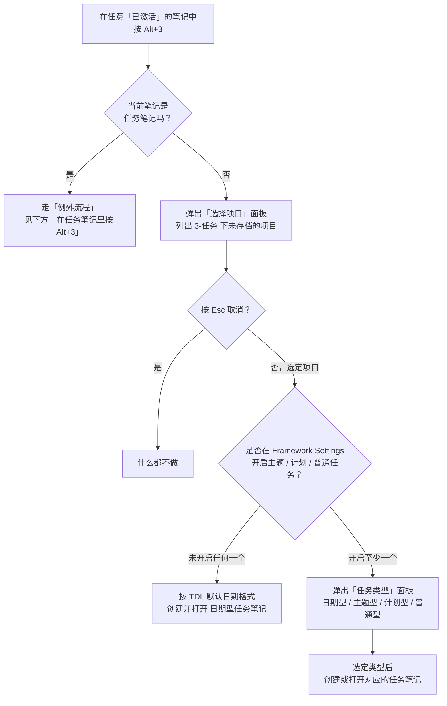
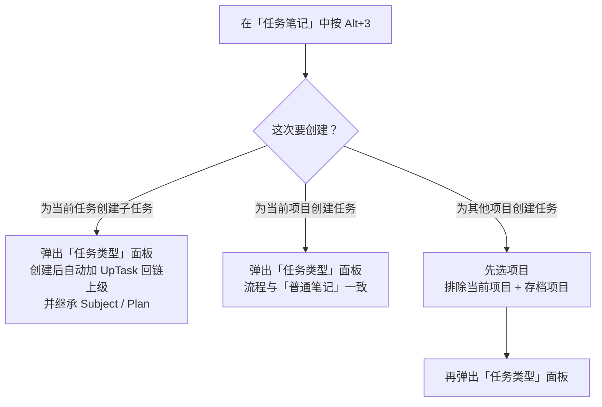

# 使用 IOTO 的默认快捷键创建任务笔记

> [!info] 写给刚接触 IOTO 的你
> 本文手把手教你用 IOTO 自带的默认快捷键 `Alt+3`（macOS 上为 `Option+3`）创建或打开任务笔记。读完后，你能在任意笔记里一键进入任务记录，不必再手动找模板。

---

## 一句话先记住

> [!tip]
> 在**任意一个已打开的笔记**里按 `Alt+3`，IOTO 会先让你选项目、再让你选任务类型（日期型 / 主题型 / 计划型 / 普通型），最后创建或打开对应的任务笔记——前提是你得先打开一个处于激活状态的笔记。

---

## 这个快捷键是什么

- **Windows / Linux**：`Alt + 3`
- **macOS**：`Option + 3`

它本质上触发的是 Templater 插件的「插入模板」命令，背后会加载 IOTO 的脚本，自动完成「选项目 → 选任务类型 → 定位 / 创建任务笔记」这一串工作。

---

## 触发前的一个硬前提

> [!warning] 必须先有一个「激活的」笔记
> 这个快捷键依赖 Templater 的插入模板命令，而该命令**要求必须在一个已激活的编辑器里运行**。
> 如果你在没有打开任何笔记的情况下按 `Alt+3`，会看到一个报错：
> ```text
> No Active Editor
> ```
> 解决办法：先点开任意一个笔记（哪怕是一张空白笔记），再按快捷键即可。

---

## 流程1：在普通笔记里按 Alt+3

当你身处一条**普通笔记**（不是任务笔记）时，按 `Alt+3` 会走下面这套流程：



逐步说明：

1. **选好项目并回车**后，分两种走向（见下一节）。
2. **取消**：在「选择项目」面板里直接按 `Esc`，什么都不会发生。

> [!note] 项目面板里都有什么
> 弹出的项目列表，来自你 `3-任务` 文件夹下、且**没有**在 IOTO Framework Settings 中设为「存档」的项目。

---

## 两种走向：直接建日期型 vs 先选任务类型

按回车后会发生什么，取决于你在 IOTO Framework Settings 的「项目和 TDL」设置里，有没有开启主题任务、计划任务或普通任务：

| 你的设置 | 按回车后的行为 |
| --- | --- |
| 三个类型**都没开启** | 直接按 `TDL 的默认日期格式`，创建并打开一篇**日期型任务笔记** |
| 至少开启了一个 | 先弹出「任务类型」面板，让你在 日期型 / 主题型 / 计划型 / 普通型 中选择 |

选定任务类型后，四种类型的行为如下：

| 任务类型 | 你需要输入什么 | 特别说明 |
| --- | --- | --- |
| **日期型** | 无需输入 | 直接按现有逻辑创建对应时间段的日期型任务笔记并打开；带 `Project` 属性 |
| **主题型** | 主题名 | 输入时实时显示当前项目下含该文字的已有主题任务，可新建也可直接打开；带 `Project` + `Subject` 属性 |
| **计划型** | 计划名 | 输入时实时显示当前项目下含该文字的已有计划任务，可新建也可直接打开；带 `Project` + `Plan` 属性 |
| **普通型** | 任务名 | 输入时实时显示当前项目下含该文字的已有普通任务，可新建也可直接打开；笔记名即你输入的名字；带 `Project` 属性 |

> [!tip] 边输入边检索
> 主题型、计划型、普通型在输入名称时，都会**实时列出当前项目下已有的同类任务**。也就是说，你既可以新建一个，也可以直接打开一条已经存在的任务笔记，不用怕重复创建。

---

## 流程2：在任务笔记里按 Alt+3

如果你正**身处一篇任务笔记**，再按 `Alt+3`，IOTO 会先问你这次要建什么：



三种选择的区别：

- **为当前任务创建子任务**：弹出和普通笔记一样的任务类型面板；创建好的笔记会额外带上一个 `UpTask` 属性，指向你按下快捷键时所在的那条笔记（即它的上级任务），并会自动回链到上级。同时，如果激活笔记里有 `Subject` / `Plan` 属性，也会一起继承到新笔记上。

  > [!note] 这个选项不是总出现
  > 「为当前任务创建子任务」只有在 IOTO Framework Settings 的「项目和 TDL」设置里**开启了主题 / 计划 / 普通任务**时才会显示。

- **为当前项目创建任务**：弹出任务类型面板，处理方式与在普通笔记里创建任务完全一样。
- **为其他项目创建任务**：先弹出一个项目列表（其中**不包含**当前笔记所在的项目，也不包含你在设置里排除的项目），选好目标项目后再弹任务类型面板，后续与普通笔记流程一致。

---

## 小结

- `Alt+3` 现在统一走「**先选项目、再选任务类型**」的思路；任务类型被明确分成四种：**日期型、主题型、计划型、普通型**，且创建时都能在输入名称的同时检索并打开已有的同类任务。
- 你能看到哪些任务类型，取决于你在 **IOTO Framework Settings** 中的设置。
- 当你本身就处于一条任务笔记里时，`Alt+3` 会多一个「**创建子任务 / 当前项目 / 其他项目**」的入口，方便你在任务之间建立从属关系（子任务会自动回链到上级任务）。

---