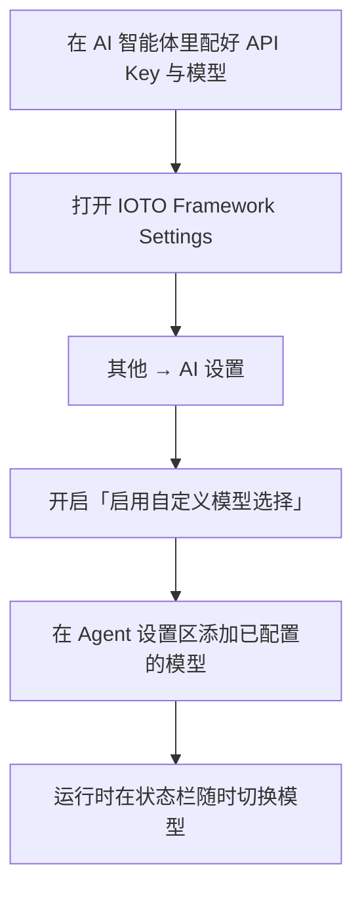

# 在 IOTO 中如何为 Agent 配置多个不同的模型

> [!info] 写给想在执行任务时灵活切换模型的你
> 如果你在用 IOTO 的「AI 执行任务」功能，默认会走当前 Agent 的默认模型；这篇文档教你如何为 Agent 配置多个模型，并在运行时随时切换。

---

## 一句话先记住

> 「配置模型」分两步：先在**你的 AI 智能体里**配好 API Key 和模型，再到 **IOTO Framework Settings → 其他 → AI 设置** 打开 `启用自定义模型选择`，之后就能在状态栏随时切换模型。

## 默认行为：用 Agent 的默认模型

运行「AI 执行任务」功能时，IOTO **默认**使用你当前所选 Agent 配置的默认模型。

如果你想在执行任务时根据需求切换不同的模型，按下面的步骤操作即可。

## 第一步：在你的 AI 智能体里配置多个模型

你使用的 AI 智能体，本身都可以配置多个不同的大语言模型。这一步**需要在 AI 智能体自己的设置里完成**，IOTO 管不了：

- 配置时通常需要提供你订阅或购买的模型 **API Key**；
- 具体怎么填，各个 AI 智能体的官方文档都有详细说明，也可以直接问你常用的 AI 聊天工具要设置指引。

> [!warning] 这一步是前提
> 模型能不能用，取决于你有没有在 Agent 侧提供对应的 API Key。IOTO 只是「选择」你已经配好的模型，不会替你去申请或存储密钥。

## 第二步：在 IOTO 中开启模型选择

为了让 IOTO 在运行时能选到你配好的模型：

1. 打开 **IOTO Framework Settings**；
2. 进入 **其他 → AI 设置**；
3. 把 **`启用自定义模型选择`** 切换到**开启**状态。

开启后，你就可以在对应 Agent 的设置区域，添加之前已经配置好的模型了。

### 默认模型与手动添加

不同的 Agent 都会预置一些默认模型。这些模型分两类：

| 类型 | 说明 | 能否使用 |
| --- | --- | --- |
| 智能体原生支持 | Agent 本身就认的模型 | 通常开箱即用 |
| 常用模型（如 Deepseek 系列） | IOTO 预置的常见选项 | 取决于你是否提供了对应 API Key |

如果你给自己 Agent 配置了列表里没有的模型，点 **`添加模型`** 按钮手动补上即可。

> [!tip] 看默认项判断格式
> 不同 Agent 对模型名的格式要求不一样：有的是 `provider/model-name`，有的只填 `model-name`。拿不准时，对照 IOTO 给的默认项来写就不会错。

## 第三步：设置「执行任务时」的默认模型

配好模型后，你还可以为每个 Agent 设置一个**默认模型**。

> [!note] 两个「默认模型」不是一回事
> - **AI 智能体设置里的默认模型**：该 Agent 全局使用的默认模型；
> - **IOTO 这里的默认模型**：仅当你用这个 Agent 运行「AI 执行任务」功能时使用的默认模型。
>
> 两者相互独立，互不影响。

## 完成后：运行时随时切换

完成以上设置后，在运行「AI 执行任务」功能时，你就可以在 **Obsidian 状态栏** 随时切换到想用的模型了。