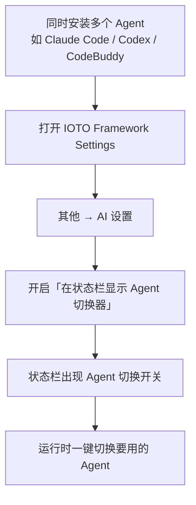

# 在 IOTO 中如何配置和使用多个不同的 Agent

> [!info] 写给同时在电脑上装了多个 AI 编程助手的你
> 如果你在用 IOTO 的「AI 执行任务」功能，又同时装了 Claude Code、Codex、CodeBuddy Code 等多个 Agent，这篇文档教你如何在 Obsidian 状态栏一键切换想用的 Agent。

---

## 一句话先记住

> 多个 Agent 可以共存；IOTO 在状态栏提供一个**切换开关**，默认隐藏，去「IOTO Framework Settings → 其他 → AI 设置」里打开 `在状态栏显示 Agent 切换器` 即可。

## 为什么需要 Agent 切换器

你可以根据自己的需要，在一台电脑上同时安装多个不同的 Agent，例如：

- Claude Code
- Codex
- CodeBuddy Code

当你有多个 Agent 时，运行「AI 执行任务」功能需要指定用哪一个。为了切换方便，IOTO 会在 Obsidian 的**状态栏**放一个 Agent 切换开关，让你随时切到想用的那个。

## 如何开启 Agent 切换器

切换开关**默认是不显示的**，需要手动打开：

1. 打开 **IOTO Framework Settings**；
2. 进入 **其他 → AI 设置**；
3. 把 **`在状态栏显示 Agent 切换器`** 设为「开启」。

开启后，状态栏就会出现 Agent 的切换开关，点击即可切换。

> [!tip] 提示
> 开关只负责「在状态栏显示切换器」，并不会改变你已经安装的 Agent。多个 Agent 需要你先自行在电脑上分别安装好。