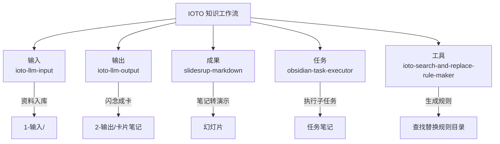
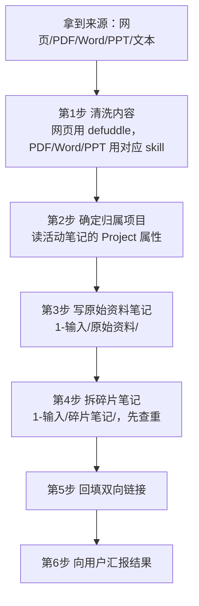
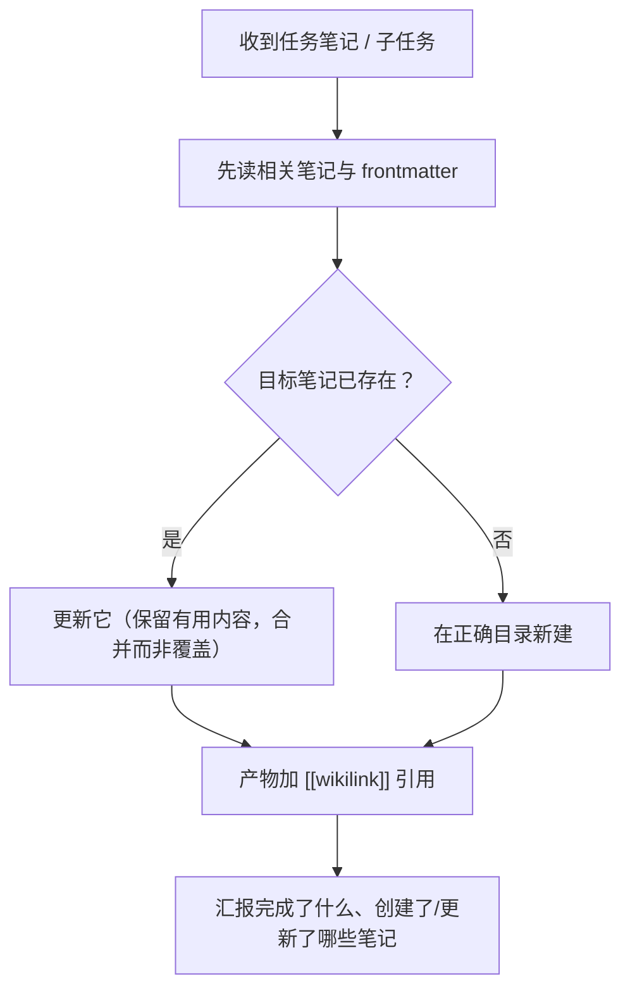

# 关于 IOTO 提供的 Skills

> [!info] 写给正在上手 IOTO 框架的你
> 本文是一份「IOTO 内置技能速查手册」。读完你会知道：**哪 5 个技能默认就装在 IOTO 里、各自解决什么问题、什么时候该喊它出来、怎么用**。

---

## 一句话先记住

IOTO 默认提供 **5 个技能**，其中前四个，对应「输入资料 → 沉淀思考 → 执行任务 → 对外演示」这一条知识工作流；最后一个是协助生成IOTO辅助工具里的[[S9-IOTO的查找替换功能如何用|查找替换]]工具的查找替换规则的。

- **`ioto-llm-input`** —— 把外部资料（文章/网页/PDF/Word/PPT）拆碎了存进笔记库。
- **`ioto-llm-output`** —— 把随手记的闪念，聚类提炼成能长期生长的卡片笔记。
- **`obsidian-task-executor`** —— 安全地执行任务笔记里委派给 AI 的子任务。
- **`slidesrup-markdown`** —— 把一篇普通笔记，转成能直接放映的演示幻灯片。 *这个技能转成的文件，需要使用SlidesRup插件转成Extended Slides等插件支持的演示格式，SlidesRup插件是我开发的另一个付费插件，需要单独购买使用。*
- **`ioto-search-and-replace-rule-maker`** —— 把「把 A 换成 B」这句话，变成可复用的查找替换规则文件。



## 它们分别在 IOTO 的哪个环节

| 技能                                   | 一句话定位      | 属于 IOTO 环节 | 典型触发词                      |
| ------------------------------------ | ---------- | ---------- | -------------------------- |
| `ioto-llm-input`                     | 资料梳理与碎片化入库 | 输入         | 拆分入库、内容入库、碎片化、LLM输入        |
| `ioto-llm-output`                    | 闪念提取成卡片笔记  | 输出         | 闪念提取成卡片、卡片化、提取闪念           |
| `obsidian-task-executor`             | 任务执行器      | 任务         | 执行任务笔记、从任务笔记执行工作           |
| `slidesrup-markdown`                 | 演示幻灯片转换    | 成果         | 转成演示、制作 Slide、SlidesRup    |
| `ioto-search-and-replace-rule-maker` | 查找替换规则生成器  | 工具         | 查找替换规则、批量把 X 换成 Y、生成 SR 规则 |

> [!tip] 记不住名字没关系
> 你只要用**自然语言**说想干啥（「帮我把这篇网页拆进库」「把这些闪念整理成卡片」「把笔记做成幻灯片」），你使用的智能体通常都会按触发词自动挑对应的技能。

---

## 1. ioto-llm-input —— 资料梳理与碎片化入库

**它做什么**：把你丢给它的任意来源内容（文章、网页 URL、PDF、Word、PPT、纯文本），先清洗干净，再按 IOTO 目录架构落库：
- 清洗后的**全文** → `1-输入/原始资料/`
- 拆出来的**原子概念碎片** → `1-输入/碎片笔记/`
- 两者之间建立**双向 `[[wikilink]]`**，方便从资料跳到碎片、从碎片回看原文。

**什么时候用**：你读到一篇好文/一个网页，想「存进 vault 并拆成可复用的小块」时。

**怎么跑（概览）**：



**关键约束**（做之前记住，避免踩坑）：
- 禁止在 `1-输入/` 下新建子文件夹，只能写已有的 `原始资料` 和 `碎片笔记`。
- 笔记标题用描述性名字（如 `5W2H模型`），**不加日期前缀**。
- 内部一律 `[[wikilink]]`，外部用标准 Markdown 链接。
- 创建碎片前**先查重**，已有同概念笔记就直接引用，不重复造。

---

## 2. ioto-llm-output —— 闪念提取成卡片笔记

**它做什么**：把一堆零散、随意的**闪念笔记**（文件名形如 `{前缀}-{日期}.md`，前缀和日期格式来自 ioto-settings 配置，**不要写死**），按主题聚类、提炼、去重，归并成 `2-输出/卡片笔记/` 里能持续生长的卡片。每张卡片文末用 `[[{前缀}-{日期}]]` 回链来源，保证可追溯、可增量。

**什么时候用**：你攒了一堆随手记的闪念，想「整理成有结构的长期卡片」时。

**三种运行模式**（默认增量）：

| 模式 | 作用 | 适合场景 |
| --- | --- | --- |
| `incremental`（默认） | 只处理处理清单里缺失的闪念 | 日常高频触发，快且幂等 |
| `range` | 指定日期区间/文件列表/标签 | 针对性补卡、回溯某段时期 |
| `full` | 全量重扫 | 冷启动、调优 prompt 后整体重聚 |

**几个亮点设计**：
- **幂等并卡**：新闪念若匹配到已有卡片，就并入该卡并追加回链，而不是另起一张新卡——每次运行都在「生长」知识树。
- **两遍法聚类**：先逐条压成一句话摘要，再对摘要聚类，省 token、控粒度。
- **`dryRun` 预览**：只产出「哪些闪念 → 哪张卡」的计划，不改写任何笔记，先确认再执行。

**关键约束**：
- 卡片一律落在 `2-输出/卡片笔记/`，禁止新建子文件夹。
- 卡片标题沿用习惯，含「是什么 / 为什么 / 如何」等关键词。
- 每张卡片**必须保留 `## 来源` 小节**回链全部派生它的闪念。
- 默认**不改写源闪念**笔记。

---

## 3. obsidian-task-executor —— 任务执行器

**它做什么**：用来执行 Obsidian **任务笔记**（或其中委派的一个子任务）。它刻意做得「基础而专注」，核心是**安全地读写笔记、复用已有笔记、在 vault 内安全地建文件、并为产物加 `[[wikilink]]` 引用**。

**什么时候用**：你有一个任务笔记（如 `IOTO提供的技能的介绍.md`），想让 AI 照着其中的清单/子任务去真正干活时。

**它的执行纪律**（也是它和「随便让 AI 改文件」最大的不同）：
- 先读相关笔记，**保留已有内容**，优先「扩展 / 追加 / 合并」而非覆盖。
- 如果只派了一个子任务，就**只做那一个**，不脑补隐藏任务、不动无关的 checklist。
- 用 Obsidian 语义去解析 `[[目标笔记]]`：能找到就更新、找不到才新建，绝不造重名副本。
- 生成产物时，顺手用 `[[wikilink]]` 把交付物串起来。



> [!note] 调用方负责「排程」，执行器负责「干活」
> 哪个子任务先做、清单状态怎么标、成果怎么汇总——这些由调用方决定。执行器不越权重排整个任务笔记，除非你明确要求。

---

## 4. slidesrup-markdown —— 演示幻灯片转换

**它做什么**：把一篇普通 Markdown 笔记，转成 **SlidesRup 标准演示格式**，可直接被 Obsidian 的 **Slides Extended** 或 **Advanced Slides** 插件渲染成幻灯片。

**什么时候用**：你有一篇知识笔记/会议记录/技术文档，想「快速变成能讲的结构化演示」时。

**转换流程**：读源笔记 → 设计大纲 → 转成 SlidesRup Markdown → 校验输出。

**大纲的标题层级（最关键的一条规则）**：

| 标题                    | 角色                        | 数量建议        |
| --------------------- | ------------------------- | ----------- |
| `#` H1                | 演示标题                      | **只能有 1 个** |
| `##` H2               | 章节                        | 2–7 个       |
| `###` H3              | 内容页                       | 每章 2–6 页    |
| `####`–`######` H4–H6 | 子页（必须带 `%%---%%` 标记才触发分页） | 按需          |

**常用控制标记（加在标题行末尾，别过度装饰）**：

| 标记 | 用途 | 示例 |
| --- | --- | --- |
| `%%class%%` | 追加 CSS 类 | `## 章节 %%big-title%%` |
| `%%bg=路径%%` | 背景图 | `### 页 %%bg=assets/bg.jpg%%` |
| `%%?%%` | 隐藏页 | `### 备用 %%?%%` |
| `%%@%%` | 忽略标题（不单独成页） | `### 页内小标题 %%@%%` |
| `%%& ... %%` | 演讲者备注 | 只在演讲视图可见 |
| `%%---%%` | 子页分隔 | 不换标题拆页 |

**内容写法小贴士**：
- 想一条条「逐点出现」的列表用 `+`，静态列表用 `-`。
- 图片用 `![[path#center shadow|600]]` 控制对齐与尺寸；左右分栏用 `::: lblock` / `::: rblock`。
- 每页控制在 5–7 个要点或 3–4 短段，冗长解释挪进演讲者备注。

> [!tip] 不知道结构怎么定？
> 技能会先给你一份大纲（H1/H2/H3 规划）确认，再动手转格式——觉得章节能合并/拆分，直接说就行。

---

## 5. ioto-search-and-replace-rule-maker —— 查找替换规则生成器

**它做什么**：把「我想把 A 变成 B」这类自然语言需求，翻译成 [[IOTOSearchAndReplace.js]] 能直接消费的规则文件（`TP-SR-*.md`），写入 `0-辅助/IOTO/Templates/Templater/MyIOTO/辅助工具/查找替换规则`。之后你在目标笔记里运行 [[IOTO-查找替换]] 模板即可套用。

**什么时候用**：你要对一批笔记做批量文本变换（换标点、列表变待办、删高亮、清 Block ID……）时。

**规则长什么样**（全部写在 YAML frontmatter 里）：

```yaml
---
search1: 要找的内容
replace1: 要换成的内容
search2: 第二条
replace2: 第二条的替换
ignoreCase: true
globalReplace: true
useRegex: true
multilineMode: false
---
一句话说明这条规则干什么（脚本不读正文，只作说明）
```

- `searchN` / `replaceN` **必须成对出现**，缺一个脚本整体放弃；按数字**从小到大依次执行**。
- 四个统一开关（对文件内所有规则生效，不能逐条设置）：

| 开关 | 作用 |
| --- | --- |
| `useRegex` | `true` 时按正则解析，支持 `$1` `$&` |
| `ignoreCase` | 忽略大小写（为 `true` 时会自动走正则通道） |
| `globalReplace` | `true` 替换全部，`false` 只换第一处 |
| `multilineMode` | `true` 时 `^`/`$` 匹配每行行首行尾 |

**最易踩的 YAML 陷阱**：

> [!warning] 写正则千万别用双引号
> YAML 双引号串里 `\d` `\s` `\-` 都会被吞掉或转义出错。含反斜杠的正则**不要加引号**（必须加引号时用单引号）；以 `-` `?` `:` 等特殊字符开头的值要加双引号；要表示「空格」用 `\s` 代替真实空格（YAML 会裁掉首尾空白）。写完后逐行自查，并用 `node` 实跑一遍验证。

**安全约束**：本技能**只生成规则文件**，不替你在真实笔记上执行替换；规则有暴力误伤风险时，必须明确提示并给更稳妥的备选写法。

如何使用查找替换规则请参考[[S9-IOTO的查找替换功能如何用]]。

---

## 在`UserExtensions`中明确指明如何使用技能

在[[S3-如何根据自己的需求去定制IOTO的AI执行任务功能#方式二：在 UserExtensions 文件夹下添加补充规则|使用UserExtensions去定制AI执行任务的规则]]中，讲解过你可以通过去创建自己的Markdown规则文件，去明确地让自己的智能体在执行任务的时候使用某些技能。

在我在`UserExtensions`文件夹下，有一个叫`SkillsRules`的Markdown笔记，里面就包含下面的几句规则内容，你可能根据自己的实际需求，去选择使用：

```
- 凡是提到「制作演示」或「制作Slide」的产物，都用/slidesrup-markdown 去完成
- 凡是提到「拆分入库」都使用/ioto-llm-input 去完成，并把新建的链接用无序子列表的形式更新到所在任务的下方
- 凡是提到「把闪念转成卡片笔记」都使用/ioto-llm-output 去完成，并把新建的链接用无序子列表的形式更新到所在任务的下方
```