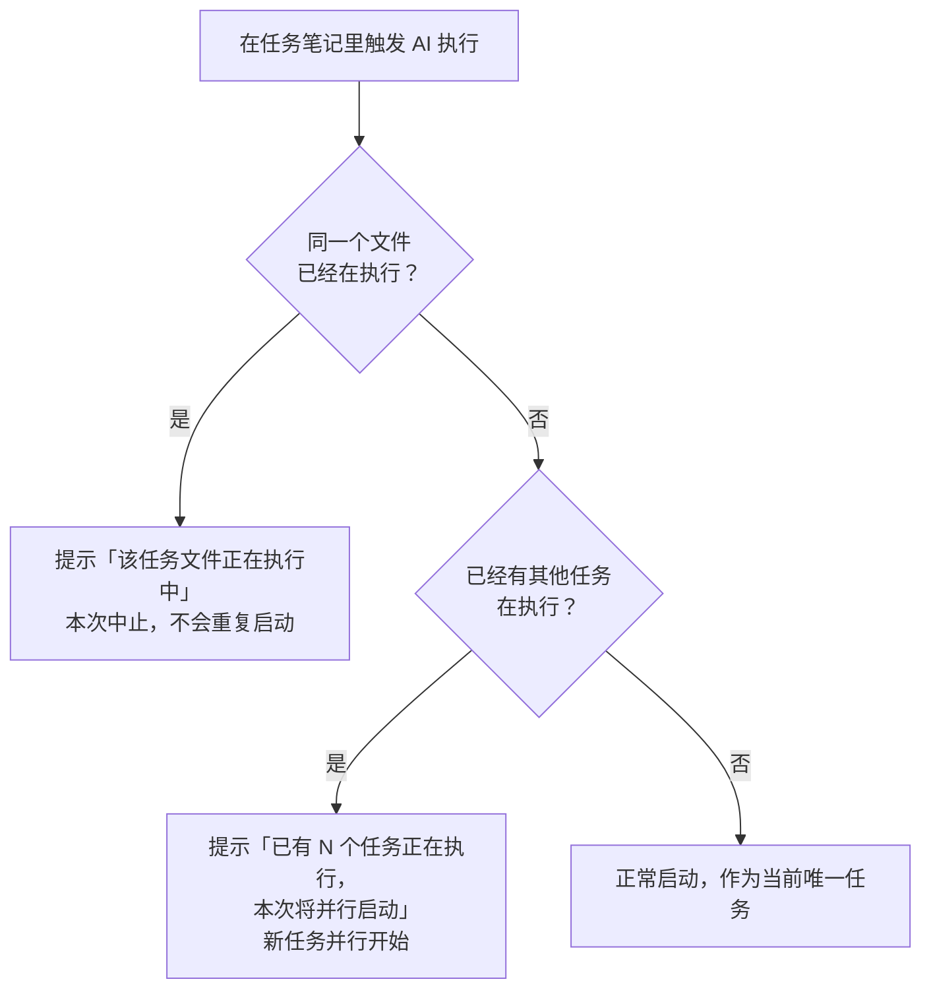
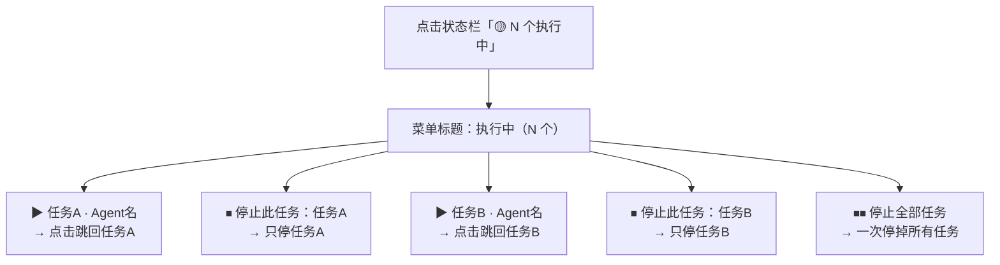
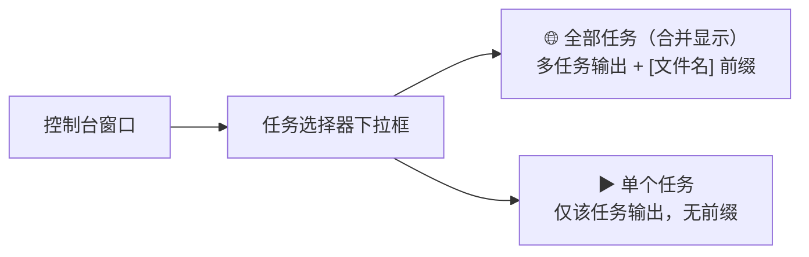

# 如何使用 IOTO AI 执行任务的多任务并行功能

> [!info] 写给正在用「AI 执行任务」功能的你
> 以前一次只能跑一个 AI 任务，想再开一个就得等上一个结束。V224 起，你可以**同时让多个任务笔记各自跑 AI**，并在状态栏与控制台里分别管理它们。
> 本文是给使用者看的操作手册，不讲实现细节。

---

## 一句话先记住

> 触发方式和以前完全一样，只是**同一个文件不能重复跑、不同文件可以一起跑**；跑起来后，状态栏点一下能跳回或停下某个任务，控制台里能分任务看输出。

---

## 它能做什么

- 在**不同的任务笔记**里各自触发 AI 执行，任务之间**并行进行**，互不阻塞。
- 每个任务独立维护自己的输出、进程与对话 session，彼此不串。
- 通过状态栏和「控制台」窗口，随时**跳回某个正在跑的任务**，或**单独停止 / 全部停止**。

> [!note] 触发入口不变
> 并行能力只改变「能不能同时跑多个」，不改变你怎么发起任务：依旧是 AI 按钮、命令面板或快捷键（如 `Alt+0`）在任务笔记里发起。

---

## 怎么并行启动多个任务

要点：

- **同文件防重复**：同一个任务笔记已经在跑时再点，会被拦下并提示，避免重复执行。
- **跨文件可并行**：在另一个任务笔记里发起，会提示「并行启动」并立即开始，无需等待前一个结束。

---

## 状态栏有什么变化

状态栏的 AI 区域会根据「正在跑的任务数量」切换形态：

| 场景 | 状态栏文字 | 点击它的行为 |
| --- | --- | --- |
| 只有 1 个任务 | `任务执行中……` | 直接跳回该任务笔记 |
| 多个任务 | `🟡 N 个执行中` | 弹出「正在执行」菜单（见下） |

- 停止按钮（方块图标）与「控制台」切换按钮，在**至少 1 个任务运行时**始终显示。
- 当只有 1 个任务时，点击状态栏文字沿用此前的「跳回正在执行任务」特性，一步到位。

### 多个任务时点开的运行菜单

点击 `🟡 N 个执行中`，会弹出菜单，逐项列出正在跑的任务：

- 每个任务提供两行：**跳回**（打开对应笔记并定位到执行位置）与**停止此任务**（只结束这一个）。
- 底部 **`⏹⏹ 停止全部任务`** 一次性结束所有正在执行的任务。

> [!tip] 想停全部，用这里
> 「停止全部任务」只在状态栏的运行菜单里提供。控制台的停止按钮只停当前选中的那一个（见下节），要清掉所有任务请回状态栏点「停止全部任务」。

---

## 控制台（Console）怎么看多个任务

打开控制台后，它不再只绑定「最后一个」任务，而是**同时接入所有正在执行的任务**。

工具栏新增了一个**任务选择器**下拉框：

| 筛选选项 | 显示内容 | 输出前缀 |
| --- | --- | --- |
| `🌐 全部任务（合并显示）` | 所有任务输出合并到一屏 | 每条前加 `[文件名]` 前缀，区分来源 |
| `▶ 任务A · Agent名` | 仅该任务的输出 | 无前缀，干净查看 |

- **合并模式下**，每条输出前面会带 `[文件名缩写]`（文件名超过 12 字会截断并加 `…`），一眼能看出这行是谁产生的。
- **只选一个任务**时，输出不带前缀，专注看单个任务。
- 只有 1 个任务运行时，界面保持原来的干净样式，不加前缀。
- 切换筛选时，Obsidian 面板标题也会跟着变：合并时显示 `全部任务（合并显示）(N)`，单任务时显示该任务标签。

> [!warning] 控制台的「停止」按钮
> 它停止的是「当前筛选对应的任务」：选了某个具体任务就停那个；选「全部」时只停列表里的第一个。要一次停掉所有任务，请回状态栏用「停止全部任务」。

---

## 注意事项与已知边界

- **同一文件不能重复执行**：已运行的文件再触发会被拦下，需先停止或等它结束。
- **全局设置被所有并行任务共用**：当前选中的 Agent、模型、权限等设置对所有正在跑的任务同时生效。
- **任务之间互不干扰**：各自的输出缓冲、子进程、session 独立，一个任务停下不影响其他任务继续。
- **「最近 AI 任务」历史按钮独立存在**：状态栏上那个查看「最近执行过的 AI 任务列表」的图标，与本功能的「正在运行」菜单是两套入口——前者用于跳回**已经结束**的历史任务，后者用于管理**正在跑**的任务。

---