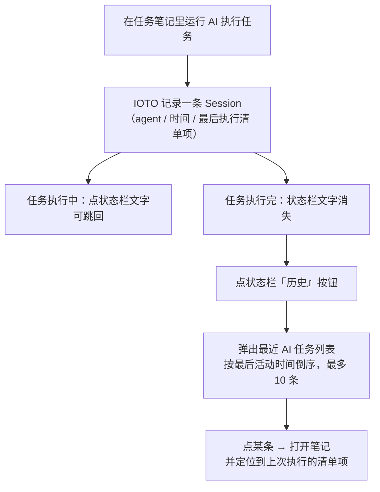

# IOTO 的 AI 执行任务功能 · 最近执行的 AI 任务（状态栏按钮）的使用

> [!info] 写给谁
> 已经用上 IOTO「AI 执行任务」功能，但任务跑完之后，发现**人已经不在这条任务笔记里了、想回去却找不到**的你。
> 这篇文档只讲状态栏右侧那个「历史」按钮怎么用，以及它解决了什么麻烦。

---

## 一句话先记住

> AI 任务跑完之后，状态栏右侧的「🕘 历史」图标会列出**最近执行过的 AI 任务笔记**，**点一下就能跳回那条笔记、并自动定位到上次执行的清单项**。最多显示 10 条，最近的排在最上面。

---

## 为什么需要它

以前 AI 执行任务时，状态栏会显示「正在执行」的文字，**点击那段文字**就能跳回当前任务笔记——但这只在任务**还跑着**的时候有用。

任务一旦跑完，那段文字就消失了，状态栏也恢复平静。此时你已经切去干别的事、打开别的笔记，再想回到「刚才那条任务」就很麻烦：得靠记忆去 `3-任务/` 里翻。

状态栏的「最近 AI 任务」按钮就是为这个场景补上的：它把**被 AI 执行过**的任务笔记都记下来，随时点开就能回去。

---

## 按钮在哪

它常驻在 Obsidian 状态栏（窗口最底部一行），位于 AI 相关按钮的右侧：

- 图标：`🕘`（history 图标）
- 鼠标悬停提示：**「最近 AI 任务（点击打开对应笔记）」**

只要历史上跑过 AI 任务，它就在那里，无需额外开启。

> [!note] 它和「正在执行」的文字是两套入口
> - **执行中**：点状态栏里「AI 执行中」那段文字 → 跳回**当前正在跑**的任务。
> - **执行完**：点「🕘 历史」按钮 → 跳回**任何一条**最近跑过的任务。
> 两者互补：一个管「当下」，一个管「过去」。

---

## 怎么用

1. 让 AI 执行过至少一条任务笔记（条目只会出现**被 AI 跑过**的任务，你手动打开的笔记不会进来）。
2. 看向状态栏右侧，点击「🕘 历史」图标。
3. 弹出菜单，列出最近执行的 AI 任务，最近的在最上面。
4. 点击任意一条 → Obsidian 打开那条任务笔记，并**自动滚动、高亮到上次执行到的清单项**。

---

## 列表里每一项长什么样

| 元素 | 含义 |
| --- | --- |
| 标题 | 任务笔记的文件名（`basename`） |
| 左侧圆点 | 执行状态：🟡 执行中 / 🟢 成功 / 🔴 失败 |
| 副标题 | `Agent 缩写 · 最后活动时间`，例如 `CC · 2026-08-09 11:05` |

支持的 Agent 缩写与状态栏一致：`CC`(Claude Code) / `Codex` / `OC`(Open Code) / `MC`(MiMo Code) / `Hermes` / `CBC`(Codebuddy Code)。

> [!tip] 点进去会定位到哪
> 跳转时 IOTO 不只是打开笔记，还会把光标移到**上次 AI 执行的那个 checklist 项**并短暂高亮。这样你回去就能接着那个位置继续，不用自己从头找。

---

## 排序、数量与有效期

| 行为 | 规则 |
| --- | --- |
| 排序 | 按「最后活动时间」**倒序**，最近执行的排最上 |
| 数量上限 | 最多 **10 条** |
| 来源 | 仅来自 AI 执行任务产生的 Session 记录 |
| 空状态 | 从未跑过 AI 任务时，菜单只显示「（暂无最近 AI 任务）」 |
| 清理 | 超过 Session 保留期（默认 **7 天**）的记录会被自动清除，不再出现在列表 |

> [!warning] 不是所有笔记都会出现
> 列表只收录**通过 AI 执行任务功能跑过**的笔记。如果你只是手动打开、编辑某条任务，它不会因为被打开而进入这个列表。

---

## 与其他跳回方式的对比

| 跳回方式 | 入口 | 适用时机 | 能定位到清单项 |
| --- | --- | --- | --- |
| 执行中文字点击 | 状态栏「AI 执行中」文字 | 任务**正在跑**时 | 是 |
| 历史按钮 | 状态栏「🕘 历史」图标 | 任务**跑完之后** | 是 |
| 手动在 `3-任务/` 翻找 | 文件管理器 / 搜索 | 任何时候 | 否（需自己找） |

---