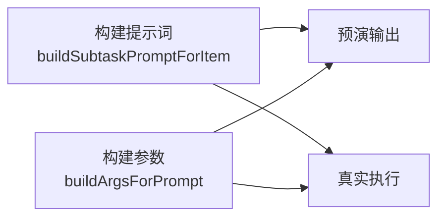
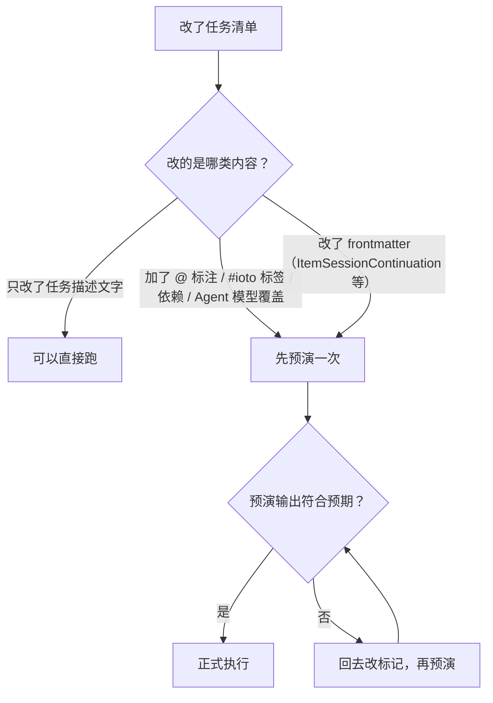

# 如何在真正执行前先预演一遍 AI 任务

> [!info] 写给想试高阶写法、又怕烧钱烧轮次的你
> 任务依赖、条目级换模型、fan-out……这些新写法光看文档很难确认「我到底写对没写对」。V2.3.1 提供了 **Dry Run（预演）**：把每条任务**实际会执行什么**完整渲染到控制台，**不启动 AI、不打勾、不花钱**。读完这篇你就敢放心试了。

---

## 一句话先记住

> [!tip] 核心结论
> 打开任务笔记，命令面板搜「**预演 AI 任务（Dry Run）**」，结果打印在 **Console 视图**（会自动打开）。
> 它与真实执行**复用同一套提示词 / 参数构建器**，所以「预演 == 真实」——预演里看到的是什么，真跑就是什么。

---

## 怎么触发

```text
1. 打开一篇任务笔记（必须在任务文件夹内）
2. Ctrl/Cmd + P 打开命令面板
3. 搜索「预演 AI 任务（Dry Run）」并回车
4. 右上角提示「预演完成，结果见 Console 视图」
```

> [!note] Console 视图在哪
> 插件会自动打开 Console 视图（只开不关）。如果没看到，用命令面板搜「Console / 控制台」打开。

> [!warning] 没有待办时会直接提示
> 若整篇笔记的任务全部打勾、或解析不出清单，会提示「没有待执行的条目（全部完成或无可解析清单）」，不会输出预演内容。

---

## 预演会渲染什么

输出长这样（示意）：

```text
=== DRY RUN · orchestrated · Claude · cwd=/Users/me/vault ===
--- 条目 1：搜集三篇关于 IOTO 的资料
Prompt:
（该条目实际会收到的完整提示词，含目标、上次进展、交付物、补充描述……）
Executable: /usr/local/bin/claude
Command: claude -p "…" --output-format stream-json …
Args(raw): ["-p","…","<session-token>"]
--- 条目 2：把三篇合并成综述，放入 @[[IOTO综述]]
依赖: 条目 1
Agent: CodeBuddy
模型: claude-opus-4-5
Prompt:
…
Executable: …
Command: …
Args(raw): …
```

| 字段 | 说明 |
| --- | --- |
| 头部 `DRY RUN` 行 | 依次给出**模式**（`legacy` / `single` / `orchestrated`）、**Agent**、**cwd** |
| `条目 N`： | 条目原文；已打勾的条目会标「（已完成，跳过）」 |
| `Prompt` | 该条目**实际会收到的完整提示词**——这是最值得看的部分 |
| `Executable` | 解析到的 CLI 路径；找不到会提示「未找到 CLI：… 请检查设置项 …Path」 |
| `Command` | 拼好的命令行，会话 token 已被 `<session-token>` 脱敏 |
| `Args(raw)` | 参数数组的 JSON |
| `依赖` | 开了依赖时按**拓扑序**渲染，并列出本条依赖哪些条目 |
| `Agent` / `模型` | 该条目若用 `#ioto/agent/` / `[model:: ]` 做了覆盖，这里会显示覆盖后的结果 |

---

## 为什么可以信它



预演和真实执行走的是**同一个构建器**，只是最后一步不 `spawn`。所以：

- 提示词里有没有注入「目标」「上次进展」「交付物」「补充描述」，预演里看得一清二楚；
- 条目级 Agent / 模型有没有路由成功，预演里直接显示结果；
- 依赖解析成没成功、拓扑序对不对，预演里直接给顺序和 `依赖` 行。

> [!note] 唯一差异：预演固定按「全新会话」渲染
> 预演不考虑会话续接（sessionToken 固定为空），因此它渲染的是**一次全新执行**会发出的内容。

---

## 三个最值得用的场景

### 1. 核对 `@` 标注有没有被识别

在 `Prompt` 里找「交付物」那一行。如果条目里写了 `@[[综述]]` 却没出现在这里，说明写法有问题——回去对照 [[S3-如何用ioto标签在一行任务里下达控制指令]] 检查是不是写到了缩进行。

### 2. 验证标签写得对不对

改完 `#ioto/depends/N`、`[model:: …]`、`#ioto/fanout` 之后跑一次预演：

- `依赖` 行出现了、顺序也对 → 依赖生效；
- `模型` 行显示的不是你写的那个 → 大概率是标签被 `.` 截断了，改用 `[model:: …]`；
- 控制台同时会打出「忽略无效标签 #…」这类告警，一起看。

### 3. 确认条目级 Agent / 模型路由成功

如果某条声明了 `#ioto/agent/codebuddy`，预演里这条的 `Agent` 行应该显示 `CodeBuddy`、`Executable` 也应该变成对应的 CLI。没变 → Agent 名写错了（非法值会告警并回退全局，不会报错）。

---

## 它不做什么

| 不做 | 说明 |
| --- | --- |
| 不启动 AI 进程 | 不会调用任何 CLI，零 token、零费用 |
| 不打勾 | 任务清单的勾选状态完全不变 |
| 不写日志 | 不会往 `.ioto/sessions` 写任何记录 |
| 不动 session | 不影响会话续接，也不会让「上次进展」产生变化 |
| 不检查 AI 是否真的能跑通 | 它只保证「发出去的内容」一致，不保证 AI 一定能完成 |

> [!warning] 预演不等于保过
> 它能帮你消灭「我写错了」这一类问题，但消灭不了「AI 做不好」。后者要在 `其他 → AI` 里打开「完成验证：交付物存在性校验」，让打勾门禁从「AI 说做完了」升级为「交付物真的存在 / 真的更新了」。

---

## 什么时候该预演一次



---

## 延伸阅读

- [[S3-如何用ioto标签在一行任务里下达控制指令]] — 预演主要就是用来验证这些标签的
- [[S3-如何让AI按你规定的先后顺序执行任务]] — 用预演看依赖的拓扑序对不对
- [[S3-IOTO中AI执行任务功能的三种不同模式]] — 预演头部的 `legacy` / `single` / `orchestrated` 分别对应什么
- [[S3-使用IOTO的AI执行任务功能时常见的坑有哪些]] — 预演通过但执行仍失败时的排查清单