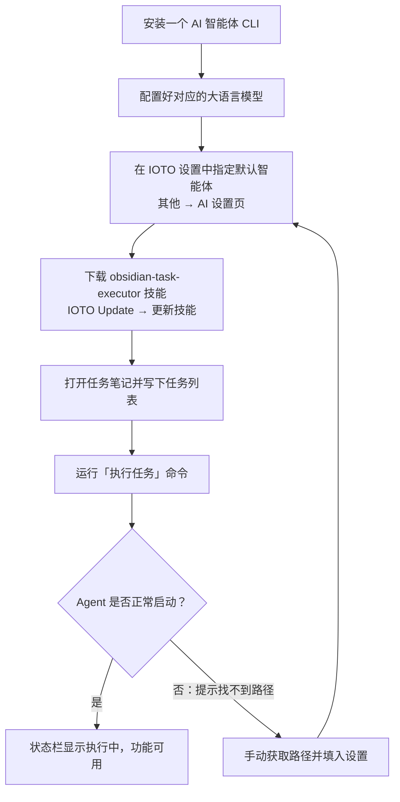

# 如何快速上手 IOTO 的 AI 执行任务功能

> [!info] 写给想让 AI 帮你自动跑 Obsidian 任务笔记的你
> 这篇文档手把手教你把 IOTO 的「AI 执行任务」功能跑起来：装好一个 AI 智能体、在设置里指定它、获取相关技能、然后在任务笔记里点一下命令即可。

---

## 一句话先记住

> [!tip] 核心结论
> AI 执行任务 = 你写一个任务清单 + 选好一个已安装的 AI 智能体 CLI，IOTO 就可以自动调用它把清单里的任务一项项跑完。唯一的难点是：让 IOTO 找得到你的智能体程序路径。

## 整体流程



## 第一步：安装一个 AI 智能体

IOTO 本身不提供 AI 能力，它负责「调度」，真正干活的是你电脑上的一个 AI 智能体的命令行（CLI）版本。先任选其一安装：

| 智能体              | 说明           | 网站                                                 |
| ---------------- | ------------ | -------------------------------------------------- |
| Claude Code      | Anthropic 出品 | https://code.claude.com/docs/zh-CN/overview        |
| OpenAI Codex     | OpenAI 出品    | https://github.com/openai/codex                    |
| OpenCode         | 开源 CLI 智能体   | https://opencode.ai/docs/zh-cn/#%E5%AE%89%E8%A3%85 |
| MimoCode         | 小米出品         | https://mimo.xiaomi.com/coder                      |
| Hermes           | 国外开源智能体      | https://hermes-agent.nousresearch.com/docs         |
| Codebuddy Code   | 腾讯出品         | https://www.codebuddy.cn/docs/cli/quickstart       |
| DeepSeek Harness | DeepSeek出品   | https://www.deepseek.com/harness/                  |
| Pi Agent         | 国外开源CLI      | https://pi.dev/docs/latest/usage                   |
| Oh My Pi         | Pi增强版        | https://omp.sh/docs/cli                            |
| QoderCN          | 阿里出品         | https://docs.qoder.cn/cli/installation             |
| Qoder            | 阿里出品         | https://docs.qoder.com/cli/installation            |

> [!note] 装哪个都行
> 列表里的任何一个都可以，挑你已经在用、或文档最顺手的即可。具体安装步骤各家的官网都有详细说明，这里不再重复；也可以直接问你常用的 AI 聊天工具「如何安装 XXX 的 CLI」，很快就能找到答案。

安装完成后，**还需要配置好该智能体使用的大语言模型**（API Key / 账号登录等），否则它跑不起来。

具体操作在各家的官网上都有详细的说明。

## 第二步：在 IOTO 设置中指定默认智能体

打开 Obsidian 的 **IOTO Framework Settings** 插件，进入：

```text
其他 → AI
```

在设置页里，把你刚安装的智能体选为「默认智能体」。


## 第三步：获取 IOTO 提供的 AI 执行任务技能

为了让 AI 智能体更规范地执行任务笔记里的任务，IOTO 专门提供了一个技能 `obsidian-task-executor`。

> [!note] 默认不会自带
> 在默认部署 IOTO 时，这个技能并不会被自动下载安装。你需要手动把它装上。

使用 **IOTO Update** 插件的 `更新技能` 命令，即可把技能文件下载安装到你所用智能体默认的项目配置文件夹下。

如果你是IOTO的老用户，已经很久没有更新IOTO了，当你使用`更新技能`命令时，出现报错，那就先试用IOTO Update的`验证用户权限`命令去重新验证你的下载权限，然后再使用`更新技能`命令。

## 第四步：在任务笔记里运行

1. 打开任意一个**任务笔记**，在里面写一个任务列表，例如：

```text
- [ ] 1.11 和 1.2 哪个更大
```

2. 运行 **IOTO Framework Work** 插件的 `执行任务` 命令。
   

3. 如果一切正常，你会看到：
   - 右上角弹出「某某 Agent 正在执行任务」的提示；
   - Obsidian 左下角状态栏出现「任务正在执行」的提示。

出现这两个提示，就说明你的 Agent 已经正常工作了。

## 常见问题：提示找不到 Agent 路径

> [!warning] 路径报错
> 如果运行命令时提示「无法找到 Agent 路径」，说明 IOTO 没能自动定位你的智能体程序。需要手动拿到它的安装路径，再填回设置里。

**Windows**：打开 PowerShell，按你的智能体输入对应指令：

```text
Get-Command claude
Get-Command codex
Get-Command opencode
Get-Command mimo
Get-Command hermes
Get-Command codebuddy
Get-Command dsh
Get-Command pi
Get-Command omp
Get-Command qodercn
Get-Command qoder
```

**macOS**：打开 Terminal，输入对应指令：

```text
which claude
which codex
which opencode
which mimo
which hermes
which codebuddy
which dsh
which pi
which omp
which qodercn
which qoder
```

如果正确返回了路径，就把这个路径填到 **IOTO Framework Settings**  `其他→AI设置`下对应智能体的路径设置项里即可。

> [!note] 如果提示没找到
> 说明该智能体之前没有正确安装，建议按官方文档重新安装一遍。

---