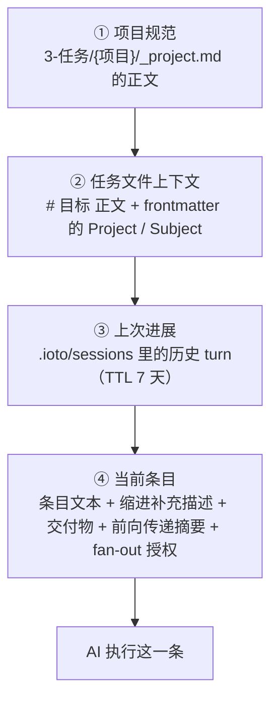
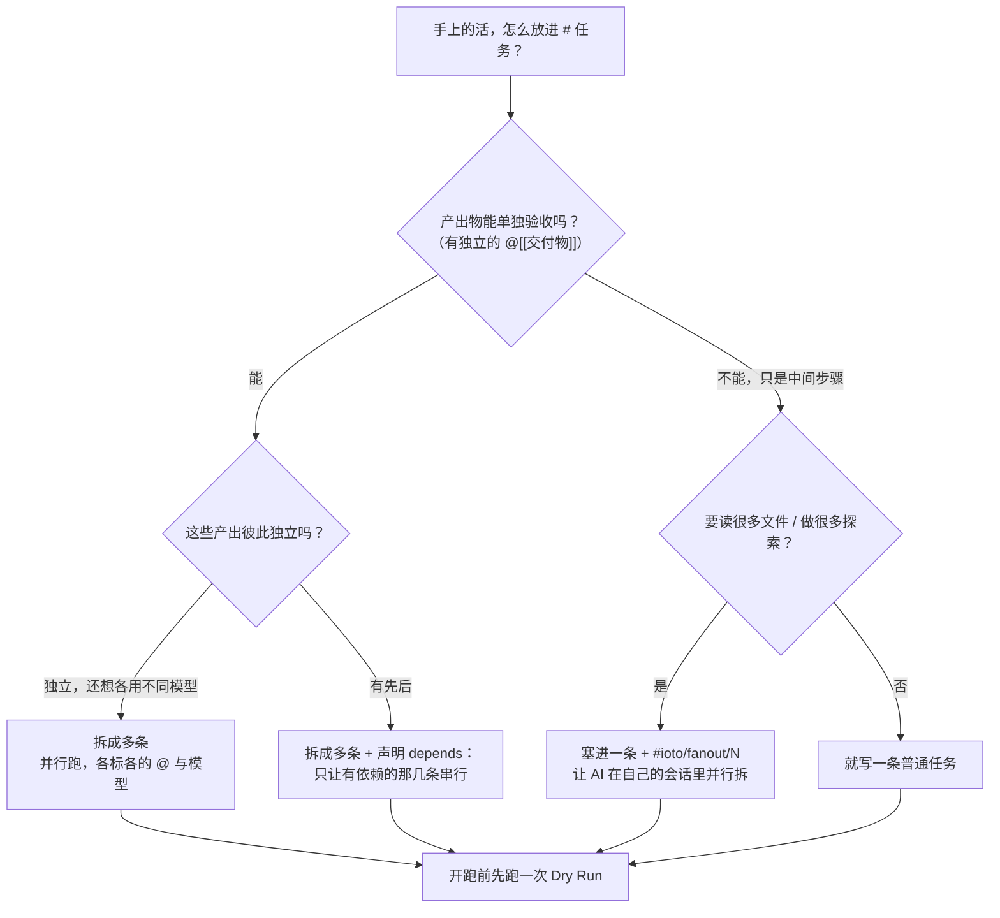

# 如何把任务文件当成 AI 的调度台来写

> [!info] 写给已经会写单条任务、现在想让一整份任务文件自己跑起来的你
> 前面几篇讲的全是单点能力：标签怎么打、依赖怎么声明、模型怎么换、fan-out 怎么授权、成果怎么往下传。可真到自己写一份任务文件时，很多人还是不知道「能直接交给 AI 跑」的文件长什么样。
> 读完这篇，你会拿到：任务文件的**四层结构**、一份**可以直接抄的完整范例**，以及「什么时候拆条目、什么时候交给 AI 自己拆」的判断口诀。

---

## 一句话先记住

> [!tip] 核心结论
> 一份任务文件不是「给 AI 看的一段话」，而是**一张带参数的调度单**：
> - `# 目标` —— 给所有条目的共同背景（为什么做）
> - `# 任务` —— 待调度的队列（做什么）
> - 条目**同一行**的 `@[[…]]` / `depends：` / `#ioto/…` —— 这一条的调度参数（怎么调度）
>
> 你负责**定目标、排队列、标参数**；先后顺序、并发、记忆、验收，交给调度器。

---

## 一、先看清：AI 到底读到了什么

写之前先建立一个正确的心智模型——你在任务文件里写的每一段，最终都会变成某条 prompt 的一部分：



| 层 | 从哪来 | 你要做什么 | 注意 |
| --- | --- | --- | --- |
| ① 项目规范 | `3-任务/{项目}/_project.md` 的**正文** | 把长期有效的项目约定写在这里 | 只有任务文件在任务文件夹下、且项目目录里有 `_project.md` 时才注入；frontmatter 部分会被去掉 |
| ② 任务文件上下文 | `# 目标` 章节正文 + frontmatter 的 `Project` / `Subject` | 用一两句话讲清「为什么做这批任务」 | 章节标题可配（`aiGoalSectionHeadings`），**只认一级标题** |
| ③ 上次进展 | `.ioto/sessions` | 一般不用管 | 默认保留 7 天；编排模式下「批次开始前取一次」，批次内共用同一份 |
| ④ 当前条目 | `# 任务` 下的**未完成** `- [ ]` | 逐条写清做什么、产出什么 | 已勾选的条目直接跳过；控制标记只认条目同一行 |

> [!note] 拆得越细，越要把 ①② 写清楚
> ①② 是**每个条目都会带上**的公共部分，写一次、全批受益。并行的条目彼此看不到对方，唯一能让它们口径一致的就是这份共同背景。

---

## 二、四层结构怎么填

### 第 1 层：项目规范 `_project.md`（写一次，长期有效）

- 位置：`3-任务/{项目}/_project.md`
- 插件读它的**正文**（去掉 frontmatter）注入每一个条目
- 适合放：目录规范、命名约定、写作口径、禁止事项、项目背景

> [!tip] 性价比最高的一层
> 一个三四十行的 `_project.md`，能让之后每一批任务的每一条都少走弯路。改一次，全项目生效——比在每条任务里重复叮嘱划算得多。

### 第 2 层：frontmatter（这一批的身份与默认值）

| 字段 | 作用 | 什么时候写 |
| --- | --- | --- |
| `Project` / `Subject` | 注入 prompt，让 AI 知道这批属于哪个项目、什么主题 | 几乎总是写（IOTO 模板本来就会带） |
| `ItemSessionContinuation: true/false` | 覆盖全局的条目级会话续接 | 迭代型任务（写长文、调代码）写 `true` |
| `ItemInternalFanout: true/false` | 覆盖全局的条目内部 fan-out | 这一批全是「读一堆文件再合成」的活 |

```markdown
---
Project: ["OBIOTO"]
Subject: ["AI执行任务"]
ItemSessionContinuation: true
---
```

> [!note] 只有这两个字段能按文件覆盖
> 其余能力一律靠**条目上写标记**来 opt-in，没有全局开关——这也是 IOTO 的风格：默认不打扰，要用了再声明。

### 第 3 层：`# 目标`（一句话讲清为什么）

- 章节正文会原样注入每个条目
- 标题可配（`aiGoalSectionHeadings`，默认 `目标`），只认**一级标题** `# 目标`

```markdown
# 目标

- 把 V231 的 AI 执行任务新能力写成一组可直接发布的用户文档，口径统一、彼此可互相引用。
```

> [!warning] 目标不是给 AI 打鸡血
> 它的实际作用是**对齐并行条目的口径**。目标写得含糊，并行跑出来的几篇就会各说各话，最后还得你手动缝合。

### 第 4 层：`# 任务` 清单（调度队列 + 每条的参数）

| 参数 | 写在哪 | 作用 |
| --- | --- | --- |
| `@[[笔记]]` | 条目行 | 标注交付物：既注入 prompt，也是完成验证的验收依据 |
| `depends：[[前置]]` / `#ioto/depends/N` | 条目行 | 声明先后顺序 |
| `#ioto/agent/<id>` / `#ioto/model/<id>` / `[model:: <id>]` | 条目行 | 这一条单独换 Agent / 模型 |
| `#ioto/fanout` / `#ioto/fanout/N` | 条目行 | 授权 AI 在自己会话里开子代理拆活 |
| 缩进续行 | 条目**下方** | 补充要求（纯文字；控制标记写在这里不生效） |

> [!warning] 所有控制标记必须写在 `- [ ]` 同一行
> 解析器只读 `- [ ]` 那一行来识别控制项。写在下方缩进行的标记只是普通文字，会被塞进 prompt 但**完全不生效**。

---

## 三、一份可以直接抄的完整范例

```markdown
---
Project: ["OBIOTO"]
Subject: ["AI执行任务"]
ItemSessionContinuation: true
---

# 目标

- 把 V231 的 AI 执行任务新能力写成一组可直接发布的用户文档，口径统一、彼此可互相引用。

# 任务

- [ ] 梳理 V231 的 18 项优化点，整理成一张能力清单，放入 @[[IOTO V231版优化点梳理]]
- [ ] 基于能力清单给出「新增哪些文档」的建议，放入 @[[IOTO AI执行任务功能V231用户文档的书写建议]] depends：[[IOTO V231版优化点梳理]]
- [ ] 写第一批三篇文档，放入 @[[S3-如何用ioto标签在一行任务里下达控制指令]] depends：[[IOTO AI执行任务功能V231用户文档的书写建议]]
    每篇控制在 3 分钟读完，结尾要有「延伸阅读」
    术语以 [[IOTO V231版优化点梳理]] 为准，不要自创
- [ ] 写第二批三篇文档，放入 @[[S3-如何让AI的「做完了」真的算数]] depends：[[IOTO AI执行任务功能V231用户文档的书写建议]] #ioto/model/haiku
- [ ] 写第三批四篇文档，放入 @[[S3-如何为单条任务指定不同的Agent和模型]] depends：[[IOTO AI执行任务功能V231用户文档的书写建议]] #ioto/agent/codebuddy
- [ ] 整理全部设置项，做成一张速查表，放入 @[[S3-IOTO AI执行任务的设置项速查]]
- [ ] 把前十篇合并成一篇总纲，放入 @[[S3-如何把任务文件当成AI的调度台来写]] depends：[[S3-如何用ioto标签在一行任务里下达控制指令]]、[[S3-如何让AI的「做完了」真的算数]]、[[S3-如何为单条任务指定不同的Agent和模型]] [model:: claude-opus-4-5] #ioto/fanout/4
    给出一份可直接抄的任务文件范例
    再画一张「四层结构」的关系图
- [ ] 通读全部文档，统一术语与链接，更新 @[[S3-IOTO AI执行任务的设置项速查]] #ioto/depends/6 #ioto/depends/7
```

**这份文件里每一处都在干什么：**

| 条目 | 用到的能力 | 说明 |
| --- | --- | --- |
| 第 1 条 | `@[[…]]` | 只标交付物，无依赖，第一批就可以跑 |
| 第 2 条 | `depends：[[…]]` | 按**交付物**声明依赖：自动匹配产出它的条目 |
| 第 3 条 | `depends：` + 缩进续行 | 主行写「做什么」，补充要求写到下面缩进 |
| 第 4 条 | `#ioto/model/haiku` | 这批相对简单，换便宜模型省成本 |
| 第 5 条 | `#ioto/agent/codebuddy` | 整条换个 Agent 跑 |
| 第 6 条 | `@[[…]]` | 与前面无依赖，可以和第 4、5 条并发 |
| 第 7 条 | 多依赖 + `[model:: ]` + `#ioto/fanout/4` | 收口重活：等三批都完成，用强模型，并授权 AI 自己在会话里并行读十篇文档 |
| 第 8 条 | `#ioto/depends/6 #ioto/depends/7` | 按**序号**声明多个依赖 |

> [!note] 序号是「本批待办条目」的序号
> `#ioto/depends/N` 的 N 从 1 起，按**本批未完成的条目**计数——已经勾选的条目不占位。所以条目会越跑越少、序号会跟着变；想写得更稳，优先用 `depends：[[交付物]]`。

---

## 四、决策流：拆成多条，还是塞进一条？



| 对比项 | 拆成多条 | 一条 + `#ioto/fanout` |
| --- | --- | --- |
| 进度可见性 | 每条独立：各自的结果摘要、成本、成败 | 只有整条一份摘要和一份成本 |
| 失败影响 | 只影响一条，其余照跑 | 整条重来 |
| 模型策略 | 每条可以不同 | 整条只有一个 |
| 记忆方式 | 前向传递（并行附最近 8 条、串行放宽到 20 条） | 同一会话内，子代理共享上下文 |
| 适合 | 产出独立、要单独验收的活 | 中间过程没有独立价值的重活 |

> [!tip] 一句口诀
> **有独立交付物 → 拆成多条；只有中间过程 → 塞进一条开 fan-out。**

---

## 五、写完之后的三个动作

1. **先预演**：命令面板搜「预演 AI 任务（Dry Run）」，核对自己写的 `@`、`依赖`、`Agent` / `模型` 行有没有被正确识别——不 spawn 进程、不打勾、不花钱（见 [[S3-如何在真正执行前先预演一遍AI任务]]）。
2. **开完成验证**：打开 `aiVerifyDeliverables`，把「AI 说做完了」变成「交付物真的存在 / 更新了」才打勾（见 [[S3-如何让AI的「做完了」真的算数]]）。
3. **看摘要与成本**：每条收尾都有结果摘要与成本行，整批结束有累计（见 [[S3-如何看懂AI执行任务的成本与结果摘要]]）。

---

## 六、排错速查

| 现象 | 最可能的原因 | 怎么处理 |
| --- | --- | --- |
| 控制标记完全没生效 | 写在缩进行里了 | 移回 `- [ ]` 同一行 |
| 整份文件一条都没跑 | `# 任务` 不是一级标题，或标题名不匹配 | 用 `# 任务`；或改 `aiTaskSectionHeadings` |
| 目标没注入 | `# 目标` 不是一级标题 / 标题名不匹配 | 改 `aiGoalSectionHeadings` |
| 依赖像是没生效 | 显式成环 → 静默降级为「忽略依赖 + 告警」 | 看控制台告警；用 Dry Run 核对 `依赖` 行 |
| 依赖的序号对不上 | 序号按**本批待办条目**计数，已勾选的不占位 | 改用 `depends：[[交付物]]` 更稳 |
| 模型没换成 | 模型 ID 含 `.`，被标签在 `.` 处截断 | 改用 `[model:: gpt-4.1]` |
| 条目跑很久不结束 | 单条超时或轮数上限 | 调「超时时间（分钟）」（默认 5）／`aiMaxTaskTurns`（默认 90） |
| 并行的几篇口径不一致 | `# 目标` 写得太含糊 | 把口径、术语、读者对象写进 `# 目标` |

---

## 延伸阅读

- [[S3-如何用ioto标签在一行任务里下达控制指令]] — 所有控制标记的总入口（含语法对照表）
- [[S3-如何在任务清单里给单条任务写清楚补充要求]] — 缩进续行怎么写、写到哪结束
- [[S3-如何让AI按你规定的先后顺序执行任务]] — 依赖调度的两种写法与兜底行为
- [[S3-如何让后面的任务看到前面任务的成果]] — 前向传递、串行带记忆、会话续接的区别
- [[S3-如何为单条任务指定不同的Agent和模型]] — 条目级混模型路由
- [[S3-如何让AI自己在一个任务里并行拆解重活]] — fan-out 授权与「别让子代理同时改一篇笔记」
- [[S3-如何让单条任务跨多次执行保持记忆]] — 迭代型条目的会话续接
- [[S3-如何在真正执行前先预演一遍AI任务]] — 零成本核对你的调度单
- [[S3-IOTO AI执行任务的设置项速查]] — 这些能力对应哪些设置项
- [[S3-IOTO中AI执行任务功能的三种不同模式]] — Legacy / 串行 / 并行怎么选
- [[S3-使用IOTO的AI执行任务功能时常见的坑有哪些]] — 更完整的排查清单