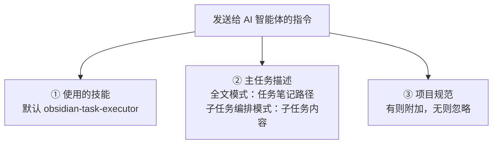

# 如何根据自己的需求去定制 IOTO 的 AI 执行任务功能

> [!info] 写给想让 AI 执行任务功能更贴合自己习惯的你
> 这篇文档讲清楚 IOTO 的「AI 执行任务」功能到底在做什么、它发给 AI 智能体的指令由哪些部分组成，以及你可以用「三种层次」去定制它的行为。

---

## 一句话先记住

> [!tip] 核心结论
> AI 执行任务功能说到底就是「自动帮你给选定的 AI 智能体发一条指令」。想定制它，你只需要决定：是**彻底换掉这个技能本身**、**给所有任务加一套通用补充规则**，还是**只给某个项目加专属规范**——越往下越聚焦、越省 token。

## AI 执行任务功能在做什么

IOTO 的 AI 执行任务功能，本质上是在你运行命令时，**自动给选中的 AI 智能体发送一条指令**。这条指令由三部分组成：



- **使用的技能**：默认是 `obsidian-task-executor`，也就是 IOTO 自带的那套任务执行规则。
- **主任务描述**：内容随模式而变——
  - 全文模式下，传入的是你运行功能时所在任务笔记的路径；
  - 子任务编排模式下，传入的是子任务的具体描述。
- **项目规范**：如果你在对应项目里设了规范就自动附加；没设则忽略。

两种模式下，实际发出的指令长这样：

| 模式 | 发出的指令结构 | 说明 |
| --- | --- | --- |
| 全文模式 | `/obsidian-task-executor 执行这个任务 3-任务/AI学习/任务笔记 当前的项目规范` | 主任务描述 = 任务笔记路径 |
| 子任务编排模式 | `/obsidian-task-executor 你的任务的具体描述 当前的项目规范` | 主任务描述 = 子任务内容 |

> [!note] 项目规范是「可选项」
> 只有当对应项目设置了规范时，指令末尾才会带上「当前的项目规范」；没有设置就直接省略，不影响功能运行。

## 三种定制方式

理解上面的指令结构后，定制就变得很清晰：**你无非是在改变这条指令里「用哪个技能」和「附加哪些规则」**。`obsidian-task-executor` 在运行时会先去你的 IOTO 框架目录找一个叫 `UserExtensions` 的文件夹，把它里面的 Markdown 规则一并加载进来。于是你一共有三种定制层次：

| 方式 | 作用范围 | 彻底程度 / 维护成本 | 怎么做 |
| --- | --- | --- | --- |
| ① 直接替换默认技能 | 全部任务 | 最彻底，但需自己维护 | 改写或重写技能，再到设置里替换 `Skill 名称` |
| ② 在 `UserExtensions` 加补充规则 | 全部任务（通用） | 轻量，无需动技能本体 | 在 IOTO 框架目录建 `UserExtensions` 文件夹并放规则文件 |
| ③ 在项目规范 `_project.md` 加规则 | 仅该项目 | 最聚焦，互不干扰 | 编辑对应项目的 `_project.md` |

> [!tip] 选哪个？
> 只想给所有任务统一加几条约定 → 用 ②；只针对某个项目 → 用 ③；想完全改写执行逻辑 → 才用 ①。绝大多数需求用 ② 或 ③ 就够了。

### 方式一：直接替换默认的技能

你可以在 `obsidian-task-executor` 的基础上改写，也可以从头重写一个技能，然后在 **IOTO Framework Settings** 插件的：

```text
其他 → AI 设置
```

页面里，把 `Skill 名称` 这个设置项，替换成你自己写的技能名字。

> [!warning] 别忘了放对位置
> 想让你的技能正常工作，必须把它放到你所用 AI 智能体要求的目录下。这种自定义最彻底，可以完全按你的想法执行任务，但也需要你自己长期维护。

### 方式二：在 UserExtensions 文件夹下添加补充规则

这种方式最省事：你只需要在 IOTO 框架文件夹下（默认路径是 `0-辅助/IOTO`）新建一个名为 `UserExtensions` 的文件夹，然后在里面根据需求添加你的规则文件（`.md`）即可。

你可以根据自己的需求，添加任意数量的规则文件。

```text
0-辅助/IOTO/UserExtensions/你的规则.md
```

> [!note] 全局通用
> 你在这里设置的规则，会在**所有任务笔记**里都通用。它是在 `obsidian-task-executor` 执行前被自动加载的，不需要你去改技能本体。

### 方式三：在项目规范文件里添加项目专属规则

IOTO 默认读取的项目规范文件，是每个项目目录下的 `_project.md`：

```text
3-任务/某个项目/_project.md
```

你可以手动创建它，也可以让 IOTO 自动帮你建。两种方式任选其一：

- 在 **IOTO 任务中心** 的项目列表里，对任意项目点击**右键**，选择 `编辑项目规范`——IOTO 会自动创建（或打开）对应的 `_project.md`。
- 或者点击 **IOTO 项目中心** 第一列的编辑图标，实现同样的效果。

> [!note] 只对本项目生效
> 写在 `_project.md` 里的规范，只会对它所在的那个项目起作用，不会影响其他项目，是「项目级」的定制。

## 给你的建议

不管用哪种方式定制，都请你**尽可能保证规则精简、明确**：

```text
你写的规范（尤其是 UserExtensions 规则文件和 _project.md 内容）
    ↓ 都会作为提示词的一部分提交给 AI 智能体
    ↓ 占用上下文 → 影响 token 消费
```

最好的做法是：你写完规范后，**让 AI 再帮你过一遍**，把啰嗦、含糊的地方压一压。规则越干净，AI 跑得越准、也越省钱。