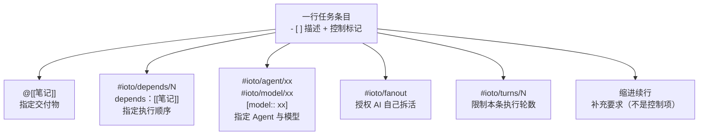

# 如何用 ioto 标签在一行任务里下达控制指令

> [!info] 写给已经开始用「AI 执行任务」、想把任务清单写得更强的你
> 在 IOTO 的子任务编排模式下，**一行 `- [ ]` 就是一条发给 AI 的指令**。除了任务描述本身，你还可以在同一行里用 `@[[…]]`、`#ioto/…`、`[model:: …]` 这些标记，给这条指令加上「交付物是谁、要等谁、用哪个 Agent/模型、允不允许自己拆活、最多跑几轮」等控制信息。
> 读完这篇，你就掌握了 V2.3.1 里所有高阶写法的总入口。

---

## 一句话先记住

> [!tip] 核心结论
> **所有控制标记必须写在 `- [ ]` 的同一行**。
> 写在下方缩进行的文字属于「任务补充描述」，只会被当成补充说明塞进提示词，**不会被当成控制项**——这是 V2.3.1 里最容易踩的坑。

```text
✅ 生效：   - [ ] 整理成文档，放入 @[[目标笔记]] #ioto/fanout/4
❌ 不生效： - [ ] 整理成文档，放入 [[目标笔记]]
                #ioto/fanout/4        ← 这一行只是补充描述
```

---

## 为什么要学这套写法

V2.3.1 新增的高阶能力——任务依赖、单条任务换 Agent / 换模型、条目内部 fan-out、完成验证——**没有任何一个是靠设置页开启的，全部靠你在任务条目里「写出来」**。

也就是说：**会不会写这一行，决定了你能不能用上这些能力。**



---

## 语法对照表

| 写法 | 作用 | 备注 |
| --- | --- | --- |
| `@[[笔记]]` | 标注本条的**交付物** | 支持多个，支持别名 `@[[笔记\|别名]]`；既注入提示词，也是「完成验证」的验收依据 |
| `#ioto/depends/N` | 等本批**第 N 条**做完再跑 | N 从 1 起，按本批待办条目计数 |
| `depends：[[前置笔记]]` | 等**产出这篇笔记**的那一条做完再跑 | 中英文冒号都行；可并列多个（`、` 或 `,` 分隔） |
| `#ioto/agent/<id>` | 本条改用指定 Agent | 大小写不敏感；非法值只告警并回退全局，**不阻断** |
| `#ioto/model/<id>` | 本条改用指定模型 | 模型 ID 含 `.` 会被标签在 `.` 处截断，见下一行 |
| `[model:: <id>]` | 模型覆盖的**推荐写法** | 支持任意字符（含 `.`），优先级高于 `#ioto/model/` |
| `#ioto/fanout` | 授权 AI 在它自己的会话里用子代理并行拆解 | 纯提示词授权，插件不会真的开子代理 |
| `#ioto/fanout/N` | 同上，并建议并行上限 N | 如 `#ioto/fanout/4` |
| `#ioto/turns/<N>` | 本条最多跑 N 轮（**条目级最大轮数**） | 取值 0–1000；`#ioto/turns/0` = 不限制；越界告警并回退全局设置 |
| 条目下方**缩进续行** | 作为「任务补充描述」注入提示词 | 只写补充要求，**不能**写控制标记 |

---

## 一个「全控制项」示例

```markdown
- [ ] 把三篇合并成综述，放入 @[[综述]] depends：[[笔记一]]、[[笔记二]] #ioto/agent/claude [model:: claude-opus-4-5] #ioto/fanout/4 #ioto/turns/120
    只覆盖 A 与 B 两个主题，不要展开 C
    口径沿用 [[背景资料]] 里的说法
```

这一行里同时声明了：

| 片段 | 含义 |
| --- | --- |
| `@[[综述]]` | 交付物是「综述」这篇笔记 |
| `depends：[[笔记一]]、[[笔记二]]` | 要等产出「笔记一」「笔记二」的条目先跑完 |
| `#ioto/agent/claude` | 这一条改用 claude |
| `[model:: claude-opus-4-5]` | 模型用 `claude-opus-4-5`（含 `.`，所以用内联字段） |
| `#ioto/fanout/4` | 授权 AI 自己在会话内并行拆解，建议上限 4 |
| `#ioto/turns/120` | 这一条单独放到 120 轮，不受全局设置限制 |
| 下面两行缩进 | 只是补充要求，不是控制项 |

---

## 三组正反例

### 例一：交付物 vs 参考资料

```markdown
✅ - [ ] 读一下 [[S3-常见坑]]，写一篇评价，放入 @[[S3-常见坑读后感]]
❌ - [ ] 读一下 [[S3-常见坑]]，写一篇评价
```

> [!note] 为什么要显式标注
> 插件不会「猜第一个链接就是交付物」。像「读 [[A]] 然后写一篇」这类条目，第一个链接其实是**参考资料**，猜就会猜错。所以交付物必须由你用 `@` 明确标出。

### 例二：模型 ID 里有点号

```markdown
✅ - [ ] 润色这封信 [model:: gpt-4.1]
❌ - [ ] 润色这封信 #ioto/model/gpt-4.1     ← 标签在 "." 处被截断成 gpt-4
```

> [!warning] 标签能用的字符有限
> Obsidian 标签只认字母、数字、`_` 和 `-`。**空格、`.`、`:`、`[`、`]`、`,` 都会把标签截断**。模型 ID 一律用 `[model:: …]` 最保险。

### 例三：控制标记写错位置

```markdown
✅ - [ ] 汇总本周进展，放入 @[[周报]] #ioto/fanout/3
❌ - [ ] 汇总本周进展，放入 [[周报]]
        @[[周报]]
        #ioto/fanout/3
```

> [!warning] 最易踩的坑
> 解析器只读 `- [ ]` **那一行**的文本。写在缩进行的标记只是普通文字，会被当作补充描述一起塞进提示词，功能完全不生效。

---

## 给单条任务单独限轮数：`#ioto/turns/N`

「最大任务轮数」在设置里只有**一个**全局值，同一次执行的条目共用（见 [[S3-IOTO AI执行任务的设置项速查]]）。想让某一条不一样，不用改完设置再改回来，直接在条目上写标签：

```markdown
- [ ] #ioto/turns/20 改一句文案，20 轮足够，放入 @[[落地页文案]]
- [ ] #ioto/turns/200 重构这个模块，放开轮数，放入 @[[重构记录]]
- [ ] #ioto/turns/0 这条不限制轮数，跑到做完为止
```

取值怎么定（全局默认 90）：

| 场景 | 建议写法 |
| --- | --- |
| 改文案、改标题、搬一段内容 | `#ioto/turns/20` ~ `#ioto/turns/30` |
| 写一篇普通笔记 | `#ioto/turns/60` |
| 多篇合并、重构、带 fan-out 的重活 | `#ioto/turns/120` 以上 |
| 完全不限制 | `#ioto/turns/0` |

> [!warning] turns 和 fanout 是两回事，别写混
> `#ioto/fanout/4` 管的是 AI 会话**内部**最多开几个子代理；`#ioto/turns/N` 管的是整个进程**最多跑多少轮**工具调用。两者互不相关，可以同时写在同一条上。想要「30 轮」就写 `#ioto/turns/30`，写成 `#ioto/fanout/30` 得到的是「30 个并行」，完全不是一回事。

> [!warning] 只对部分 Agent 生效
> 只有 **claude / hermes / codebuddy / qoder / qodercn** 接受 `--max-turns`。条目上写了 `#ioto/turns/N`、实际跑的却是 codex、opencode、mimo、dsh、pi、omp 时，控制台会提示「不支持 --max-turns，本条的 #ioto/turns/N 标签被忽略」并回退全局设置，**不会阻断**整批任务。

> [!note] 三个容易被忽略的细节
> 1. **`0` 表示不限制**，不是「回退全局」——`#ioto/turns/0` 会直接省略 `--max-turns` 参数。
> 2. **轮数按每次尝试计算**：条目失败重试会另起一个进程，上限不累计。
> 3. **越界不自动截断**：`#ioto/turns/1001` 会告警并回退全局设置，不会被悄悄改成 1000——写错值要能被你看见。

---

## 旧写法还能用吗

能，但**不建议再用**。旧写法是 HTML 注释，现在全部仍然兼容，只是控制台会提示你改用标签：

| 旧写法（兼容，会提示弃用） | 新写法（推荐） |
| --- | --- |
| `<!--depends: 1,3-->` | `#ioto/depends/1` `#ioto/depends/3` 或 `depends：[[…]]` |
| `<!--agent: claude-->` | `#ioto/agent/claude` |
| `<!--model: gpt-4.1-->` | `[model:: gpt-4.1]` |
| `<!--fanout-->` / `<!--fanout: 4-->` | `#ioto/fanout` / `#ioto/fanout/4` |

> [!tip] 新文件直接用标签
> 标签写法更短、能被 Obsidian 高亮、不会因为写错格式而整段失效。历史文件不急着改，等哪天顺手再说。轮数没有旧写法——`#ioto/turns/N` 是纯新增能力，HTML 注释里从来就没有过 turns。

---

## 写错了吗？怎么自查

标签写错不会阻断执行，只会**静默失效或在控制台告警**，所以很容易「以为写了其实没生效」。自查三步：

1. **看控制台**：无效标签会打出「忽略无效标签 #…（… 须为 …）」这类提示；
2. **跑一次预演**：用「预演 AI 任务（Dry Run）」看每条渲染出来的 `Prompt` / `Agent` / `模型` / `最大轮数` / `依赖` 行对不对——只有写了 `#ioto/turns/N` 且生效的条目才会多出「最大轮数」一行（见 [[S3-如何在真正执行前先预演一遍AI任务]]）；
3. **只放行一个标记**：一次加一个控制标记，确认生效后再叠加。

---

## 嫌手敲标签麻烦？用「条目控制面板」一键生成

如果你觉得手动输入 `@[[…]]`、`#ioto/…`、`[model:: …]` 这些标签还是有点麻烦，从 IOTO 的 **2.3.3** 版本开始，可以用可视化的方式来生成同一行的控制语句。

- 命令面板里执行 **`编辑条目控制`**；
- 或者直接用快捷键 **`Alt+I`**（macOS 上为 **`Option+I`**）。

两种方式都会打开**条目控制面板**，你只用鼠标点选要的控制项（交付物、依赖、Agent、模型、fanout、轮数……），面板就会自动把对应的标签控制语句拼好、写进当前条目那一行——不用自己记语法、也不用担心把标记写错位置。


> [!tip] 面板只是帮你「写标签」，不是另一套语法
> 面板生成的仍然是这篇文档里讲的同一套标签语法——它只是把「手敲」换成「点选」，最终写进条目的还是 `@[[…]]`、`#ioto/…`、`[model:: …]` 这些标记。所以前面所有语法规则、位置要求（**必须写在同一行**）、自查方法，对面板生成的条目**同样适用**。
>
> 想知道面板上每个按钮对应的标签细节，见 [[使用条目控制面板快速添加条目控制]]。

---

## 延伸阅读

- [[S3-如何让AI按你规定的先后顺序执行任务]] — `depends` 的两种写法与依赖调度的完整规则
- [[S3-如何在真正执行前先预演一遍AI任务]] — 零成本验证你的标签写得对不对
- [[S3-IOTO AI执行任务的几个使用技巧]] — `@` 标注交付物、失败重试等基础技巧
- [[S3-IOTO AI执行任务的设置项速查]] — 全局「最大任务轮数」的取值建议，决定了没写 `#ioto/turns/N` 的条目跑多少轮
- [[S3-如何让AI自己在一个任务里并行拆解重活]] — `#ioto/fanout/N` 的完整规则，以及它和轮数为什么是两回事
- [[S3-IOTO中AI执行任务功能的三种不同模式]] — 哪些写法依赖「子任务编排模式」才生效
- [[S3-使用IOTO的AI执行任务功能时常见的坑有哪些]] — 控制标记不生效时的排查清单