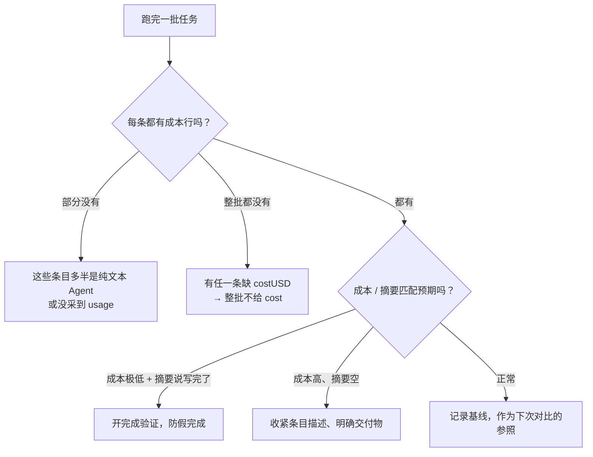

# 如何看懂 AI 执行任务的成本与结果摘要

> [!info] 写给跑完一批任务只剩一个「打没打勾」信号的你
> 以前一批任务跑完，你能看到的只有清单上多出来的几个勾：每条到底说了什么结论、这次一共烧了多少 token，**全都要靠回忆和猜**。
> V2.3.1 在每条任务收尾时往控制台追加了两块内容：**结果摘要**（它说了什么）和**成本**（这次花了多少）。读完这篇你就知道在哪里看、每一行什么意思、什么时候会没有。

---

## 一句话先记住

> [!tip] 核心结论
> 每条任务跑完，Console 里会依次多出两块：
> **「── 结果摘要 · 条目 N ──」**（AI 最后结论的首尾各 2 段、每段 200 字）和 **「成本 · 条目 N · in/out/total tokens · $」**；
> 整批结束再给一行**整批累计**。两者都是**零 token 成本**的纯展示，不需要开任何开关。

---

## 去哪里看

**Console 视图**。跑「执行 AI 任务」时插件会自动打开；没看到就用命令面板搜「Console / 控制台」。

```text
── 结果摘要 · 条目 2 ──
（AI 这条任务最后一次尝试的最终回复：开头 2 段 + 结尾 2 段，每段约 200 字）

成本 · 条目 2 · in 12,480 / out 3,215 / total 15,695 tokens · $0.0412
```

---

## 上半块：结果摘要

| 项目 | 说明 |
| --- | --- |
| 长什么样 | `── 结果摘要 · 条目 N ──` 打头，下面是正文 |
| 内容从哪来 | 该条目**最后一次尝试**的最终回复（重试过就是重试那次的） |
| 截取规则 | **首尾各 2 段、每段 200 字**——保留开场结论与收尾交付说明，砍掉中间的探索过程 |
| 成本 | **零 token**，纯展示，不加设置项 |
| 额外作用 | 同时回写到 `.ioto/sessions`，让下一次的「**上次进展**」终于有内容可回喂 |


> [!note] 为什么只给首尾、不给全文
> 中间部分大多是「读了哪个文件、试了哪种写法」这类过程信息，对回顾价值低；首尾才是「结论」和「交付了什么」。想看全过程，Console 里更上面的原始输出没有截断。

> [!tip] 并行模式下不会串味
> 并行编排时每个 worker 用**条目级局部采集器**，各采各的。10 条并发跑，摘要也不会张冠李戴。

---

## 下半块：成本

| 项目 | 说明 |
| --- | --- |
| 长什么样 | `成本 · 条目 N · in 12,480 / out 3,215 / total 15,695 tokens · $0.0412` |
| 数据从哪来 | 从 stream-json 顺带提取 token usage，与解析 session id **共用同一份预解析对象，零额外解析开销** |
| 累计 | 整批结束再输出一行**整批累计** |
| 落盘 | usage 同时写进 `.ioto/sessions` 的 turn 记录，事后可查 |
| 状态栏 | **空闲时**显示最近一次 run 的累计成本，需开 `成本状态栏`（`aiShowCostStatusBar`，**默认关**） |

三个数字的含义：

```text
in    = 输入 token（提示词 + 上下文，含注入的目标、上次进展、前向传递）
out   = 输出 token（AI 生成的内容）
total = in + out
$     = 本次折算费用（按当前 Agent / 模型费率）
```

> [!note] 为什么状态栏默认关
> 状态栏已经塞了模式切换器、任务进度等好几项，再加一个容易挤爆。想要的话自己去 `其他 → AI` 打开「**成本状态栏**」。

---

## 什么时候会看不到

这两块都是**能采到就打、采不到就静默跳过**，不会报错。

| 情况 | 表现 |
| --- | --- |
| Agent 是**纯文本**输出（非 stream-json） | 成本行**整行跳过**；结果摘要仍可能正常 |
| 没采集到 usage 字段 | 成本行**整行跳过** |
| **任意一条**缺 `costUSD` | **整批都不给 cost**——宁可不给，也不让「部分求和」误导你 |
| 条目失败 / 被依赖阻断 | 没有正常收尾，自然没有摘要与成本 |
| 用的是 dry-run 预演 | 不启动 AI，两块都没有（预演也不产生任何成本） |

> [!warning] 整批没给 cost 时别慌
> 这通常只是**某一条**没采到费用字段，而不是功能坏了。逐条看：哪些条目有成本行、哪些没有，缺的那条多半是纯文本 Agent。

---

## 拿到这两个信号之后，能判断什么

| 你看到的 | 大概率意味着 | 可以做的事 |
| --- | --- | --- |
| total 很高、out 很低 | 大量上下文注入 + AI 没怎么产出 | 检查是不是前向传递 / 目标章节太长，或条目描述太啰嗦 |
| out 很高、结果摘要没干货 | AI 在长篇探索却没收敛 | 把条目的交付物用 `@[[…]]` 标清楚，约束更具体 |
| 成本明显低于同类任务 | 可能根本没干活 | 打开「完成验证」，见 [[S3-如何让AI的「做完了」真的算数]] |
| 摘要里说「已写入 X」但 X 不存在 | 典型假完成 | 同上，开完成验证 |
| 某条成本是其他条的十倍 | 这条是重活 | 考虑给它单独配便宜模型，或拆成多条目 |



> [!tip] 给自己建一条基线
> 同类任务跑过一两次后，正常的 token 区间你就有数了。之后某条突然翻倍或腰斩，一眼就能看出异常——这是成本账本最实用的用法。

---

## 常见疑问

**Q：结果摘要会喂回给 AI 吗？**
会，但不是同一批内。摘要会写进 `keyOutputs`，下一次执行时作为「**上次进展**」块回喂（默认 TTL 7 天）。同一批次内跨条目的共享走的是[[S3-如何让后面的任务看到前面任务的成果|结果前向传递]]，两者不是一回事。

**Q：担心摘要把敏感内容写进 session 文件？**
摘要确实会落盘到 `.ioto/sessions`。如果 vault 里的任务涉及敏感内容，注意这个目录的同步与备份范围。

**Q：能不能关掉这两块输出？**
结果摘要没有开关（默认输出，零成本）。成本行的**状态栏显示**默认关闭，但每条的 `成本 · 条目 N` 行随执行输出，没有单独开关。

**Q：为什么我看到的 `$` 和官方账单对不上？**
插件是按各 Agent 上报的 usage 字段折算的，字段口径由 Agent 决定，仅作**相对参考**，不作为计费依据。

---

## 延伸阅读

- [[S3-如何让AI的「做完了」真的算数]] — 用完成验证识别「成本极低却说做完了」的假完成
- [[S3-如何在真正执行前先预演一遍AI任务]] — 执行前零成本试错，不产生任何 token 花费
- [[S3-如何让后面的任务看到前面任务的成果]] — 前向传递会推高 `in` token，这是成本的来源之一
- [[S3-IOTO中AI执行任务功能的三种不同模式]] — 并行 / 串行 / 全文模式对成本结构的影响