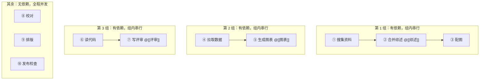

# 如何让 AI 按你规定的先后顺序执行任务

> [!info] 写给想说「先做 A，再做 B」的你
> 以前你想表达顺序，只有一个办法：**把整批任务切成串行模式**（并行度设为 1），代价是**所有任务都变慢**。
> V2.3.1 加了**任务依赖**：只要在条目上声明「我依赖谁」，IOTO 就会让**有依赖的那几条**按顺序跑，**其余照常并行**。读完这篇你就知道怎么写、出错会怎样、和串行模式该怎么选。

---

## 一句话先记住

> [!tip] 核心结论
> 在条目上加 `#ioto/depends/N`（按序号）或 `depends：[[前置笔记]]`（按交付物），**依赖与并行度是正交的**——受约束的那几条串行化，没被约束的照常并发。
> 开关是 `尊重子任务依赖`，**默认开启**，也就是说你只要写对标记，立刻生效。

---

## 两种写法

### 写法一：按序号 `#ioto/depends/N`

```markdown
- [ ] 搜集三篇关于 IOTO 的资料
- [ ] 把三篇合并成综述，放入 @[[IOTO综述]] #ioto/depends/1
- [ ] 给综述配一张图 #ioto/depends/2
```

- `N` 从 **1** 起，按**本批待办条目**从上往下数（已完成的不计入）；
- 依赖多条就写多个标签：`#ioto/depends/1 #ioto/depends/3`。

> [!warning] 序号是「本批待办」的序号
> 已经打勾的条目不参与计数。如果你习惯跑完一批再补几条，序号会跟着变——这种情况下更建议用写法二。

### 写法二：按交付物 `depends：[[前置笔记]]`（推荐）

```markdown
- [ ] 整理 A 主题，放入 @[[笔记一]]
- [ ] 整理 B 主题，放入 @[[笔记二]]
- [ ] 把三篇合并成综述，放入 @[[IOTO综述]] depends：[[笔记一]]、[[笔记二]]
```

- 中英文冒号都认：`depends：` 与 `depends:` 都可以；
- 可并列多个，用 `、` 或 `,` 分隔；
- 匹配规则：去找**哪一条用 `@` 标注了这个交付物**，就以那一条为前置。

> [!warning] 前置条目必须自己标注了 `@`
> 按交付物匹配的前提是：产出它的那条任务**也写了 `@[[笔记一]]`**。如果前置条目没写 `@`，插件找不到产出者，只会**告警并忽略这条依赖**，不会报错。

---

## 关键卖点：依赖与并行度正交

假设并行度是 3，任务清单里有 10 条，其中 3 组有依赖：



| | 串行模式（老办法） | 依赖调度（新办法） |
| --- | --- | --- |
| 没依赖的任务 | 也被迫排队 | 照常并发 |
| 有依赖的任务 | 按顺序跑 | 按顺序跑 |
| 一批 10 条、3 组依赖 | 全部 10 条排成一队 | 组内串行、组间并行 |

> [!tip] 一句话判断
> **只有「后面的要用前面的产物」才需要顺序**，其余任务没有理由陪着一起等。

---

## 前置失败会怎样：后继直接跳过

依赖不只是排序，还是**熔断**：前置失败时，它的所有后继会被标记为 `blocked` **直接跳过**，不浪费轮次。

```text
⊘ 子任务 3 被跳过（依赖的子任务 2 失败）
[系统] 2 个子任务因前置依赖失败被跳过
```

> [!note] 连带好处
> 被跳过的条目不会进入「结果前向传递」的摘要，后面的任务不会误引用一个根本不存在的笔记。

---

## 写错了会不会炸：四道兜底

依赖写错**不会阻断整批执行**，最坏情况只是「依赖没生效」：

| 情况 | 表现 | 结果 |
| --- | --- | --- |
| 序号越界（如本批只有 3 条却写了 `#ioto/depends/9`） | 控制台告警 | 忽略该依赖，该条照常跑 |
| `depends：[[X]]` 找不到产出 X 的条目 | 控制台告警 | 忽略该依赖，该条照常跑 |
| 条目依赖自己 | 控制台告警 | 忽略，不自锁 |
| **依赖成环**（A 等 B、B 又等 A） | `⛔ 检测到任务依赖成环（条目 …）；已忽略依赖调度，按文件顺序执行` | 降级为「按文件顺序执行」，**绝不死锁** |

> [!warning] 成环看起来像「依赖没生效」
> 因为它静默降级、不报错。如果你的顺序约束突然不起作用了，先去控制台确认有没有这条 `⛔` 提示。

> [!note] 只有一条待办时不调度
> 批次里只有一条任务时没有可调度的前置，插件会告警「单条批次中没有可调度的前置条目；仍将直接执行」，然后照常执行。

---

## 两个开关要不要动

在 `IOTO Framework Settings → 其他 → AI` 下：

```text
IOTO Framework Settings
  └─ 其他
       └─ AI
            ├─ 尊重子任务依赖     ← 默认「开」，一般不用动
            └─ 缩进即依赖         ← 默认「关」，建议保持关闭
```

| 开关 | 默认 | 说明 | 建议 |
| --- | --- | --- | --- |
| 尊重子任务依赖 | 开 | 尊重条目里显式声明的 `#ioto/depends/N` 与 `depends：[[…]]` | 保持开启；关掉则所有依赖被忽略 |
| 缩进即依赖 | 关 | 把「缩进更深」的条目视为依赖最近一条缩进更浅的条目 | **保持关闭**。历史文件里偶发的缩进会莫名其妙改变执行顺序 |

---

## 依赖调度还是串行模式？

| 你的情况 | 选哪个 |
| --- | --- |
| 只有少数几条有先后顺序 | ✅ **依赖调度**（保持并行度，只让有依赖的排队） |
| 几乎每一条都要用前一条的成果 | 串行模式更省事（并行度设为 1，且前向传递上限放大到 20 条） |
| 想让整批共享上下文、不只是共享顺序 | 串行模式（见 [[S3-IOTO中AI执行任务功能的三种不同模式]]） |
| 全文模式 / 任务没拆成条目 | 两者都不适用，先切到子任务编排模式 |

> [!tip] 两者可以叠加
> 串行模式下依赖依然生效，只是意义不大——反正都一个一个跑。

---

## 写完之后：先预演一次

依赖写对没写对，不能靠肉眼。跑一次「预演 AI 任务（Dry Run）」，你会看到：

- 条目按**拓扑序**渲染（而不是纯文件顺序）；
- 每条下面多出一行 `依赖: …`。

顺序和你预期不一致，就回去改标记，零成本。详见 [[S3-如何在真正执行前先预演一遍AI任务]]。

---

## 延伸阅读

- [[S3-如何用ioto标签在一行任务里下达控制指令]] — `depends` 只是标签语法的一种，先看这篇了解通用规则
- [[S3-如何在真正执行前先预演一遍AI任务]] — 验证依赖有没有被正确解析
- [[S3-IOTO中AI执行任务功能的三种不同模式]] — 并行 / 串行 / 全文模式的差异与切换
- [[S3-IOTO AI执行任务的几个使用技巧]] — 用 `@` 标注交付物（按交付物声明依赖的前提）