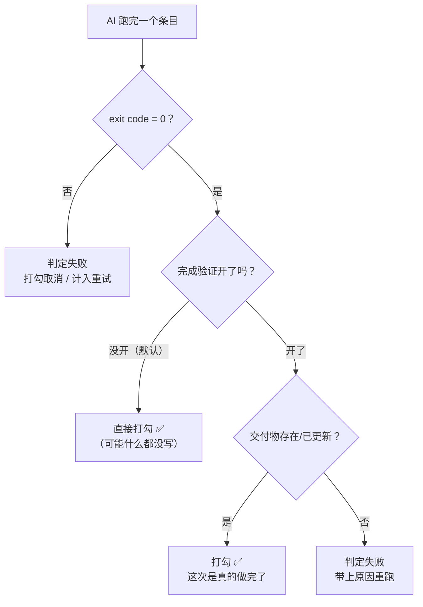
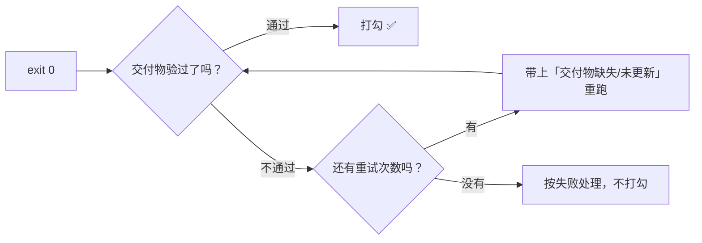

# 如何让 AI 的「做完了」真的算数

> [!info] 写给被「AI 说做完了，但笔记根本没动」坑过的你
> 默认规则下，一个条目只要 AI 进程正常退出（exit 0），IOTO 就给它打勾——至于它到底有没有建笔记、有没有改文件，插件是不管的。所以「AI 说做完了」和「活真的干了」之间，隔着一道**没人把守的门**。
> V2.3.1 加了**完成验证**：把打勾门禁从「AI 说做完了」升级为「交付物**真的存在 / 真的更新了**」。读完这篇你就知道它验什么、依据从哪来、失败了会怎样、两个开关该怎么配。

---

## 一句话先记住

> [!tip] 核心结论
> 在 `其他 → AI` 里打开「**完成验证：交付物存在性校验**」，打勾条件就从 `exit 0` 变成 `exit 0 **且** 交付物经校验存在 / 已更新`。
> 验收依据优先取你在条目里写的 `@[[…]]`——**所以 `@` 标注不只是「提示 AI 往哪写」，它同时是验收的凭据**。
> 这个开关**默认是关的**，想要就得自己去开。

---

## 问题出在哪：exit 0 不等于做完了

```text
AI：我已经把内容整理好，写入了《IOTO综述》。
插件：进程正常退出（exit 0）→ 打勾 ✅
现实：vault 里根本没有《IOTO综述》这篇笔记
```

AI 不是在撒谎，它只是**以为自己做了**（路径写错、工具调用失败、中途换了个文件名……）。而插件过去唯一的判据是退出码，所以这类「假完成」一律被放行。



---

## 它到底验什么

两步，都是纯文件层面的事实核查：

| 时机 | 动作 |
| --- | --- |
| 条目**执行前** | 给验收链接指向的笔记拍一张 **mtime（最后修改时间）快照** |
| 条目 `exit 0` **之后** | 再看一眼：笔记存在吗？mtime 前进了吗？（取决于开关，见下） |

> [!note] 它不检查质量
> 完成验证只回答「文件在不在、有没有被改过」，**不回答「写得对不对、好不好」**。它消灭的是「根本没写」和「读到了但没改」，不是「写得烂」。

---

## 验收依据从哪来：三级回退

插件要验，得先知道「该验哪个笔记」。取值顺序如下：

| 优先级 | 依据 | 说明 |
| --- | --- | --- |
| 1 | 条目里的 `@[[笔记]]` | **推荐**。你显式标注的交付物，多个则都要满足 |
| 2 | 条目里**第一个** wikilink | 没写 `@` 时的兜底；可能误判（第一个链接也许是参考资料） |
| 3 | 都没有 | **跳过验证，视为通过**（不会误杀没有交付物的条目，比如「帮我想想思路」） |

```markdown
✅ 明确：  - [ ] 把三篇合并成综述，放入 @[[IOTO综述]]
⚠️ 靠猜：  - [ ] 把三篇合并成综述 [[IOTO综述]]        ← 回退到「第一个 wikilink」
⭕ 不验：  - [ ] 帮我想想这个专题还能怎么拆            ← 没有链接，直接跳过验证
```

> [!warning] 靠猜有风险
> 像「读一下 [[S3-常见坑]]，写一篇评价」这种条目，第一个 wikilink 其实是**参考资料**而不是交付物，回退规则会验错对象。所以**凡是期望 AI 产出笔记的条目，都请老老实实写 `@[[…]]`**。

---

## 两个开关：总闸与更严一档

在 `IOTO Framework Settings → 其他 → AI` 下：

```text
IOTO Framework Settings
  └─ 其他
       └─ AI
            ├─ 完成验证：交付物存在性校验   ← 总闸，默认「关」
            └─ 完成验证：还要求文件更新时间前进 ← 更严一档，默认「关」
```

| 开关 | 默认 | 作用 | 什么时候开 |
| --- | --- | --- | --- |
| **交付物存在性校验**（`aiVerifyDeliverables`） | **关** | 总闸。关掉则完全不验证 | **建议开**。只要你的任务是「产出/更新笔记」，就该开 |
| **还要求文件更新时间前进**（`aiVerifyRequireMtime`） | 关 | 对**原本就存在**的笔记，还要求 mtime 前进 | 任务大多是「**更新**已有笔记」时开，能过滤「打开看了一眼就报完成」 |

```text
只开总闸：              笔记不存在 → 失败      ｜ 笔记存在 → 通过（哪怕没改动）
总闸 + mtime：          笔记不存在 → 失败      ｜ 笔记存在但没改 → 失败
```

> [!tip] 怎么选
> - 任务以**新建**笔记为主 → 只开总闸就够，误判极少；
> - 任务以**改写/补充**已有笔记为主 → 两个都开，不然「读到了但没改」会被放过；
> - 混合型 → 两个都开。多一次 mtime 比对，几乎没有额外成本。

---

## 验证失败会怎样：带上原因重跑

验证失败**不会直接判死刑**，而是把失败原因回喂给 AI，让它再试一次：

```text
⚠️ 子任务 2 完成验证失败：交付物「IOTO综述」不存在 / 未更新
（该原因并入重试预算，重跑）
```

| 环节 | 行为 |
| --- | --- |
| 失败原因 | 明确写清「交付物缺失」还是「未更新」 |
| 重试 | 并入**失败重试**的预算里重跑，**不额外烧新预算** |
| 预算 | 重试开关 `失败自动重试`（`aiRetryFailedSubtasks`，默认关）+ `aiRetryMaxAttempts`（默认 1 次） |
| 最终仍失败 | 不打勾，条目按失败处理 |



> [!warning] 不重试的两种情况
> 沿用失败重试的既有规则：**用户主动停止**（killed）与 **spawn 级错误**（exit -1，比如 CLI 根本没装）**不重试**。这两种情况下验证结果无从谈起。
> 也就是说，**想让「验证失败 → 自动重跑」这条链路跑通，你得同时打开「失败自动重试」**；只开验证不开重试，验证失败就只是不打勾而已。

> [!note] 连带好处：不会污染后面的任务
> 验证失败的条目，在[[S3-如何让后面的任务看到前面任务的成果|结果前向传递]]里会被映射为**失败态**。后续条目因此不会拿到一个「说完成了但其实不存在」的链接去引用。

---

## 推荐配方

| 你的情况 | 交付物存在性校验 | 要求 mtime 前进 | 失败自动重试 |
| --- | --- | --- | --- |
| 刚上手，只想防「根本没建笔记」 | ✅ 开 | 关 | 建议开（1 次） |
| 经常让 AI 补充/改写已有笔记 | ✅ 开 | ✅ 开 | 建议开（1 次） |
| 条目多是纯思考、不产出笔记 | 可不开 | 关 | 随意 |
| 想省轮次和费用 | 关 | 关 | 关（回到 V2.3.0 行为） |

---

## 排查：开了验证但还是打勾了

按顺序自查：

1. **条目里有没有 `@[[…]]`？** 没有就走「第一个 wikilink」，验错对象；连链接都没有则**直接跳过验证**；
2. **笔记名对不对得上？** 别名写法 `@[[真实笔记\|显示名]]` 里，验收取的是**真实笔记**那一段；
3. **重跑时有没有真的改动？** 开了 mtime 那一档，内容没变就判失败——这是对的；
4. **控制台有没有验证提示？** 验证未通过会打出 `⚠️ …完成验证失败：…`；一行都没有，说明总闸没开或该条被跳过了；
5. **跑一次预演**：确认 `@` 被正确解析成了「交付物」，见 [[S3-如何在真正执行前先预演一遍AI任务]]。

---

## 它管不了什么

| 不在范围内 | 说明 |
| --- | --- |
| 内容质量 | 只验「有没有」，不验「好不好」 |
| 非笔记类产物 | 让 AI 改了代码、发了请求，但条目只链了笔记 → 验的是笔记 |
| 无交付物的条目 | 没有链接就跳过验证，视为通过 |
| 部分完成 | 标注了 3 个交付物只写了 2 个 → 按失败处理，但如果它写了 2 个就够，请只标那 2 个 |

---

## 延伸阅读

- [[S3-如何用ioto标签在一行任务里下达控制指令]] — `@[[…]]` 怎么写；它是完成验证的验收依据
- [[S3-IOTO AI执行任务的几个使用技巧]] — 失败重试 + 原因回喂的基础机制
- [[S3-如何在真正执行前先预演一遍AI任务]] — 执行前先确认 `@` 标注有没有被识别
- [[S3-如何让后面的任务看到前面任务的成果]] — 验证失败的条目如何不污染后续任务
- [[S3-使用IOTO的AI执行任务功能时常见的坑有哪些]] — 其他「看起来生效了其实没生效」的场景