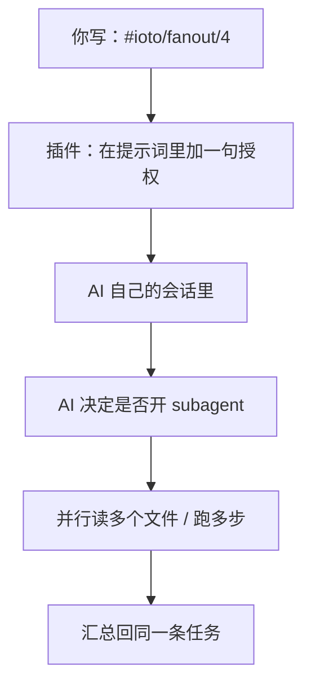

# 如何让 AI 自己在一个任务里并行拆解重活

> [!info] 写给经常写「读十个文件，再写一篇综述」这类重活任务的你
> 有些任务本身就很重：要读一堆文件、查一堆资料，再综合成一篇。你不必把它手动拆成一堆条目——可以让 AI 在**它自己的会话里**开子代理并行拆解。
> 读完这篇，你就知道怎么授权、怎么设上限，以及哪条红线不能踩。

---

## 一句话先记住

> [!tip] 核心结论
> 在条目同一行写 `#ioto/fanout`（或 `#ioto/fanout/N`），就是**授权 AI 在它自己的会话里用子代理 / workflow 并行拆解**这条任务里的重活。
> 注意：这**只是给 AI 的一句话授权**，插件并不会真的替你开子代理——真正拆不拆、怎么拆，由 AI 自己决定。

---

## 它「不是」什么（先划清边界）

最容易误解的一点：**`#ioto/fanout` 不会让插件真的 spawn 子代理。**

它是**纯 prompt 增强**：插件在提示词里加一句「你可以用多代理 / 子代理并行拆解」，至于 AI 是否启用、怎么启用 subagent / workflow，取决于 AI 自身的能力（比如 Claude Code 的 subagent、Codex 的并行工具调用）。



> [!note] 和「拆成多条条目」的区别
> 把重活拆成多条 `- [ ]` 是**插件层**的并行（每条独立进程）。`#ioto/fanout` 是**会话内**的并行，由 AI 自己调度，更灵活——比如「读十个文件再写一篇」这种，让 AI 自己开 subagent 比硬拆条目自然得多。

---

## 三级开关（从强到弱）

fan-out 有三级开关，越靠前优先级越高：

| 级别 | 写法 / 设置 | 作用 |
| --- | --- | --- |
| 条目级（最强） | `- [ ] … #ioto/fanout` 或 `#ioto/fanout/4` | 这条任务强制授权 |
| 文件级 | 任务文件 frontmatter `ItemInternalFanout: true` | 整个文件默认授权 |
| 全局级（最弱） | 设置 `aiItemInternalFanout`（默认**关**） | 全 vault 默认授权 |

```markdown
- [ ] 读这 10 个文件，综合成一篇综述，放入 @[[综述]] #ioto/fanout/4
```

`#ioto/fanout/4` 里的 `/4` 是**建议的并行上限**（不是硬限制），给 AI 一个量级参考，避免它一口气开太多。

---

## ⚠️ 一条红线：别让多个子代理改写同一篇笔记

> [!warning] 最重要的警告
> 子代理共享同一个 vault。如果**多个子代理同时改写同一篇笔记**，会产生**写入冲突**，后写的覆盖先写的，结果不可预期。
>
> 安全的做法是：让不同子代理各写各的**不同笔记**，最后由主任务汇总；或者只读不写、把产出交回主会话落盘。

---

## 兼容性：有些 Agent 用不了

fan-out 依赖 AI 自身的「会话内子代理」能力。对**不支持**该能力的 Agent，插件不会报错，只会发一条软提示（大概率不生效），**不阻断**执行：

| 不支持会话内子代理的 Agent | 结果 |
| --- | --- |
| mimo / hermes / dsh / pi / omp | 只收到软提示，fan-out 大概率不生效 |

如果你用的是上面这些 Agent，fan-out 写了也白写——老老实实把重活拆成多条条目更靠谱。

---

## 延伸阅读

- [[S3-如何为单条任务指定不同的Agent和模型]] — 给这条 fan-out 任务指定合适的模型
- [[S3-如何用ioto标签在一行任务里下达控制指令]] — `#ioto/fanout` 在语法对照表里的位置
- [[S3-如何让单条任务跨多次执行保持记忆]] — 重活迭代多次时，让会话接着上次的状态跑
- [[S3-使用IOTO的AI执行任务功能时常见的坑有哪些]] — fan-out 不生效的排查清单