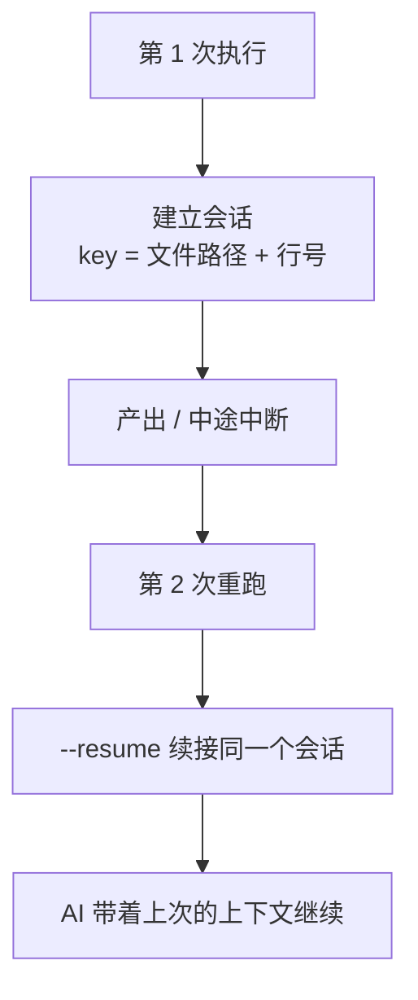

# 如何让单条任务跨多次执行保持记忆

> [!info] 写给要写长文、调代码这类「会反复跑好几次」任务的你
> 写长文、调代码是典型的迭代型任务：第一次跑搭个骨架，第二次跑补内容，第三次跑改 bug……但默认每次重跑都是**全新会话，从零开始**，前面探索过的上下文全丢了，白白重复。
> 读完这篇，你就知道怎么让单条任务「记住」自己上一次跑到哪。

---

## 一句话先记住

> [!tip] 核心结论
> 开启「条目级会话续接」后，每条任务会以**「文件路径 + 行号」为 key** 维护一个**属于它自己的 CLI 会话**。重跑 / 失败重试时，用 `--resume` **续接它自己的会话**，而不是重开一个空白会话。
> 开启方式二选一：设置 `aiItemSessionContinuation`，或任务文件 frontmatter 写 `ItemSessionContinuation: true`。

---

## 它解决什么

默认情况下，每次执行（无论首次还是重跑）都是全新会话。对迭代型任务来说，这很浪费：

- 写长文：好不容易让 AI 摸清了文章结构，重跑又要重新交代一遍；
- 调代码：AI 已经定位到 bug 附近，重跑又从「读仓库」开始。

会话续接让**同一条任务**跨多次执行共享上下文，像人一样「接着上次的地方继续干」。



---

## 怎么开启

两种方式，二选一。优先级：frontmatter 覆盖全局设置。

| 方式 | 怎么写 |
| --- | --- |
| 全局设置（所有任务文件生效） | `IOTO Framework Settings` 里打开 `aiItemSessionContinuation`（默认**关**） |
| 单文件覆盖（只对这个文件生效） | 任务文件 frontmatter 加 `ItemSessionContinuation: true` |

```yaml
---
Project: ["OBIOTO"]
ItemSessionContinuation: true
---
```

> [!note] 默认关是有意的
> 会话续接会保留跨 run 的上下文，多数一次性任务并不需要，开着反而可能让 AI「被旧上下文带偏」。所以默认关，**只在迭代型任务上显式打开**最划算。

---

## 安全阀：条目改了就重建

你不用怕「续接到一个已经过时的旧上下文」。插件有 sanity check：

- **条目文本一旦被修改**，它对应的会话 key 会自动**销毁重建**——下次执行是干净的新会话，不会续接到被你改过的旧上下文。

也就是说，只要你改了任务描述，续接自动失效，安全兜底已经帮你做好了。

---

## 它和「串行带记忆」不是一回事

IOTO 里有好几种「记忆」，容易混，这里划清：

| 记忆类型            | 跨越什么            | 机制                         |
| --------------- | --------------- | -------------------------- |
| **条目级会话续接**（本文） | 同一条目**跨多次 run** | `--resume` 续接它自己的 CLI 会话   |
| 串行带记忆           | 同一批次**跨条目**     | 前向传递上限放到 20，整批文本摘要共享       |
| 历史 turn 回喂      | 跨**轮次**         | 读 `.ioto/sessions` 的「上次进展」 |

> [!note] 一句话区分
> - 想让**同一条任务**下次重跑接着干 → 用本文的会话续接；
> - 想让**同一批里后面的任务**看到前面任务的成果 → 用串行模式 / 前向传递（见 [[S3-如何让后面的任务看到前面任务的成果]]）。

---

## 已知例外

有个 Agent 用不了会话续接：**dsh**。原因是它无法从 stdout 提取 session id，插件会自动把它排除在续接之外——你不必手动处理。

---

## 延伸阅读

- [[S3-如何让后面的任务看到前面任务的成果]] — 跨条目 / 跨轮次的另外两种「记忆」与区别
- [[S3-IOTO中AI执行任务功能的三种不同模式]] — 串行模式本身的「整批共享」记忆
- [[S3-如何让AI自己在一个任务里并行拆解重活]] — 重活迭代时配合会话续接更顺
- [[S3-如何用ioto标签在一行任务里下达控制指令]] — 其他条目控制标记的总入口