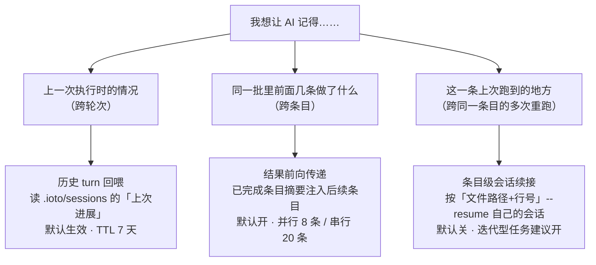
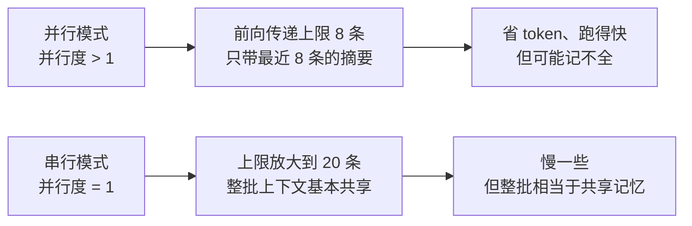

# 如何让后面的任务看到前面任务的成果

> [!info] 写给抱怨「每条任务都是失忆的新会话」的你
> 并行模式下，IOTO 会给**每个条目开一个全新的 AI 进程**。好处是快，坏处是条目之间互不知情——第 5 条根本不知道第 1～4 条干了什么，于是重复探索、口径打架、引用到还没生成的笔记。
> V2.3.1 提供了**三条不同层次的记忆通道**，把「前面的成果」送到后面的任务面前。读完这篇你就知道它们各自覆盖什么范围、上限是多少、该用哪一条。

---

## 一句话先记住

> [!tip] 核心结论
> 记忆分三层，按**作用范围**区分：
> **跨轮次**（上次跑的 → 这次跑的）走「历史 turn 回喂」，**跨条目**（这条 → 那条）走「结果前向传递」，**跨同一条目的多次重跑**走「会话续接」。
> 前向传递**默认开启**；并行只带最近 **8 条**，串行放宽到 **20 条**——想要「整批基本共享上下文」，把并行度设成 1 切到**串行模式**即可。

---

## 先分清三种「记忆」

这是全篇最容易混淆的地方，一张图讲清：



| 记忆类型 | 覆盖什么 | 怎么触发 | 默认 | 载体 |
| --- | --- | --- | --- | --- |
| **历史 turn 回喂** | 上一次 run 的 exitCode / keyOutputs / 执行过哪些条目 | 自动，`.ioto/sessions` 里有记录即可 | ✅ 开（TTL 7 天） | 文本块「上次进展」 |
| **结果前向传递** | 同一批次里**已完成条目**的摘要 | 自动（`aiFeedForwardSubtasks`） | ✅ 开 | 文本块，注入后续条目提示词 |
| **条目级会话续接** | 同一条目**上一次执行**的完整会话 | `aiItemSessionContinuation` 或 frontmatter `ItemSessionContinuation: true` | ❌ 关 | CLI `--resume` 真实会话 |

> [!warning] 别把「共享文本」当成「共享会话」
> 前向传递只是把前面条目的**摘要文本**塞进后面的提示词，AI 看到的仍然是「别人转述的话」，不是它自己的记忆。要真正的会话级记忆，开的是**会话续接**（那又是另一个能力）。

---

## 结果前向传递：到底传了什么

每个已完成的条目，会被压成这样一条摘要，注入**后续条目**的提示词：

```text
已完成条目 2：把三篇合并成综述，放入 @[[IOTO综述]]
结果：成功（重试后）
产出：[[IOTO综述]]
摘要：（条目文本截断 120 字）
```

| 字段 | 说明 |
| --- | --- |
| 条目序号 | 批次内的序号，方便后续条目用「参见第 2 条」这种方式指代 |
| 条目文本 | **截断 120 字**——只留关键信息，控制 token |
| 成败状态 | 成功 / 失败；**重试过的会标「（重试后）」** |
| 交付物 | 该条用 `@[[…]]` 标注的笔记，后续条目可以直接引用 |

> [!note] 哪些条目不会进摘要
> - **被依赖阻断（blocked）而跳过**的条目不进摘要（见 [[S3-如何让AI按你规定的先后顺序执行任务]]）；
> - **完成验证失败**的条目会被映射为**失败态**，后续条目不会误引用一个不存在的笔记（见 [[S3-如何让AI的「做完了」真的算数]]）。

---

## 上限为什么是 8 和 20



前向传递是要**写进每一条提示词**的，条目越多、注入越长、`in` token 越贵。所以并行模式下只带最近 8 条；串行模式因为本来就一条一条跑、没有并发放大效应，才放宽到 20。

> [!tip] 串行模式的真正价值在这里
> 很多人以为串行模式只是「保证顺序」——其实它更重要的红利是**上限放大到 20、整批上下文基本共享**。顺序问题用[[S3-如何让AI按你规定的先后顺序执行任务|依赖调度]]解决更划算，串行留给「几乎每一条都要读前面所有成果」的场景。

---

## 三种模式怎么选

| 你的需求 | 用什么 |
| --- | --- |
| 少数几条有先后顺序 | **依赖调度**（保持并行度，只让有依赖的排队） |
| 每条都要看前面所有条的成果 | **串行模式**（前向传递上限 20） |
| 快，且条目之间基本独立 | **并行模式**（前向传递上限 8） |
| 同一条长任务要反复迭代（写长文、调代码） | **条目级会话续接**（跨 run 保留自己的会话） |
| 想让这次执行知道上次执行的结果 | **历史 turn 回喂**（默认就有，TTL 7 天） |

---

## 怎么写，才能让传递更有效

前向传递的摘要里有**交付物链接**这一项——这是后续条目唯一能「拿到手就用」的东西。所以：

```markdown
✅ - [ ] 整理 A 主题，放入 @[[笔记一]]
   - [ ] 整理 B 主题，放入 @[[笔记二]]
   - [ ] 把上面两篇合并成综述，放入 @[[IOTO综述]] depends：[[笔记一]]、[[笔记二]]

❌ - [ ] 整理 A 主题
   - [ ] 整理 B 主题
   - [ ] 把上面两篇合并成综述
```

| 写法 | 后续条目拿到的信息 |
| --- | --- |
| 标了 `@[[…]]` | 明确知道前面产出的是哪篇笔记，可以直接引用 |
| 没标 | 只有一条 120 字的文字摘要，AI 得靠猜文件名 |

> [!tip] 依赖 + `@` 是一对
> 依赖调度保证**顺序**（先做 A 再做 B），`@` 标注保证**内容**（B 知道 A 产出的笔记叫什么）。两者一起用，才构成完整的「接力」。

---

## 边界与注意

| 情况 | 说明 |
| --- | --- |
| **编排模式下「上次进展」只取一次** | 批次**开始前**取一份，批次内所有条目**共用同一份**。批次内跨条目的共享走前向传递，不走这里 |
| **历史 turn 有 TTL** | 默认 **7 天**，超过 7 天没跑过，就没有「上次进展」可回喂 |
| **摘要是截断的** | 条目文本只保留 120 字，细节不会传下去——关键的结论请让它写进交付物笔记，而不是留在对话里 |
| **前向传递推高成本** | 注入越长 `in` token 越多，见 [[S3-如何看懂AI执行任务的成本与结果摘要]] |
| **顺序不保证** | 并行模式下「前面/后面」指的是**完成顺序**，不是清单顺序。需要严格先后请用依赖调度 |

---

## 自检：传递到底生效了没

1. **跑一次预演**：在 `Prompt` 里找「已完成条目」或类似的摘要块，看里面有没有你预期的条目与交付物链接。见 [[S3-如何在真正执行前先预演一遍AI任务]]；
2. **看条目序号**：摘要里标的序号和你心里的对不上，多半是清单顺序与完成顺序不一致；
3. **看交付物链接**：写进了 `@[[…]]` 却没有出现在摘要里，回去检查 `@` 是不是写到了缩进行（见 [[S3-如何用ioto标签在一行任务里下达控制指令]]）。

---

## 延伸阅读

- [[S3-如何用ioto标签在一行任务里下达控制指令]] — `@[[…]]` 是让成果可被后续引用前提
- [[S3-如何让AI按你规定的先后顺序执行任务]] — 依赖调度管顺序，前向传递管内容
- [[S3-IOTO中AI执行任务功能的三种不同模式]] — 并行 / 串行 / 全文模式的完整差异与切换
- [[S3-如何看懂AI执行任务的成本与结果摘要]] — 前向传递会推高 `in` token，成本行能看出来
- [[S3-如何让AI的「做完了」真的算数]] — 验证失败的条目不会污染前向传递