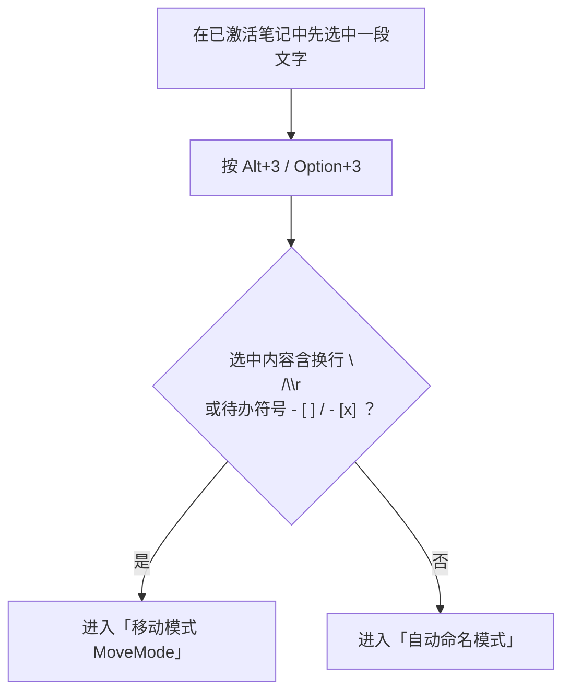
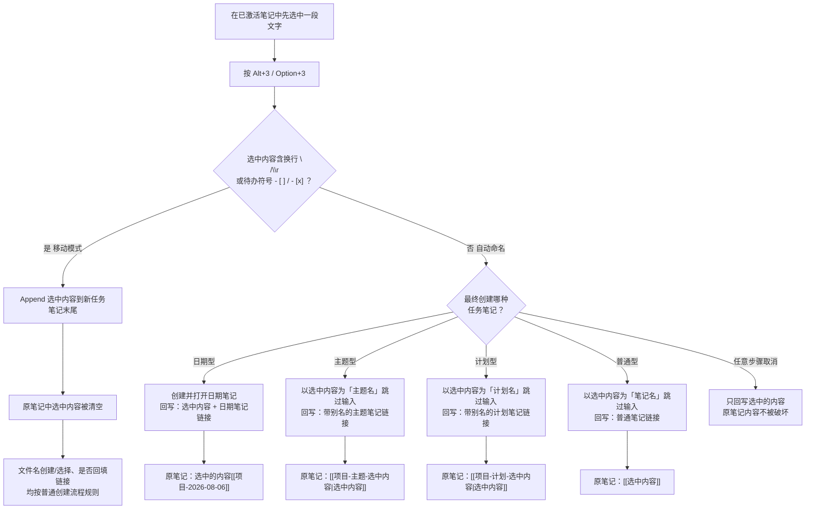

# 当你在笔记中选中内容后，再使用 IOTO 的默认快捷键去创建任务笔记

> [!info] 写给刚接触 IOTO 的你
> 本文是 [[S3-使用IOTO的默认快捷键创建任务笔记]] 的**补充篇**。上一篇讲了在普通笔记里直接按 `Alt+3` 会走什么流程；这一篇专门讲一种更顺手的用法：**你先在笔记里选中一段文字，再按 `Alt+3`**，IOTO 会把这段文字「接住」，按你选中的内容自动走两条路子之一：
> - **移动模式（MoveMode）**：你选的是一整段 / 多条待办，IOTO 把它「搬」进新笔记，原文处清空。
> - **自动命名模式**：你选的是一句话 / 一个词，IOTO 拿它当新笔记的名字，并回填链接。

---

## 一句话先记住

> [!tip]
> 先**选中一段文字**再按 `Alt+3`：`Windows / Linux` 为 `Alt+3`，`macOS` 为 `Option+3`。IOTO 会先看这段文本里**有没有换行或待办符号**：
> - **有**（换行 / `- [ ]` / `- [x]`）→ 进入**移动模式**：整段内容被搬进新任务笔记，原文处清空。
> - **没有** → 进入**自动命名模式**：选中的文字被当作新笔记的名字，跳过手输环节，并回填链接到原笔记。
> 你选中的字，就是新笔记的名字来源。

---

## 这个用法好在哪

正常情况下按 `Alt+3` 创建任务笔记，日期型以外都要你手动输入主题名 / 计划名 / 任务名（见 [[S3-使用IOTO的默认快捷键创建任务笔记]]）。

而当你**先选好文字**再触发快捷键，IOTO 会直接拿这段选中的文字来用，省去复制粘贴和手打。根据你选的内容形态，它会自动分两条路：

| 你选中的内容 | IOTO 走的模式 | 结果 |
| --- | --- | --- |
| 含换行 `\n`/`\r`，或含待办符号 `- [ ]` / `- [x]` | **移动模式 MoveMode** | 整段内容被「搬」进新任务笔记，原文处清空 |
| 其他（一句话 / 一个词等） | **自动命名模式** | 拿它当新笔记的名字，跳过命名输入，并回填链接 |

> [!note] 适用所有情形
> 无论你是在普通笔记里创建、还是在任务笔记里创建子任务，只要触发前选中了文字，都会先判断走哪条路（见下表）。

---

## 先判断：你选中的内容属于哪种

按下 `Alt+3` 后，IOTO 第一件事是检查选中文本的内容形态，决定走哪条路：



下面分别说明两条路的细节。

---

## 情形一：移动模式 MoveMode

当你选中的内容里**含有换行**，或含有 `- [ ]` / `- [x]`（比如你框选了多条待办、或一大段正文），IOTO 认为你是要**把这段内容挪到一篇新任务笔记里**，于是进入移动模式：

- **搬运**：选中的内容会被 **Append（追加）到新创建的任务笔记正文末尾**。
- **清空原文**：在原笔记里，你选中的那段内容会被**清空**——相当于「剪切」到了新笔记。
- **文件名创建 / 选择**：与平时正常创建和打开任务笔记的流程完全一致（选项目 → 选类型 → 命名 / 打开），不会因为走了移动模式而改变。
- **是否回填链接**：遵循与正常创建和打开任务笔记**相同的规则**（即在 [[S3-使用IOTO的默认快捷键创建任务笔记]] 里讲的标准行为），不会因为走了移动模式而不同。

> [!warning] 移动模式会清掉原文里选中的内容
> 和普通「自动命名模式」不同，移动模式是真正的「搬走」：原笔记里那段被选中的文字会被删除，只留下（按正常规则）可能回填的一条链接。所以移动模式适合你已经决定「这段内容就该属于一条新任务」的场景。

---

## 情形二：自动命名模式（把选中文字当作新笔记的名字）

当你的选中内容**不含换行、也不含待办符号**时，IOTO 把它当作新笔记的命名依据，**跳过名称输入环节**。你最终选了哪种任务类型，决定了选中文字的去向，以及回填到原笔记的链接长什么样：

| 你最终创建的类型 | 选中文字会被用作 | 是否跳过命名输入 | 回填到原笔记的内容 |
| --- | --- | --- | --- |
| **日期型** | 正文（附在日期笔记链接前） | 否（日期由 IOTO 自动生成） | `选中的内容[[项目名-2026-08-06]]` |
| **主题型** | 主题名 | 是 | `[[项目名-主题-选中的内容\|选中的内容]]` |
| **计划型** | 计划名 | 是 | `[[项目名-计划-选中的内容\|选中的内容]]` |
| **普通型** | 笔记名 | 是 | `[[选中的内容]]` |

> [!note] 主题型 / 计划型的「别名」
> 主题型和计划型回填的链接里，竖线 `|` 后面是你选中的原文，作为**别名**显示——原笔记里看到的是你选的那句话，点进去才是完整笔记名。

---

## 一图看清整条逻辑



---

## 具体例子

### 例子 A：移动模式（选中了多条待办）

假设你在某篇笔记里选中了下面这段（注意里面有换行和 `- [ ]`）：

```text
- [ ] 整理 Q3 复盘要点
- [ ] 约设计评审
```

再按 `Alt+3`，项目选「OBIOTO」，任务类型选「主题型」：

- IOTO 判定选中内容含待办符号 → 进入**移动模式**。
- 直接以「Q3 复盘」为主题名建好并打开主题笔记，把你选中的两条待办**追加到该笔记正文末尾**。
- 原笔记里那两段待办被**清空**，并按普通流程的规则回填主题笔记链接：
  ```text
  [[OBIOTO-主题-Q3 复盘|Q3 复盘]]
  ```

### 例子 B：自动命名模式（选中了一句话）

假设你在某篇笔记里选中了「整理 Q3 复盘要点」这几个字（单行、无待办符号），再按 `Alt+3`，项目选「OBIOTO」：

- **选日期型**：打开 `OBIOTO-2026-08-06` 后，原笔记多了一行：
  ```text
  整理 Q3 复盘要点[[OBIOTO-2026-08-06]]
  ```
- **选主题型**：直接以「整理 Q3 复盘要点」为主题名建好并打开，原笔记变成：
  ```text
  [[OBIOTO-主题-整理 Q3 复盘要点|整理 Q3 复盘要点]]
  ```
- **选计划型**：直接以「整理 Q3 复盘要点」为计划名建好并打开，原笔记变成：
  ```text
  [[OBIOTO-计划-整理 Q3 复盘要点|整理 Q3 复盘要点]]
  ```
- **选普通型**：直接以「整理 Q3 复盘要点」为笔记名建好并打开，原笔记变成：
  ```text
  [[整理 Q3 复盘要点]]
  ```

---

## 中途取消会怎样

> [!warning] 取消也不会弄丢你的内容
> 如果在任意步骤（选项目、选类型、输名字）按 `Esc` 取消，IOTO 只会把**你选中的那段文字**原样保留，不会往原笔记插入任何链接，也不会改动你原来的笔记内容。放心试，不会破坏文档。
> 注意：一旦进入**移动模式**且新笔记已经创建完成，选中内容便已搬入新笔记、原文处清空，这时再取消无意义——「取消保护」只在你按下快捷键后、完成创建前的选择过程中生效。

---

## 小结

- 先**选中文字**再按 `Alt+3`，是普通创建流程的「增强版」。IOTO 第一步会判断选中内容的形态：
  - **含换行 / 待办符号** → **移动模式**：整段内容被追加进新任务笔记，原文处清空；文件名与链接回填都按正常流程。
  - **其他** → **自动命名模式**：选中文字被当作新笔记的自动命名依据，**跳过手输环节**。
- 自动命名模式下，四种类型对选中文字的用法不同：日期型把它附在链接前当正文，主题型 / 计划型 / 普通型直接拿它当名字（主题 / 计划还会以原文做别名）。
- 创建完成后，一条指向新笔记的链接会自动回填到原笔记（自动命名模式），你选中的字在原文处依然可见。
- 任何时候取消，都只保留选中的内容，原笔记不被破坏（移动模式已在创建完成后生效的除外）。

---