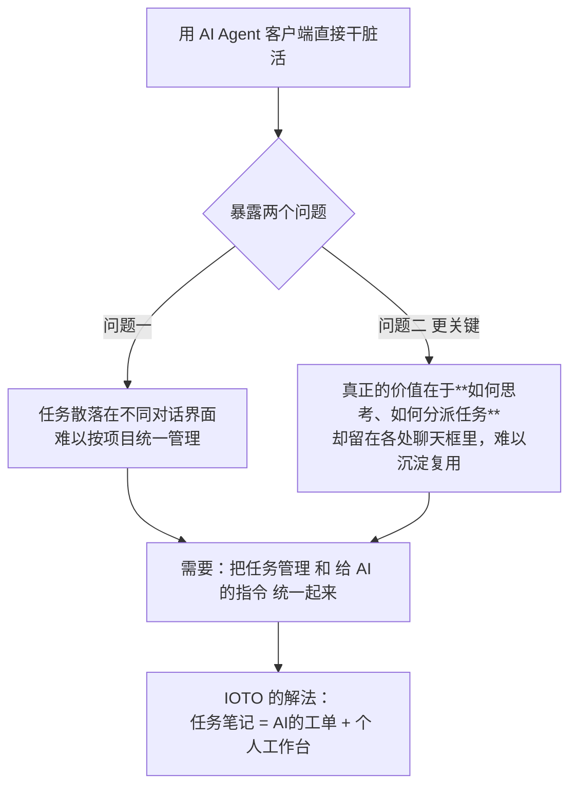
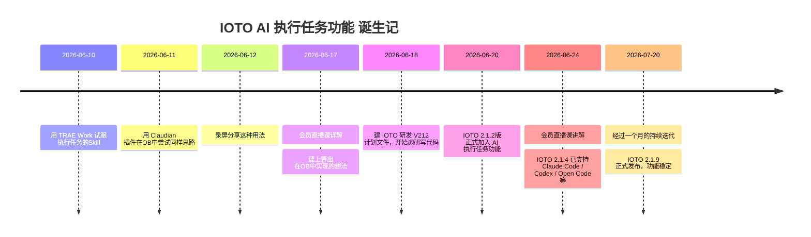

# 我为什么要做 IOTO 的 AI 执行任务功能

> [!info] 写给正在犹豫"要不要试 AI 执行任务功能"的你
> 这篇文档不讲具体操作，只回答一个问题：**IOTO 为什么要做这个功能、它和"把 AI 搬进 Obsidian"有什么本质不同**。读完后，你应该能判断它是不是你需要的。

---

## 一句话先记住

> [!abstract] 核心结论
> IOTO 的 AI 执行任务功能，不是把 AI 问答搬进 Obsidian，而是**把你的任务笔记同时也变成 AI 的工作工单**：AI 智能体直接读取任务笔记、执行未完成的项、做完再帮你标记完成。你的项目管理和"怎么分派任务"的经验，从此都留在 Obsidian 里，而不是散落在各个 AI 工作台的聊天框里。

## AI 走了三步，我对"结合 IOTO"的态度也变了

最早在 ChatGPT 刚火的时候，Obsidian 里就已经出现各种 AI 插件。但我对"把 IOTO 和 AI 结合"一直没想清楚，直到 AI 自身能力跨过三个阶段：

| 阶段 | AI 能做什么 | 我当时为什么不想结合 |
| --- | --- | --- |
| 阶段一：问答 | 更高级的搜索、回答问题 | 单纯把问答搬进 Obsidian，对工作流没有本质帮助 |
| 阶段二：创作 | 润色文章、生成内容 | 不如直接用 Cursor 这类 AI IDE 打开库，想要的都有，没必要多此一举 |
| 阶段三：执行 | AI Agent 直接干活（读写笔记、联网、操作其他工具） | **这下不一样了**——但随即暴露了新问题 |

到了"AI Agent 能直接干活"这一阶段，市面上出现了 Claude Cowork、Hermes、TRAE Work、WorkBuddy 这类智能体工作台：它们能直接打开你的 Obsidian 库，根据指令执行任务，过程中还能联网搜索、调用电脑里的其他工具。

## 用了一阵子，暴露两个绕不开的问题

**问题一：任务散了。** 我派出去的任务散落在不同的对话界面，很难按项目去管理。虽然各家工具后来都加了项目 / 任务管理功能，但它们和 Obsidian 里的项目、任务是割裂的两套。

**问题二（更关键）：经验丢了。** 当 AI 在"输入端"（收集资料）和"成果端"（产出交付物）都慢慢比我们自己做得更好时，人真正值钱的地方，就落在**我们怎么思考、怎么分配和指派任务**上。换句话说，我们要像管理者一样给 AI 员工派活——管理者的本事不是自己挽袖子把事做完，而是知道怎么更合理、更高效地把任务分出去。如果这部分最宝贵的思考和分派经验，都散落在各个 AI 客户端的聊天框里，我们就很难把它们真正用起来。你当然可以再让 AI 帮你梳理一遍，但你真的一回回都这么做了吗？

## IOTO 的解法：让任务笔记成为 AI 的"工单"

怎么把 Obsidian 里的项目和任务管理，跟"给 AI 下达指令"结合起来？我盯上了 IOTO 的任务笔记。

思路很简单：

- 写一个技能，让 AI 智能体每次都**根据任务笔记去执行**；
- 已经完成的项跳过，没完成的就执行；
- 执行完，再帮你把对应项标记为完成。

第一版 `obsidian-task-executor` 技能就这样出来了，我用 TRAE Work 试跑。但很快就碰到最大的别扭：**每次都得在 AI 客户端里手动提供任务笔记的路径**，哪怕在 Obsidian 里用 Claudian 之类的插件也一样麻烦。

于是念头变成了：能不能**直接在 Obsidian 的任务笔记里发起一个命令**，让 AI 智能体去执行这条笔记？只要能把发给智能体的指令直接打包好发过去，这事就成了。

## 从念头到现实：36 小时

从 6 月 17 日冒出"在笔记里直接发起"的念头，到 6 月 18 日调研写代码，再到 6 月 20 日 IOTO 2.1.2 正式加入 AI 执行任务功能——差不多 **36 小时**，想法就变成了现实。到 7 月 20 日发布 2.1.9 时，这个功能已经支持 Claude Code、Codex、Open Code、Mimo Code、Hermes 等多款 AI 客户端，并经过一个多月的边用边打磨，真正稳定下来。

如果你想了解IOTO AI执行任务功能的演变，可以查看[[@IOTO更新日志]]。

> [!tip] 边做边用的真实反馈
> 这一个多月我是一边开发、一边使用、一边优化，明显感觉到这种方式极大提升了我的效率。几位早期用户参与测试后，也感受到了同样的变化。
> **没有错，你现在看的这篇文档也是用IOTO的AI执行任务功能写出来的**

## 现在，你可以怎么开始

如果你还没用过，别担心，具体的操作步骤我会在后续的文档和视频里一点点讲清楚。你现在只需要先做一件事：

1. **挑一个你想要的 AI Agent 的 CLI 版，装到电脑上。**
2. 对绝大多数日常工作，直接用国内产品就足够了。
3. 我个人推荐 **CodeBuddy Code**，你可以同时搭配 **WorkBuddy** 客户端一起用。

> [!note] 想试试的话，从 CodeBuddy Code 开始就好
> 如果还没注册 WorkBuddy / CodeBuddy（两者账号互通），可以用这个邀请链接注册：
> https://www.codebuddy.cn/events/invite?inviteCode=9i74ky0c2ljj1l9
> 注册成功，我们都能得到 650 积分，能用挺久的。

当你能看到这篇文档时，就说明 IOTO 的 AI 执行任务功能已经在你手边、可以被你使用了。

> [!note] 相关录屏与直播回放
> - 2026-06-12 用法分享录屏：https://meeting.tencent.com/crm/ldAdgWrz66
> - 2026-06-17 直播《在 IOTO 中和 AI 一起做任务-上》：https://meeting.tencent.com/crm/N8Q59V8412
> - 2026-06-24 直播《在 IOTO 中和 AI 一起做任务-下》：https://meeting.tencent.com/crm/2YAvPgkQac