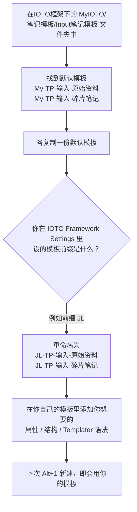

# 如何定制自己的 IOTO 输入笔记模板

> [!Danger] 注意
> 在使用本文档的模板修改方式时，请先把你的IOTO更新到2.2.0版。
> 不会更新的话，请查看[[S0-如何更新IOTO|如何更新IOTO]]

> [!info] 写给想"改默认输入模板"的你
> 你已经用 `Alt+1` 建过输入笔记，但默认模板只给你写了个标题，你或许需要在模板中自动加入属性等内容。本文教你用「复制默认模板 + 重命名」的方式，把 IOTO 的输入模板换成自己的版本。

---

## 一句话先记住

> IOTO 的输入模板不建议你直接改`My-`前缀开头的原文件，而是**复制默认模板 → 用你在设置里的前缀重命名 → 在里面写你自己的内容**。两个默认的输入子文件夹各有一套默认模板，要分别处理。

## 默认的输入模板长什么样

初次部署 IOTO 后，`1-输入` 文件夹下会有两个子文件夹，分别对应不同类型输入笔记的默认模板：

| 输入子文件夹 | 默认模板笔记 |
| --- | --- |
| `1-输入/原始资料` | [[My-TP-输入-原始资料]] |
| `1-输入/碎片笔记` | [[My-TP-输入-碎片笔记]] |

这两个默认模板内容很简单，都用同一句 Templater 语法：

```markdown
# <% tp.file.title %>
```

它的作用只有一个：**新建笔记时，把你输入的笔记名自动写成这篇笔记的 H1 标题**。也就是说，默认模板只管"标题"，不帮你记任何属性或结构。

## 为什么要定制

默认模板只有标题、没有结构。如果你每次都要手动补"类别""来源""相关笔记"之类的固定内容，就可以把这些结构写进你自己的模板，以后 `Alt+1` 一键就带好。

> [!tip] 思路和定制任务模板一致
> 定制输入模板的方法，和 [[S3-IOTO中任务笔记的模板如何去自定义|定制任务模板]] 完全一样：都是基于 IOTO 提供的默认模板做副本，再按自己的前缀重命名。如果你改过任务模板，这套流程可以直接复用。

## 怎么定制（三步）



1. **复制默认模板**：在 `1-输入/原始资料` 和 `1-输入/碎片笔记` 下，分别找到 [[My-TP-输入-原始资料]] 和 [[My-TP-输入-碎片笔记]]，各复制一份。
2. **用你的前缀重命名**：把副本重命名成"你的前缀 + 原模板名"。前缀就是你在 **IOTO Framework Settings** 插件里设置的模板前缀。
   - 例如你设的前缀是 `JL`，则重命名为：
     - `JL-TP-输入-原始资料`
     - `JL-TP-输入-碎片笔记`
3. **写你自己的内容**：在副本里添加你想要的 YAML 属性或正文结构。这里同样可以使用 Templater 模板语法。

> [!warning] 前缀要对得上设置
> 重命名用的前缀，必须和你在 IOTO Framework Settings 中设置的一致，**同时要记住，文件名只修改前缀，别的不要改**。IOTO 才能正确识别并套用你的模板。

## 一个模板示例

比如你想给"原始资料"类型的输入笔记，固定带上"类别 / 来源 / 相关笔记"结构，可以把 `JL-TP-输入-原始资料` 的内容写成：

```markdown
---
类别: 
来源: 
---

# <% tp.file.title %>

# 相关笔记

```

- 顶部的 `类别:`、`来源:` 是 YAML 属性，新建后会留空等你填；
- `# <% tp.file.title %>` 让笔记名自动成为 H1；
- `# 相关笔记` 是给你手动补链接的固定小节。