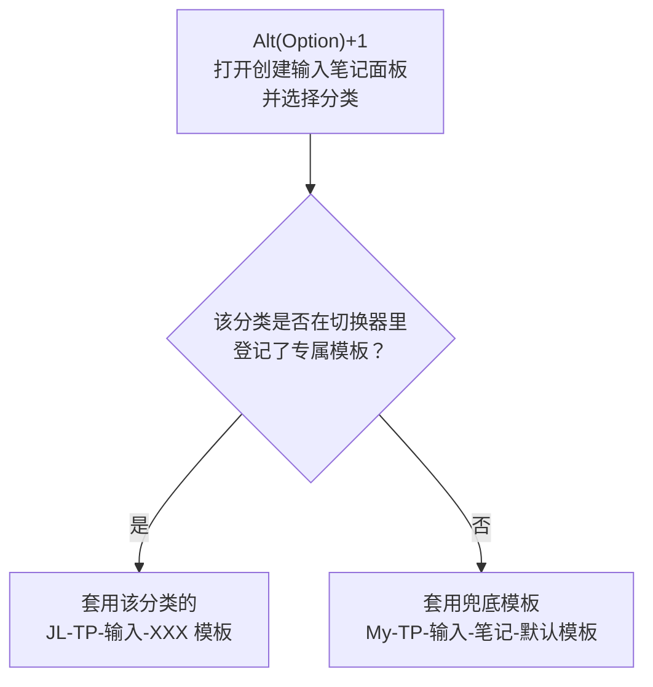
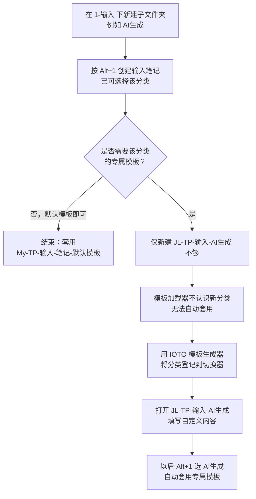
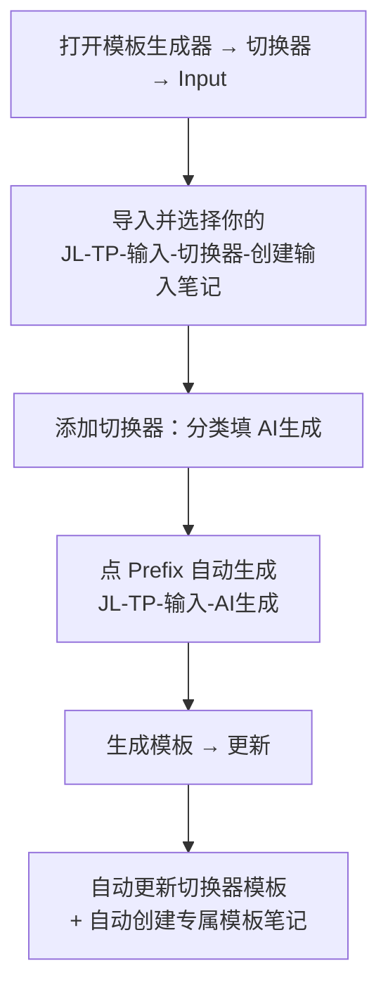

# 如何给 IOTO 的输入笔记增加新的分类并设置自定义模板

> [!Danger] 注意
> 在使用本文档的模板修改方式时，请先把你的IOTO更新到2.2.0版。
> 不会更新的话，请查看[[S0-如何更新IOTO|如何更新IOTO]]

> [!info] 写给想扩展输入体系的你
> 当你发现 `1-输入` 下的默认分类（原始资料、碎片笔记）不够用时，本文教你如何新建一个输入分类（如 `AI生成`），并为它配置一套专属笔记模板。

---

## 一句话先记住

> 在 `1-输入` 下新建文件夹，只是让 `Alt+1` 多出一个可选分类；要让它用上**专属模板**，还必须通过「IOTO 模板生成器」把新分类登记到输入切换器里。只新建一个 类似`JL-TP-输入-XXX` 这样的使用你自定义前缀的模板是不够的——模板加载器不认识这个分类，不会自动套用。

---

## 背景：分类与模板是怎么配合的

IOTO 建议 `1-输入` 下的子分类越少越好，但并不禁止你新增。常见场景：很多输入内容其实是让 AI 调研整理后返还的，你希望把这些「AI 生成」的内容单独放到一个文件夹里管理。

当新建文件夹 `AI生成` 后，按 `Alt+1` 创建输入笔记时，已经能在分类列表里选择它。但此时创建出来的笔记，套用的是**默认输入模板**——因为新分类还没有指定任何专属模板。

关键模板之间的关系如下：

| 模板                                  | 作用                                                 |
| ----------------------------------- | -------------------------------------------------- |
| [[My-TP-输入-笔记-默认模板]]                | 兜底模板。当某个分类没有登记专属模板时自动套用；其内容与 `原始资料`、`碎片笔记` 的默认模板一致 |
| [[My-TP-输入-原始资料]]、[[My-TP-输入-碎片笔记]] | 已登记专属模板的分类（示例）。你一旦为它们指定了自定义模板，就会用你指定的版本            |
| [[My-TP-输入-切换器-创建输入笔记]]             | 切换器模板。它根据用户所选的文件夹，决定套用哪一个模板                        |
| `JL-TP-输入-AI生成`                     | 你为新分类创建的专属模板（也可以由生成器自动生成）                          |

也就是说，笔记创建时的模板是这样被选中的：



---

## 总体流程

假设自定义目前前缀是`JL`。



---

## 步骤一：新建分类文件夹

在 `1-输入` 目录下新建一个子文件夹，名字就是你的新分类，例如 `AI生成`。

> [!tip] 命名建议
> 分类名会直接出现在 `Alt+1` 的选择列表里，起一个一眼能懂的名字（如 `AI生成`、`读书摘录`）最省心。

新建后无需其他配置，按 `Alt+1` 创建输入笔记时就已经能选到它，只是暂时套用的是默认模板。

---

## 步骤二：准备你的切换器模板副本

要让新分类有专属模板，核心是把新分类「告诉」IOTO 的模板加载器。这一步靠的就是切换器模板 [[My-TP-输入-切换器-创建输入笔记]]——它负责根据所选文件夹切换不同模板。

做法和定制其他模板一样：

1. 把 [[My-TP-输入-切换器-创建输入笔记]] 复制一份。
2. 按你自己的前缀改名，例如改成 `JL-TP-输入-切换器-创建输入笔记`（`JL` 换成你实际使用的前缀）。

> [!warning] 别直接改默认模板
> 不要在原版 `My-TP-输入-切换器-创建输入笔记` 上改，保留 `My-` 开头的默认模板，只定制你前缀的副本。

直接打开这个副本，你会看到里面全是代码、无从下手——这正是下一步用工具的原因。

---

## 步骤三：用 IOTO 模板生成器登记分类

IOTO 提供了专门的 **IOTO 模板生成器** 插件，帮你生成和编辑各类定制模板，省去手写代码的麻烦。

**1. 安装插件**

在 Obsidian 命令面板执行：

```text
IOTO Update: 安装IOTO模板生成器
```

安装完成后，左侧工具栏会出现一个图标，点击即可打开模板生成器。


**2. 导入你的切换器模板**

1. 在左侧导航栏找到「切换器」，点击 **Input**，进入输入切换器设置页。
2. 点击 **导入** 按钮，会看到两个输入切换器模板：
   - 一个是 `My` 开头的默认模板；
   - 一个是你自定义前缀开头的模板（如 `JL-TP-输入-切换器-创建输入笔记`）。
3. 选择**以你自定义前缀开头**的那个，点击它，生成器会把该模板内容加载进来。


**3. 添加一条切换规则**

1. 页面最下方是「切换器设置」区域，里面已有两条默认分类设置，先不用管。
2. 点击 **添加切换器**，出现一个空行。
3. 在第一个输入框填入新分类名，例如 `AI生成`。
4. 点击右侧的 **Prefix** 按钮，后面输入框会自动生成一个以你前缀开头的笔记名，例如 `JL-TP-输入-AI生成`。


**4. 生成并更新**

1. 点击右上角的 **生成模板** 按钮。
2. 在弹出的窗口里，点击右下角的 **更新** 按钮。


此时 IOTO 会自动更新你自定义的输入切换器模板内容；同时，如果之前没有 `JL-TP-输入-AI生成` 这个模板笔记，也会自动帮你创建，默认存放在 `MyIOTO/笔记模板` 下。



---

## 步骤四：编写专属模板内容

登记完成后，打开 `JL-TP-输入-AI生成` 这个模板笔记，在里面填写你想要的自定义内容（和定制其他输入笔记模板的方式完全一样）。

之后，当你再按 `Alt+1` 创建输入笔记并选择 `AI生成` 分类时，创建出来的笔记就会自动套用 `JL-TP-输入-AI生成` 里的内容。日后想改模板，只需打开 `JL-TP-输入-AI生成` 这一篇即可。

---

## 常见疑问

> [!question] 我只建了 `JL-TP-输入-AI生成` 模板，为什么没生效？
> 因为模板加载器还不知道 `AI生成` 这个分类的存在。必须像步骤三那样，通过模板生成器把它登记进切换器，加载器才会去套用对应模板。

> [!question] 默认模板和原始资料/碎片笔记的模板内容一样，有什么区别？
> [[My-TP-输入-笔记-默认模板]] 是兜底模板：当某个分类没有登记专属模板时套用它。而 `原始资料`、`碎片笔记` 若已被你指定了自定义模板，就会优先用你指定的版本。

> [!note] 前缀要一致
> 切换器副本、`JL-TP-输入-AI生成`、生成器里 Prefix 自动生成的名字，前缀（如 `JL`）要保持一致，否则加载器匹配不到。

---