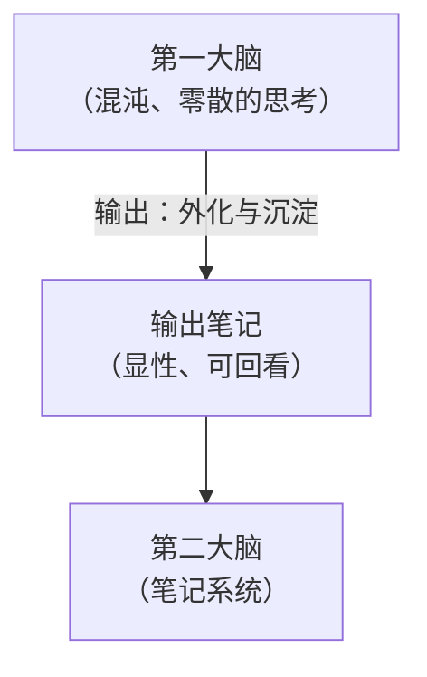
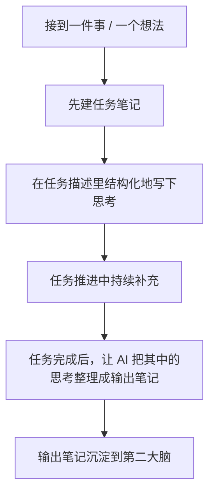

# IOTO 中关于输出的建议和原则

> [!info] 写给正在用（或准备用）IOTO 做笔记的你
> 这篇文档把 IOTO 里「输出笔记」背后的原则和实操建议讲清楚，帮你少走弯路、更快进入自己的节奏。

---

## 一句话先记住

> 在 IOTO 里，**输出是写给你自己的**，不是写给别人看的。放下「要对别人负责」的负担，把脑子里的思考尽可能外化下来，就是最好的输出。

## 输出到底指什么

很多人一听「输出」，就以为是发文章、发朋友圈、做展示——要把东西拿出去给别人看。

在 IOTO 里恰恰相反：

> **输出，是你对自己思考过程的外化和沉淀。**

它的核心特征是**面向自己**：不需要对别人负责，只需要对自己负责。用一句话概括：

> 输出 = 我 → 我

它和 IOTO 的几个核心观点是对应的：

- 输出对应**思考**，也就是「问、思、辨」；
- 输出是**给自己**的；
- 输出是为了**沉淀价值**；
- 输出是把你**第一大脑**里混沌、零散的思考，用显性方式外化、留存到你的**第二大脑**（笔记系统）里。

## 原则一：尽可能多地去输出

记住一点：**输出只对你自己负责**。只要你自己能看懂、对你自己有用，就够了。

所以，可以放下一切负担，尽可能地去输出——也就是尽可能地把你的思考记录下来。

哪怕你正在做的事情完全没有头绪，也可以开一个笔记，把当时脑子里那些胡思乱想、没有章法的东西直接写出来。这样做，往往会对你有意想不到的帮助。

> [!tip] 没头绪时更要写
> 越是混乱、没思路的时候，越值得动笔。把「我现在脑子里一团乱」如实写下来，本身就是一种梳理。记录得越多，你的思考就会越顺、越高效。

## 原则二：节奏感比灵感更重要

快速捕获闪念，是很多人会重点打磨的流程。灵感这个词听着带劲儿，我们都怕那些有价值的灵感一闪而逝，感觉错过了好几个亿。

灵感、闪念，确实是输出的一部分。但更好的灵感，其实往往来自**节奏感**。

> 节奏感，是由你的习惯、规律和工作流组成的。

当你沉浸在自己的习惯和工作流中时，更容易进入心流状态，那时灵感会源源不断地产生。而那个时候，你往往已经在你的工作系统里了——记录灵感或其他思考（输出），就是顺手的事。

| 对比项 | 只追「灵感」 | 建立「节奏感」 |
| --- | --- | --- |
| 来源 | 偶然、随机的闪念 | 习惯 + 规律 + 工作流 |
| 状态 | 怕错过，总在「捕获」 | 沉浸心流，灵感自然涌出 |
| 记录动作 | 打断当下去补记 | 本就在系统里，顺手记下 |
| 可持续度 | 依赖运气 | 可稳定复现 |

> [!note] 不是不要灵感，而是别只靠灵感
> 捕获闪念的工具和流程照样值得有。但别把全部希望押在「灵感别跑掉」上——把节奏感建起来，灵感会更主动地来找你。

## 原则三：在任务中思考

在 [[S4-IOTO中输入笔记的使用原则]] 里，有一条是：

> 先建任务笔记，再建输入笔记

输出也是一样的道理：**你的输出应该和某个任务绑定，它才有根基、才能落地。**

我们会有很多天马行空的想法，但只有那些和具体任务有关联的想法，才有可能真的留存下来。

IOTO 确实建议你：先建任务笔记，再建输出笔记。但同时它也建议你——**直接在任务笔记中去思考**。

当你每次去描述任务时，你就在思考。把思考尽可能结构化地写在任务描述里，不但方便你自己回顾和复盘，也能让 AI 更了解你，从而更好地和你协作。

等一个任务完成，你还可以让 AI 把这个笔记里的思考，整体整理成你自己的输出笔记，方便未来使用。

## 给新手的三个提醒

1. **先追求「写下来」，别追求「写得好」。** 输出是给自己的，能看懂就有价值。
2. **别等灵感，先把自己放进工作流。** 节奏感一旦建立，输出会变成习惯而非负担。
3. **别把想法悬空放，挂到任务上。** 有任务的输出才落地，也才更容易被未来复用。