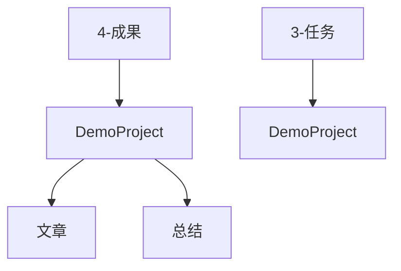
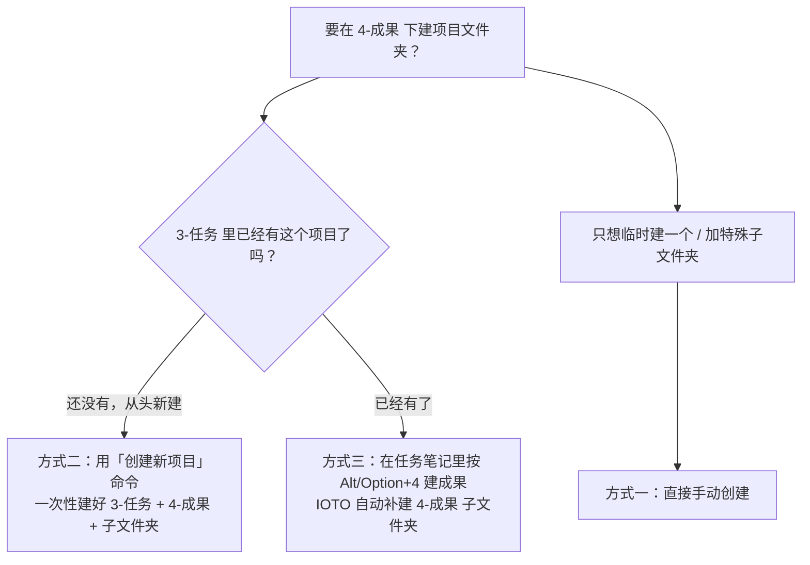

# IOTO 中在成果文件夹下创建项目文件夹及其子文件夹的 3 种方式

> [!info] 写给刚接触 IOTO 的你
> 当你想在 `4-成果` 里给某个项目（比如 `DemoProject`）建一个专属文件夹、并顺便把 `文章`/`总结` 这类子文件夹一起准备好时，有 3 种做法可选。本文帮你快速搞清楚「各自怎么用、什么时候用哪个」。

---

## 一句话先记住

> 想在 `4-成果` 下建项目文件夹，可以**手动建**、用 **「创建新项目」命令一键建**、或**在任务笔记里按 `Alt/Option+4` 建成果时让它自动补建**——后两种方式会按 IOTO 设置里的「成果项目默认子文件夹」自动生成子文件夹。

---

## 3 种方式一览

| 方式 | 入口 | 是否自动建 `4-成果` 项目文件夹 | 是否自动建子文件夹 | 适合场景 |
| --- | --- | --- | --- | --- |
| 一、手动创建 | 文件管理器 / Obsidian 文件列表 | 是（你亲手建） | 否（子文件夹也需手动） | 临时补一个、或加非标准的特殊子文件夹 |
| 二、「创建新项目」命令 | IOTO Framework Settings 插件命令 | 是（自动） | 是（按默认子文件夹） | 从零开始新建一个项目 |
| 三、`Alt/Option+4` 建成果时 | 任务笔记内的快捷键 | 是（检测到缺失时自动） | 是（按默认子文件夹） | `3-任务` 里已有项目，补全它的成果文件夹 |

> [!note] 关键前提：后两种方式的「自动建子文件夹」都依赖 IOTO Framework Settings **成果设置页**里的 `成果项目默认子文件夹`。默认值通常是：
> ```text
> 文章
> 总结
> ```

---

## 方式一：手动创建

一定要牢记：**Obsidian 库里的所有东西，本质上就是你电脑硬盘里的文件夹和文件**。

所以只要你愿意，随时都可以用文件管理器（或 Obsidian 左侧的文件列表）手动在 `4-成果` 下新建文件夹和子文件夹。这是最朴素、也最不受约束的方式——想叫什么名字、想建几层，都随你。

- 优点：完全自由，零学习成本。
- 缺点：子文件夹（如 `文章`/`总结`）要自己一个一个建，重复劳动多。

> [!tip] 手动方式最适合「临时补建」或「添加默认列表之外的特殊子文件夹」，例如你突然想给 `DemoProject` 加一个 `素材` 文件夹。

---

## 方式二：用「创建新项目」命令创建

IOTO Framework Settings 插件提供了一个 **`创建新项目`** 命令。用它新建项目时，会自动帮你把相关结构一次性搭好：

1. 在 `3-任务` 下创建你输入的项目（例如 `DemoProject`）；
2. 同时在 `4-成果` 下自动创建一个同名的 `DemoProject` 子文件夹；
3. 再根据**成果设置页**里 `成果项目默认子文件夹` 的内容，自动在 `DemoProject` 下生成对应子文件夹。

若 `成果项目默认子文件夹` 用的是默认值（`文章`、`总结`），执行后你会得到这样的结构：



> [!note] 之后若想在 `DemoProject` 下再加其他类型的子文件夹，直接**手动创建**即可——默认子文件夹只负责「初始那一批」，不限制你后续扩展。

---

## 方式三：用 `Alt/Option+4` 创建成果时自动创建

如果你是通过**手动**在 `3-任务` 下建了 `DemoProject`，或是用 IOTO **任务中心**的「添加项目」按钮建的项目——这两种情况下，`4-成果` 里**不会**自动出现对应的 `DemoProject` 子文件夹。

不过，当你进入 `3-任务/DemoProject` 下的任务笔记，按 `Alt/Option+4` 创建成果时，IOTO 会先检查：若发现 `4-成果` 下还没有 `DemoProject` 子文件夹，就会**自动帮你创建好**，并依据 `成果项目默认子文件夹` 的设置把相关子文件夹一并建好，且**直接供你选择**使用。



> [!warning] 方式三的「自动补建」只在 `4-成果` 下**缺失**对应项目文件夹时触发。如果文件夹已存在，它就不会重复创建，只会照常让你选择已有的子文件夹。

---

## 给新手的推荐 / 判断口诀

- **从零开始做一个新项目** → 用方式二「创建新项目」命令，一步到位。
- **项目已在 `3-任务` 跑着、只是成果文件夹还没建** → 直接进任务笔记按 `Alt/Option+4` 建成果，让 IOTO 顺手补上（方式三）。
- **只想临时加个文件夹 / 加默认列表之外的子文件夹** → 方式一手建最快。

> [!tip] 想让自动建出来的子文件夹更符合你的习惯？先去 IOTO Framework Settings 的**成果设置页**改好 `成果项目默认子文件夹`，之后方式二、方式三都会按新配置生成。