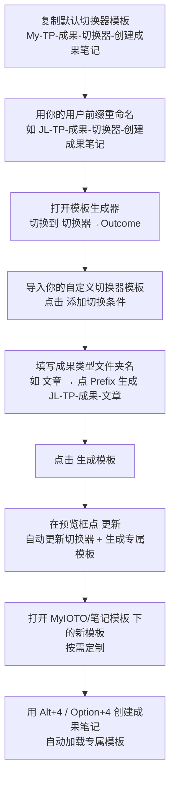

# IOTO 中如何定制成果笔记的模板

> [!info] 写给想要「为不同成果类型配置专属笔记模板」的你
> 读完本文，你将学会如何一步一步为「文章」「视频」等具体成果类型，定制出专属的默认笔记模板。

---

## 一句话先记住

> IOTO 只提供了**通用的成果笔记模板**，并不预置按类型分好的专属模板。想给某一类成果（如「文章」）配置专属模板，**复制切换器模板 → 在模板生成器里添加切换条件 → 生成模板**，三步即可。

## 为什么需要自己定制

在 `Templates/Templater/MyIOTO/笔记模板` 文件夹下，IOTO 提供了默认模板 [[My-TP-成果-笔记-默认模板]]。它是你创建**任意类型**成果笔记时都会套用的通用模板。

> [!note] 和输入 / 输出笔记的区别
> 输入笔记、输出笔记都自带了按类型分好的专属模板子文件夹；但 `笔记模板` 下**没有** `Outcome 笔记模板` 子文件夹。
> 原因是不同用户的成果类型差异很大，IOTO 把这件事留给你自己来定制。

好消息是：**定制成果模板的流程，和定制输入 / 输出模板完全一样。**

## 整体流程



## 详细步骤

### 1. 复制并改名切换器模板

进入 `切换器模板` 文件夹，找到默认提供的 [[My-TP-成果-切换器-创建成果笔记]]，为它创建一个**副本**，并用你设置的用户前缀重命名。

> [!tip] 命名示例
> 若你的用户前缀是 `JL`，就把副本重命名为：
> ```text
> JL-TP-成果-切换器-创建成果笔记
> ```

### 2. 导入并添加切换条件

1. 打开 IOTO 的**模板生成器**；
2. 切换到 `切换器 → Outcome` 设置页；
3. 导入以你前缀开头的自定义成果切换器模板；
4. 点击 **添加切换条件** 按钮。

### 3. 指定成果类型并生成

- 若想给 `文章` 这个成果类型指定专属模板：在「文件夹名称」部分填入 `文章`，再点 **Prefix** 按钮，系统会为你生成类似 `JL-TP-成果-文章` 的笔记名。
- 若还想继续为其他成果类型创建专属模板，重复上述流程即可。
- 最后点击右上角的 **生成模板** 按钮。

在弹出的预览框中点击 **更新**：IOTO 会自动更新你的自定义切换器模板，并**自动生成**你设置的具体类型成果笔记模板。

> [!note] 模板存放位置
> 生成的专属模板默认存放在 `MyIOTO/笔记模板` 下方。你只需打开这些模板，按自己的需求定制内容即可。

### 4. 使用专属模板

完成某类成果模板的定制后，以后使用 `Alt + 4` 或 `Option + 4` 快捷键创建对应类型的成果笔记时，就会**自动加载你设置的模板**。

## 给新手的推荐

- 先用通用模板 [[My-TP-成果-笔记-默认模板]] 跑通流程，再为高频成果类型（如「文章」）做专属模板。
- 用户前缀要保持全局一致，否则切换器模板无法被正确识别。