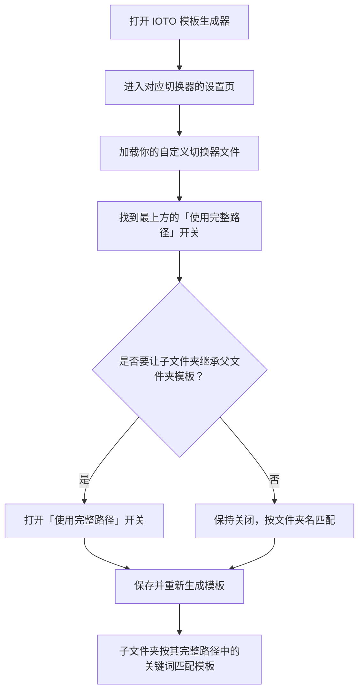

# IOTO中如何让子文件夹也继承给父文件夹指定的模板

> [!info] 写给正在定制 IOTO 模板的你
> 如果你已经按 [[S4-如何给IOTO的输入笔记增加新的分类并设置自定义模板]]、[[S5-IOTO中如何定制自己的输出笔记]] 或 [[S6-IOTO中如何定制成果笔记的模板]] 自定义过切换器模板，这篇文档教你怎么让「父文件夹指定的模板」也能被它的子文件夹继承。

---

## 一句话先记住

> 默认情况下，IOTO 切换器只按「你选择的文件夹名」匹配模板，所以子文件夹用不了父文件夹的模板。只要打开切换器设置顶部的 **`使用完整路径`** 开关，匹配就会改成按「完整路径里是否包含你指定的关键词」来判断，子文件夹就自动继承父文件夹的模板了。

## 你遇到的麻烦：子文件夹用不上父文件夹的模板

在 [[S4-如何给IOTO的输入笔记增加新的分类并设置自定义模板|S4]] 这类文档里，我们讲过怎么给某类笔记指定自定义模板。

比如你可以给 `1-输入/AI生成` 指定一个专门的模板。在默认设置下，只有用 `Alt+1` 直接在 `1-输入/AI生成` 这个文件夹下创建笔记时，才会套用你指定的模板。

如果你在 `1-输入/AI生成` 下面又建了子文件夹：

```
1-输入/AI生成
    - 文章
    - 分析
```

当你用 `Alt+1` 在 `文章` 或 `分析` 下创建笔记时，它们**不会**套用你给 `AI生成` 指定的模板，而是用默认模板。

> [!warning] 为什么会这样
> IOTO 的切换器默认是「按你选择的文件夹的文件名」去匹配模板的。你选了 `文章`，识别出的关键词就是 `文章`，而并没有名为 `文章` 的模板，于是就回退到默认模板了。

## 更好的做法：打开「使用完整路径」

想让子文件夹也继承父文件夹的模板，很简单：

1. 用 IOTO 的**模板生成器**，在对应的切换器设置里加载你的自定义切换器文件；
2. 把设置**最上面**的 **`使用完整路径`** 开关打开即可。


打开 `使用完整路径` 后，切换器不再只看「文件夹名」，而是看「你所选文件夹的**完整路径**里是否包含你指定的关键词」来决定用哪套模板。

比如你选了 `1-输入/AI生成/文章`，这条路径里包含 `AI生成`，就会套用你给 `AI生成` 指定的模板——于是子文件夹 `文章` 也继承了父文件夹的模板。

> [!tip] 适用范围
> 这个 `使用完整路径` 开关在**其他类型的切换器**里同样适用，你可以按自己的需求去调整，不局限于输入笔记。

## 怎么设置（操作步骤）

在模板生成器中，进入对应切换器的设置 → 加载你的自定义切换器文件 → 找到最上方的 `使用完整路径` 开关并打开 → 保存并重新生成模板。



要点说明：

1. **加载自定义切换器文件**：确认你在对应切换器设置里加载的是你自己的自定义切换器文件（而非内置默认文件），否则改的是内置模板。
2. **开关位置在最上方**：`使用完整路径` 是切换器设置顶部的开关，不要和下面的其他配置混淆。
3. **按关键词匹配**：打开后，只要完整路径里包含你指定过模板的关键词（例如 `AI生成`），就会命中对应模板，无论它在第几层子文件夹。
4. **重新生成模板**：改完开关后保存，并重新生成你的模板使其生效。

## 让设置生效

打开 `使用完整路径` 并重新生成模板后，下次在任意子文件夹下创建笔记时，切换器会沿完整路径向上寻找匹配的关键词，从而自动套用父文件夹指定的模板。

> [!note] 生效时机
> 该设置对所有由该切换器创建的笔记立即生效，无需在每个子文件夹里再单独指定一遍模板。

## 延伸阅读

- [[S4-如何给IOTO的输入笔记增加新的分类并设置自定义模板]]
- [[S5-IOTO中如何定制自己的输出笔记]]
- [[S6-IOTO中如何定制成果笔记的模板]]