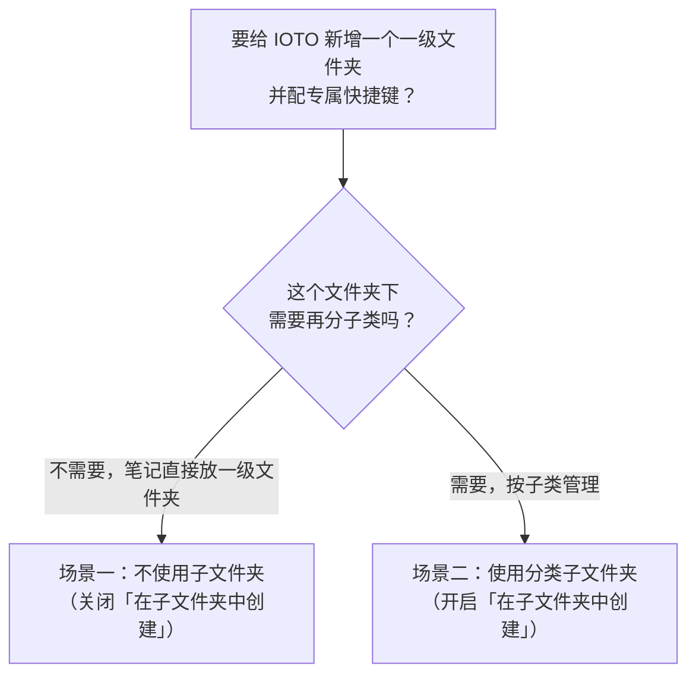

# 如何创建和使用自定义模板选择器

> [!info] 写给需要自定义模板选择器的人
> 本文面向已经会用 IOTO 默认快捷键（`Alt` / `Option` + `1`~`4`）创建输入 / 输出 / 任务 / 成果笔记，但想**新增自己的一级文件夹**（例如「人脉」）并用专属快捷键快速创建笔记的 IOTO 用户。读完你将能：新建一个自定义一级目录、用 `IOTO 模板生成器` 把它接入快捷键体系，并可选地为它加子分类、配专属模板。

---

## 一句话先记住

> [!tip] 核心结论
> IOTO 默认只管「输入、输出、任务、成果」四类笔记，但你可以用**自定义选择器（Custom）**把任意一级文件夹（如 `5-人脉`）也接入快捷键体系；并可进一步选择：笔记直接放在一级文件夹下，或先分子类再创建。

---

## 默认机制与扩展边界

IOTO 的核心能力之一，是基于一套模板自动化系统：让你用快捷键，或快速面板里的按钮，在**指定位置**快速创建或打开笔记。

- 默认快捷键：`Alt`（Windows）/ `Option`（macOS） + `1 / 2 / 3 / 4`，分别对应在**输入、输出、任务、成果**文件夹创建或打开笔记。
- IOTO 建议你尽量保持 Obsidian 下一级目录简洁，但**允许**在确有需要时扩展一级目录。

> [!warning] 扩展前先想清楚两件事
> 1. **选择越多，决策越久。** 每增加一个入口，你每次创建笔记时都要多花时间判断。
> 2. **先考虑归入既有分类。** 与知识管理相关的内容，几乎都能归类到输入、输出、成果之下。想新增根级目录前，先问自己：它真的放不进现有分类吗？

### 一个典型例子：人脉管理

人脉管理和知识管理是两个维度，但又有交叉——做具体项目时往往要顺手管理相关人物。

- 搜集人物基本信息 → 可算「输入」
- 写与某人交往的心得 → 可算「输出」
- 写人物点评 → 可算「成果」

但实际做人脉管理时，你通常会把三类内容写在**同一篇人物笔记**里，这样用起来更顺手。此时最方便的做法，就是直接建一个 `5-人脉` 的一级目录，统一管理所有项目相关的人物。

下面以 `5-人脉` 为例，讲解如何一步步扩展。

---

## 先决定：要不要分子类？

自定义选择器支持两种用法，对后续配置影响很大，请先选好：



| 对比项 | 场景一：不使用子文件夹 | 场景二：使用分类子文件夹 |
| --- | --- | --- |
| 适用情形 | 该目录下笔记类型单一，无需再分 | 该目录下要按子类（如家人 / 同事 / 客户）管理 |
| 创建时 | 直接输入笔记名即可 | 先选子类，再输入笔记名 |
| 配置要点 | 关闭「在子文件夹中创建或打开笔记」 | 开启该开关，并可给不同子类配不同模板 |
| 进阶能力 | — | 可用**切换器模板**为不同子类套用不同笔记模板 |

> [!note] 选择器与切换器的关系
> 两者配合，构成「创建位置 → 套用模板」的链路：
> ```mermaid
> graph TD
>     H["Alt+6 快捷键"] --> SEL["人脉选择器模板<br/>（决定在哪个文件夹创建）"]
>     SEL --> SW["人脉切换器模板<br/>（决定套用哪个笔记模板）"]
>     SW --> T["实际笔记模板<br/>（位于 MyIOTO / 笔记模板 下）"]
>     T --> N["创建出的人脉笔记"]
> ```

---

## 场景一：直接在一级文件夹下创建（不使用子文件夹）

### 准备工作：安装 IOTO 模板生成器

如果你的库里还没有 `IOTO 模板生成器` 插件，可用 `IOTO Update` 插件的命令安装。


安装成功后，你会在左侧工具栏看到对应的图标。


### 第一步：创建一级文件夹

在你的 Obsidian 库中，创建一个 `5-人脉` 的一级文件夹。


### 第二步：用 IOTO 模板生成器生成模板并配置快捷键

点击 `IOTO 模板生成器` 图标，打开模板生成器。

因为我们要创建的是 IOTO 默认「输入 / 输出 / 任务 / 成果」之外的选择器，所以需要点击左侧**选择器**分类下的 `Custom（自定义）` 标签。

在**文件夹设置**标签下，点击 `文件夹路径` 设置项右侧的文件夹图标（也可手动输入路径，选图标是为了方便且避免出错）。


点击文件夹图标后，在弹出窗口中输入 `5` 可快速过滤出对应路径，然后点选它。


确认 `文件夹路径` 为 `5-人脉` 后，把下方的**「在子文件夹中创建或打开笔记」**开关切到**关闭**状态——因为目前 `5-人脉` 下没有子文件夹，人物是直接创建在它下面的。


切换到**笔记设置**标签，在 `模板` 设置项中点击 `Prefix` 按钮。它的作用是根据你的设置，自动生成切换器笔记名的前缀。


演示库在 `IOTO Framework Settings` 插件里设置的用户模板前缀是 `JL`，所以截图中看到的是 `JL` 开头的前缀；如果你做了其他设置，会看到对应前缀。


在自动生成的前缀后面加上 `人脉`，其他设置保持不变。


然后点击**生成模板**按钮。


此时会弹出预览窗口，第一步是给自动生成的选择器文件名**重命名**。默认带时间戳是为了确保文件名唯一。


把后面的时间戳改成 `人脉`，然后点击右侧的**「点击以添加快捷键」**按钮，给这个选择器模板指定一个快捷键。


点击后按钮状态会变化、文字变成「按下快捷键」，此时直接按下你想要的快捷键组合即可。


为了和 IOTO 其它创建笔记的快捷键保持一致，这里使用 `Alt+6`。

> [!warning] 为什么是 Alt+6 而不是 Alt+5？
> `Alt+5` 默认留给 IOTO 的辅助工具使用，所以自定义选择器建议从 `Alt+6` 起。

输入快捷键后，按钮上会显示对应组合；若出现冲突提示，或想改键，重新点这个按钮即可再次设置。

设置好快捷键后，点击右侧的**保存为文件**按钮。


点击保存后会出现几条提示，告诉你实际发生了什么：

1. 选择器模板已创建；
2. 分配的快捷键已创建；
3. 指定的切换器模板已创建；
4. 模板生成器自动切到 `Custom` 切换器的设置页，并加载刚创建的选择器，便于进一步设置。


当前暂不需要额外设置，直接点**生成模板**按钮。


在弹出窗口中直接点击对应的**更新**按钮即可。

> [!note] 切换器模板不需要设快捷键
> 切换器模板是在选择器模板被触发后**自动加载**的，所以它本身不需要配置快捷键。


点击生成模板后，会看到对应的更新提示。


### 第三步：测试自定义模板和快捷键

在任意一篇笔记中触发 `Alt+6`（macOS 为 `Option+6`）快捷键。

你会看到一个让你输入笔记名的对话框。因为我们之前设了「不在子文件夹中创建」，所以这里没有子文件夹选项（当前 `5-人脉` 下也确实没有子文件夹）。


输入一个人物名，点击创建。


你会看到一个返回的链接。


打开链接后，这篇人脉笔记会**自动继承**之前文件设置的 `Project` 属性。


---

## 场景二：在一级文件夹下使用分类子文件夹

如果你想像创建输入 / 输出那样，先选子类再创建笔记，就按下面步骤给 `5-人脉` 加上分类。

### 第一步：创建子分类

根据你的需求，在 `5-人脉` 文件夹下创建相关分类。


### 第二步：更新选择器模板（开启子文件夹）

打开 `IOTO 模板生成器`，在左侧**选择器**设置下选中 `Custom`，点击**导入**按钮。


选择之前创建的人脉选择器并导入后，把**「在子文件夹中创建或打开笔记」**开关切回**开启**状态。


然后点击**生成模板**按钮。


直接点击**更新**按钮。


此后在笔记里再用 `Alt+6` 创建人脉时，就会看到子文件夹选项了。


### 第三步：更新切换器模板（为不同分类指定不同模板）

如果你想给不同分类指定不同模板，就在 `IOTO 模板生成器` 中点击**切换器**下的 `Custom`，再点击**导入**按钮。


导入之前创建的人脉切换器。


添加你希望的切换规则：输入关键词后点击 `Prefix` 按钮，再点击**生成模板**按钮。


在出现的预览窗口中点击**更新**按钮。


提示中会显示：

1. 切换器模板已更新；
2. 你指定的模板已创建。


在 `MyIOTO` 下的 `笔记模板` 文件夹中找到你创建的模板，可按需自定义。之后再用 `Alt+6` 创建对应人脉类型时，就会应用你配置的模板。


---