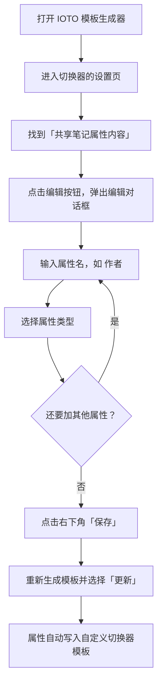

# IOTO中如何给同一类笔记设置共用的属性

> [!info] 写给正在定制 IOTO 模板的你
> 如果你已经按 [[S4-如何给IOTO的输入笔记增加新的分类并设置自定义模板]]、[[S5-IOTO中如何定制自己的输出笔记]] 或 [[S6-IOTO中如何定制成果笔记的模板]] 自定义过模板，这篇文档教你怎么避免「同类笔记重复写属性」的麻烦。

---

## 一句话先记住

> 同一切换器控制的多套模板里，凡是会重复出现的属性（如 `作者`、`状态`），都不要一份份写进每个模板，而是统一填进模板生成器的 **`共享笔记属性内容`** 设置；之后重新生成模板即可自动带上。

## 你遇到的麻烦：属性在重复

假设你在 `My-TP-成果-切换器-创建成果笔记` 的基础上，定制了一个自己的切换器模板 `JL-TP-成果-切换器-创建成果笔记`，并用它给「文章」和「总结」两类成果各生成了一套模板：

- `JL-TP-成果-文章`
- `JL-TP-成果-总结`

为了好用，你在这两套模板的属性区分别加了字段：

| 模板 | 属性 |
| --- | --- |
| `JL-TP-成果-文章` | `作者: Johnny` / `状态: 进行中` / `完成日期:` / `类别: 公众号` |
| `JL-TP-成果-总结` | `作者: Johnny` / `状态: 进行中` / `总结类型: 月总结` / `年份: 2026` |

问题在于：`作者` 和 `状态` 两套模板都有。以后再加「视频」「演讲稿」等模板，还得再写一遍。

> [!warning] 重复属性的隐患
> 每多一套模板就手填一次相同字段，既费事，也容易出现「有的写了、有的漏了、默认值还不一样」的混乱。

## 更好的做法：共享笔记属性内容

IOTO 模板生成器的**切换器设置**页里，有一个叫 **`共享笔记属性内容`** 的设置，专门用来给「同一个切换器控制的所有模板」提供共用的属性。

把 `作者`、`状态` 这类公共字段抽到这里，所有由该切换器生成的模板都会自动带上，不用逐个模板复制。

> [!tip] 一句话判断该不该放进共享属性
> 只要这个字段「预计会出现在该切换器下的多套模板里」，就该放进 `共享笔记属性内容`，而不是写进单个模板。

## 怎么设置（操作步骤）

在模板生成器中，打开对应切换器的设置 → 找到 `共享笔记属性内容` → 点击**编辑按钮**，会弹出编辑对话框。

编辑条目时的要点：

1. **输入属性名**：例如 `作者`。
2. **选择属性类型**（见下表）。
3. **按需填默认值**：类型选好后，可填入默认值（如 `作者` 默认 `Johnny`）。
4. **添加更多**：重复以上步骤即可增删条目。
5. **保存**：完成后点击对话框右下角的**保存**按钮，共享属性即设置完成。

### 可选的属性类型

| 类型 | 适用场景 |
| --- | --- |
| 字符串 | 名称、作者等文本，如 `作者: Johnny` |
| 数字 | 计数、年份等数值，如 `年份: 2026` |
| 布尔值 | 是否类开关 |
| 数组 | 多值列表 |
| 日期 | 仅日期，如 `完成日期` |
| 日期时间 | 精确到时间的字段 |

## 让设置生效

设置好 `共享笔记属性内容` 后，**重新生成你的模板并选择「更新」**，这些共享属性就会被写入你的自定义切换器模板。

> [!note] 生效时机
> 下次通过该切换器创建对应笔记时，你设置的共用属性（含默认值）会自动出现在笔记里，无需再手动添加。