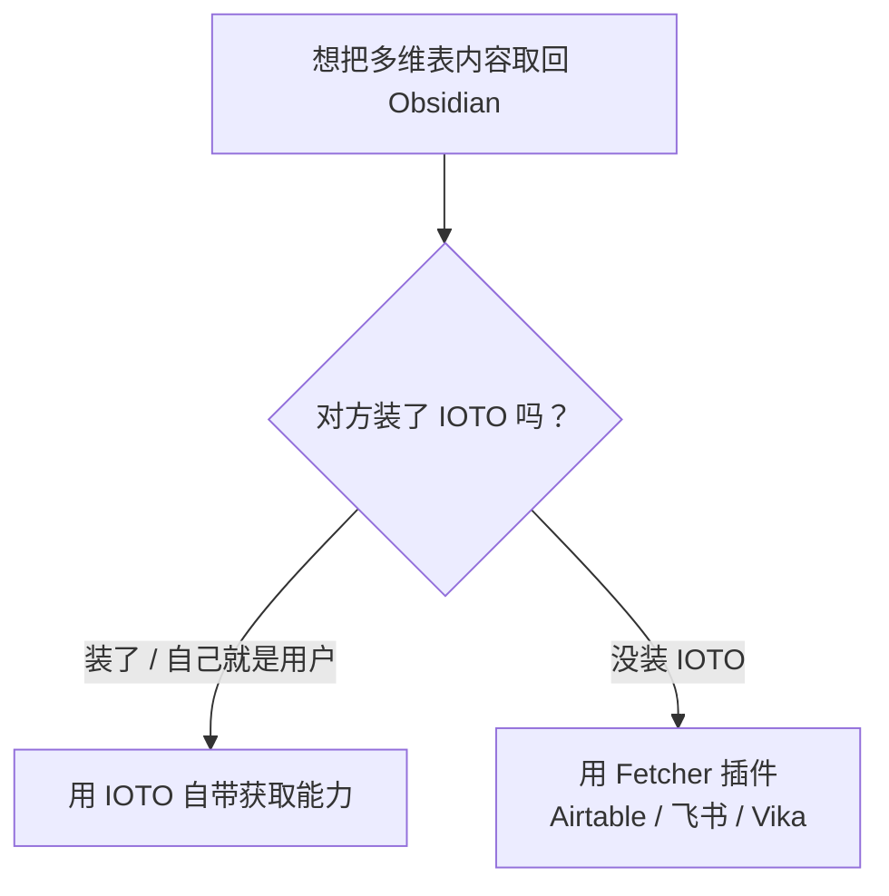

# IOTO 中的数据获取能力和免费的 Fetcher 类插件

> [!info] 写给想把多维表内容「拉回」Obsidian 的你
> 当你想把分享到多维表的内容取回到 Obsidian —— 尤其是**对方没装 IOTO** 也想取到时，这篇文档就是给你看的。读完你会明白 IOTO 自带的「获取能力」和 Fetcher 插件分别能做什么、有什么不同、该怎么选。

---

## 一句话先记住

> [!quote]
> IOTO 的获取能力只给「自己人」用；要让没装 IOTO 的人也能取内容，用免费的 Fetcher 插件。

## IOTO 自带的「获取能力」是什么

IOTO 内置了数据获取能力，可以方便地把**指定多维表**里的数据，获取到你自己的 Obsidian 库里。

但它有个前提：**只有 IOTO 的用户才能用这个能力**。获取能力是 IOTO 框架内部的功能，依赖你本机装好并配置好 IOTO。

## 一个新的需求：把内容分享给没装 IOTO 的人

假设你已经用 IOTO 的**数据同步 · 上传能力**，把想分享的内容上传到了某个多维表里。

这时你希望：**没有装 IOTO 的人**，也能在自己的 Obsidian 库里，把你分享的这些多维表内容**获取回去**。

问题来了 —— 对方打不开 IOTO 的获取能力（因为他没装 IOTO）。怎么办？

> [!question] 一句话场景
> 「我上传了，对方想取，可对方没装 IOTO。」

## 解决方案：三款免费的 Fetcher 插件

我在 2025 年开发了三个 Obsidian 插件，专门解决上面的问题。它们**免费**，而且**不要求使用者安装 IOTO**。

| 插件 | Gitee | GitHub |
| --- | --- | --- |
| Obsidian Airtable Fetcher | [gitee.com/johnnylearns/obsidian-airtable-fetcher](https://gitee.com/johnnylearns/obsidian-airtable-fetcher) | [github.com/shawndotty/obsidian-airtable-fetcher](https://github.com/shawndotty/obsidian-airtable-fetcher) |
| Obsidian Feishu Fetcher | [gitee.com/johnnylearns/obsidian-feishu-fetcher](https://gitee.com/johnnylearns/obsidian-feishu-fetcher) | [github.com/shawndotty/obsidian-feishu-fetcher](https://github.com/shawndotty/obsidian-feishu-fetcher) |
| Obsidian Vika Fetcher | [gitee.com/johnnylearns/obsidian-vika-fetcher](https://gitee.com/johnnylearns/obsidian-vika-fetcher) | [github.com/shawndotty/obsidian-vika-fetcher](https://github.com/shawndotty/obsidian-vika-fetcher) |

> [!tip] 想尝试？
> 这三个插件的 Readme 里都有详细的配置说明，按步骤照着做即可。

## IOTO 获取能力 vs Fetcher 插件，有什么不同

| 对比项 | IOTO 自带获取能力 | Fetcher 系列插件 |
| --- | --- | --- |
| 使用者要求 | 必须安装并配置 IOTO | 不要求安装 IOTO（免费即可用） |
| 支持平台 | 更多平台 | 仅 Airtable、飞书、Vika 三个 |
| 触发方式 | 基于 Templater 脚本，需在**已激活的笔记**里触发命令 | 不依赖 Templater，**没打开笔记时也能用** |
| 配置 / 分享难度 | 相对复杂 | 配置和分享更简单 |

## 该选哪个：一张图判断

> [!tip] 给新手的判断口诀
> - 你自己就是 IOTO 用户，想从多维表取回自己的内容 → 直接用 **IOTO 获取能力**。
> - 你想把内容分享给别人，而对方**很可能没装 IOTO** → 让对方装对应的 **Fetcher 插件**。
> - 你只想在自己库里取 Airtable / 飞书 / Vika 的内容，又不想折腾 Templater → 也选 **Fetcher 插件**。