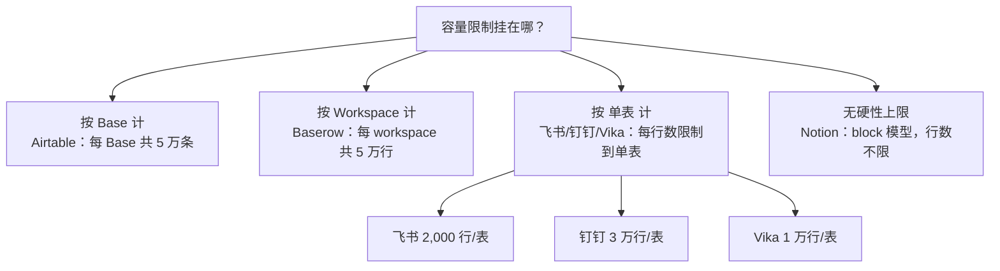

# IOTO支持的多维表产品最低档付费版的使用限制对比

> [!info] 写给准备为同步平台付费的你
> 免费版容量不够用时，你大概率会纠结「花最少的钱升到哪一档」。这篇文档帮你把 IOTO 支持的 6 个平台、各自**最便宜的付费档**能建多少表、每张表能存多少条记录，一次性讲清楚。

---

## 一句话先记住

> [!tip] 给新手的建议
> 「最低档付费版」不等于「容量大幅放开」。**飞书多维表格**的最低付费档行数仍只有 2,000 行/表（和免费版一样），要上「商业专业版」才到 2 万行；而 **Airtable / Baserow / Vika** 从免费升到最低付费档，容量直接翻几倍到十几倍。想「花最少钱换最大容量」，优先看这三家。

## 先厘清：限制是按什么算的

各家对「表数量」和「记录数」的计量口径不一样，买之前一定要看清限额**挂在哪个对象上**，否则很容易踩坑：

> [!warning] 最容易搞错的两个口径
> - **Airtable / Baserow** 的限制是「总量」：5 万条是**整个 Base / 整个 workspace 共用**，不是每张表各 5 万。
> - **飞书多维表格**的最低付费档：**单表仍只有 2,000 行**，和免费版一致。它只是把「单文件总表数、协同人数」等放开，行数要再升一档才有实质提升。

## 对比总表

> 调研时间：2026-07-27；价格随官方调整，以各家定价页为准。

| 产品 | 最低档付费版 | 价格（约） | 能建多少个「表」 | 每个表能存多少条记录 | 关键补充 |
|------|------------|-----------|----------------|----------------------|----------|
| Airtable | Team | $20 /人/月（年付，$24 月付） | 无限个 Base；Base 内表数无硬上限 | 每 Base **共 5 万条**（按 Base 计，不是按表） | 20GB 附件/Base；2.5 万次自动化/月；无限编辑席位 |
| 飞书多维表格 | 商业标准版 | 随飞书套件按人计费 | 单文件内最多 **300 个数据表**（数据表+仪表盘+文档合计≤300） | **2,000 行/表**（与免费默认一致） | 下一档「商业专业版」才到 2 万行/表；单文件总行 1,000 万 |
| Notion | Plus | $10 /人/月（年付更便宜） | 无上限（页面/数据库数量无限） | **无硬性行数上限**（block 模型，无限协作 blocks） | 文件上传无限、单文件约 5GB；历史 30 天 |
| 钉钉AI表格 | 企业版 | ¥18 /人/月（年付） | 单个 AI 表格内最多 **100 个数据表** | 单表 **3 万行**（可扩容至千万行） | 自动化 5 万次/月；AI 字段高速通道；历史 365 天 |
| Baserow | Premium | $10 /人/月（年付，$12 月付） | 无限个数据库（database） | 每 workspace **共 5 万行**（按 workspace 计） | 20GB 存储/workspace；10 万自动化额度 |
| Vika 维格表 | 白银级 | ¥368 /年起 | 每空间站最多 **300 个文件节点**（表/节点） | 单表 **1 万行**；空间站总行 **300 万行** | 附件 5GB/席位；API 10 万次/月；席位 1~100 |

## 各产品最低档付费版详解

### Airtable Team

- **价格**：$20 /人/月（按年计费），$24 /人/月（按月）。
    - 不过因为淘宝的存在，其实你可以用**100RMB左右**的价格，使用一年的Airtable Team版，这个直接把Airtable变成了所有产品中最便宜的了。
    - 如有需要可以联系我，给你推荐靠谱的淘宝老板。
- **表数量**：可创建**无限个 Base**；Base 内可建多个数据表，表数无硬上限。
- **单表记录数**：限制按 **Base** 计算，每个 Base 最多 **5 万条记录**（不是每张表 5 万）。Base 内所有表合计达到 5 万即到顶。
- 其他：20GB 附件/Base、2.5 万次自动化运行/月、无限编辑席位、标准同步集成、甘特/时间线视图。

### 飞书多维表格 商业标准版

- **价格**：随飞书套件按席位计费（最低付费档即「商业标准版」）。
- **表数量**：一个「多维表格」文件内最多可创建 **300 个数据表**（数据表、仪表盘、文档三者合计≤300，其中文档≤10）。付费档不改变单文件的表数上限。
- **单表记录数**：**2,000 行/表**——与免费基础版默认一致。也就是说，飞书多维表格最低付费档在「行数」上并没比免费版多出空间，真正拉开差距的是再上一档「商业专业版」（2 万行/表）和「商业旗舰版/企业版」（5 万行/表）。
- 其他：单表 300 列、200 视图；单附件≤2GB；200 人协同编辑；单文件总行上限 1,000 万。

### Notion Plus

- **价格**：$10 /人/月（按年计费可更低）。
- **表数量**：无上限。页面与数据库数量无限。
- **单表记录数**：**没有硬性行数上限**。Notion 采用 block（块）模型，Plus 为**无限协作 blocks**；数据库里每一行由若干 block 组成，行数极多时性能受实际数据量影响但不会触发封顶。
- 其他：文件上传无限（单文件约 5GB 上限）、页面历史 30 天、无限 guests、自定义表单/站点、图表无限。

### 钉钉AI表格 企业版

- **价格**：¥18 /人/月（按年计费）。
- **表数量**：一个 AI 表格（文件）内最多 **100 个数据表**（另：仪表盘 50 个、说明文档若干）。
- **单表记录数**：单表 **3 万行**；可申请扩容至千万行。
- 其他：自动化 5 万次/月、AI 字段高速通道、高级权限角色 50 个、历史保留 365 天、300 列/表。

### Baserow Premium

- **价格**：$10 /人/月（按年计费），$12 /人/月（按月）。
- **表数量**：无限个数据库（database），每个 workspace 内数据库数量无上限。
- **单表记录数**：限制按 **workspace** 计算，整个 workspace 共 **5 万行**（非每表 5 万）。
- 其他：20GB 存储/workspace、10 万自动化额度、500 外部应用用户、全部视图类型、AI 功能。

### Vika 维格表 白银级

- **价格**：¥368 /年起（1 元/人/天量级，席位 1~100）。
- **表数量**：每个空间站最多 **300 个文件节点**（「文件节点」即表/节点，含数据表、仪表盘、视图等计数）。
- **单表记录数**：**单表 1 万行**；空间站总行数 **300 万行**。
- 其他：附件 5GB/席位；API 10 万次请求/月（5 次/秒）；自动化 1 万次/月；归档 5,000 条/表；席位 1~100。

## 对 IOTO 数据同步选型的提示

- 笔记量在几万条以内、想要「按表自由拆分且单表容量大」：**Airtable Team**（5 万条/Base，可建无限 Base）最直接；不够就多建 Base。
- 国内用户、与 IM 生态打通：**钉钉AI表格企业版**（3 万行/表）和**飞书多维表格**（最低付费档仅 2,000 行/表，建议直接上「商业专业版」2 万行）都友好，钉钉最低付费档行数更宽松。
- **Baserow Premium** 与 **Vika 白银级** 都是 5 万/workspace 或 1 万/表 级别，比免费版宽很多，但仍是「总量」或「单表」双重限制，适合中等规模同步。
- **Notion Plus** 对行数完全不设上限，最适合「把整库笔记铺进数据库」的场景，但要注意同步后查询/筛选性能需实测，且价格按席位计。
- 普遍规律：免费→最低付费档，**Airtable（1千→5万）、Baserow（3千→5万）、Vika（5千→1万/表）** 提升最明显；飞书需上「专业版」才有实质行数提升。