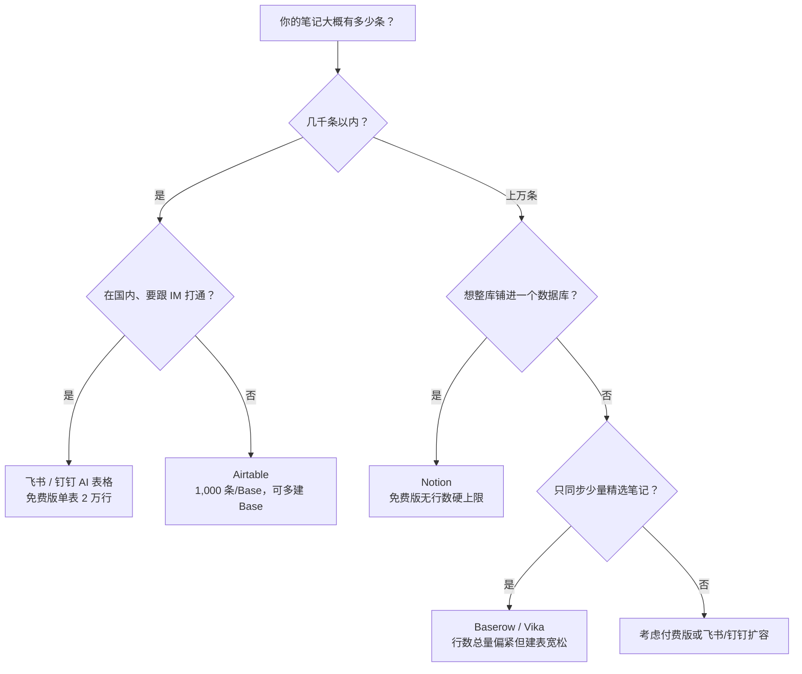

# IOTO 支持的多维表产品，免费版使用限制对比

> [!info] 写给正在挑选同步平台的你
> 如果你打算用 IOTO 把 Obsidian 笔记同步到某个在线多维表，但还没决定用哪一个，这篇文档帮你一眼看清 6 款产品免费版的「能建多少表、每表能存多少记录」。
> 调研时间：2026-07-27，数据来自各产品官方定价 / 帮助中心页面。

---

## 一句话先记住

> Airtable、Baserow、Vika 的行数上限偏低（1,000 / 3,000 / 2 万），但建表宽松；飞书、钉钉免费版单表就有 **2 万行**，容量最友好；Notion 免费版**没有行数硬上限**，但行数多了可能卡顿。

---

## 对比总表

| 产品 | 免费版能建多少「表」 | 每个表能存多少条记录 | 给 IOTO 同步的关键提示 |
| --- | --- | --- | --- |
| Airtable | 无限个 Base；Base 内表数无硬上限 | 每个 Base **共 1,000 条**（按 Base 计，不是按表） | 5 个编辑席位、1GB 附件、100 次自动化 / 月 |
| 飞书多维表格 | 单个多维表格文件内最多 **300 个数据表**（数据表 + 仪表盘 + 文档合计 ≤ 300，文档 ≤ 10） | 默认 **2,000 行**，可免费领 1.8 万行权益 → 实际 **2 万行 / 表** | 单文件总行上限 1,000 万 |
| Notion | 无明确上限（页面 / 数据库数量无限，个人版 blocks 无限） | **无硬性行数上限**；采用 block 模型，团队（≥ 2 人）blocks 受限 | 文件上传 ≤ 5MB；超大行数会卡顿 |
| 钉钉 AI 表格 | 单个 AI 表格内最多 **100 个数据表** | 免费版单表 **2 万行** | 单表 300 列；AI 字段 1 万次 / 人 / 天；附件 3GB |
| Baserow | 无限个数据库（database） | 每个 workspace **共 3,000 行**（按 workspace 计） | 2GB 存储 / workspace；2,000 自动化额度 |
| Vika 维格表 | 每个空间站最多 **30 个文件节点**（表 / 节点） | 单表 **5,000 行**；空间站总行 **2 万行** | 附件 1GB；1 万次 API / 月；席位 1~5 |

> [!warning] 注意「按整体计」和「按单表计」的区别
> Airtable 的 1,000 条是**整个 Base 共享**的，Baserow 的 3,000 行是**整个 workspace 共享**的，Vika 的 2 万行是**整个空间站共享**的——它们都**不是每张表各算一份**。真正「单表独立计行」的是飞书、钉钉（2 万 / 表）和 Notion（无硬上限）。

---

## 分产品速览

### Airtable 免费版

- **表数量**：可建无限个 Base（数据库文件），Base 内可建多个数据表，无明确数量上限。
- **单表记录数**：限制按 **Base** 计算，每个 Base 最多 **1,000 条记录**（不是每张表 1,000）。Base 内所有表记录合计到 1,000 就到顶。
- **其他限制**：5 个编辑席位、1GB 附件空间、100 次自动化运行 / 月、只读协作者不限。

### 飞书多维表格 免费版（基础版）

- **表数量**：一个「多维表格」文件内最多 **300 个数据表**（数据表、仪表盘、文档三者合计 ≤ 300，其中文档 ≤ 10）；未查到对文件数量的硬性封顶。
- **单表记录数**：默认 **2,000 行**；基础版 / 商业标准版用户可在 2,000 行基础上**免费领取 1.8 万行权益**，即实际可用 **2 万行 / 表**。付费版：商业专业版 2 万、旗舰 / 企业 5 万；扩容后单表最高 200 万行、单文件总行最高 1,000 万行。
- **其他**：单表 300 列、200 视图；单附件 ≤ 2GB；200 人协同编辑。
- **常见误区**：网传「免费版最多 5 张表单、每张 500 条」指的是**表单（form）**而非数据表，与多维表本身限制不同。

### Notion 免费版

- **表数量**：无明确上限，页面与数据库数量个人版无限。
- **单表记录数**：**没有硬性行数上限**。Notion 采用 block（块）模型，个人版 blocks 无限；团队（≥ 2 人）方案 blocks 受限。数据库每行由若干 block 组成，行数极多时页面会变卡。
- **其他限制**：文件上传 ≤ 5MB、页面历史仅 7 天、协作 / 权限 / AI 等高级功能受限。

### 钉钉 AI 表格 免费版

- **表数量**：一个 AI 表格（文件）内最多 **100 个数据表**（另：仪表盘 20 个、说明文档 5 个）。
- **单表记录数**：免费版单表最多 **2 万行**；企业版 3 万、旗舰 5 万，最高可申请扩容至 1,000 万行。
- **其他**：单表 300 列、200 视图；AI 字段 1 万次 / 人 / 天；单个 AI 表格最多 300 人在线编辑、阅读不限；附件 3GB。

### Baserow 免费版

- **表数量**：无限个数据库（database），每个 workspace 内数据库数量无上限。
- **单表记录数**：限制按 **workspace** 计算，整个 workspace 共 **3,000 行**（非每表 3,000）。
- **其他**：2GB 存储 / workspace、2,000 自动化额度、500 外部应用用户；支持 Grid / Form / Gallery 视图及 65+ 模板。

### Vika 维格表 青铜免费版

- **表数量**：每个空间站最多 **30 个文件节点**（「文件节点」即表 / 节点，含数据表、仪表盘、视图等计数）。
- **单表记录数**：**单表 5,000 行**；空间站总行数 **2 万行**。
- **其他**：附件 1GB；API 1 万次请求 / 月（2 次 / 秒）；自动化 100 次 / 月；席位 1~5；归档 1,000 条 / 表。

---

## 给 IOTO 新手的选型建议

> [!tip] 按笔记量挑平台
> - **笔记量几千条以内**：Airtable 免费版最易用，但 1,000 条 / Base 偏紧——记录数到顶就多建几个 Base 分摊。
> - **国内用户 / 想容量更宽松**：飞书、钉钉免费版单表就有 2 万行，且与 IM 生态打通，对国内用户最友好。
> - **轻量同步**：Baserow、Vika 行数也偏紧（workspace / 空间站总量限制），适合只同步少量笔记。
> - **想把整库铺进数据库**：Notion 免费版没有行数硬上限，最适合这种场景，但同步后的查询 / 筛选性能需要实测。

### 一图帮你决定

---