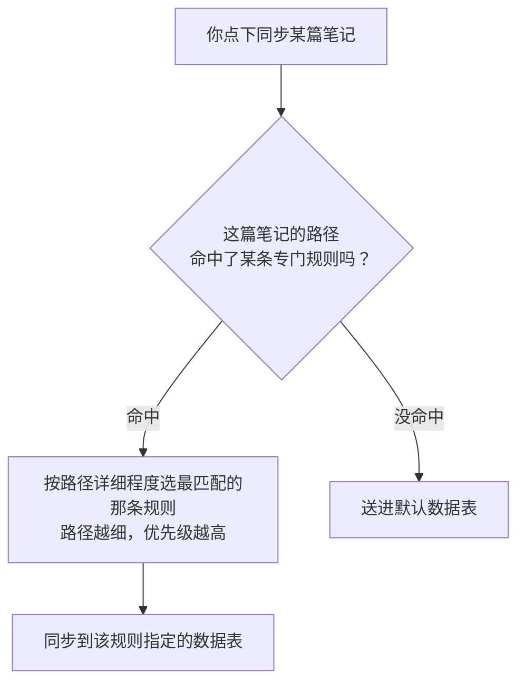

> [!info] 写给第一次配置同步规则的人
> 这篇文档帮你搞清楚：当你点下"同步"时，IOTO 到底凭什么决定把一篇笔记送进哪一张数据表。理解了这个判断逻辑，你就能随心所欲地安排"哪些笔记去哪张表"。

---

## 一句话先记住

> [!tip]
> IOTO 是靠**笔记所在的文件夹路径**来判断同步目标的：**路径写得越细，规则优先级越高**；如果一篇笔记的路径没有命中任何专门规则，它就会被送进你设置的**默认表**。

## 先搞懂两个世界的对应关系

在 Obsidian 里，我们习惯把同一类笔记丢进同一个文件夹；在多维表里，我们也习惯用不同的数据表来存放同一类数据。两边其实是同构的：

| Obsidian 世界 | 多维表世界 | 说明 |
| --- | --- | --- |
| 文件夹（如 `1-输入`） | 数据表（如"输入表"） | 同一类内容的容器 |
| 文件夹里的一篇篇笔记 | 数据表里的一条条记录 | 真正被同步的"数据行" |
| 文件夹下的子文件夹 | 数据表里的某个属性（分类、路径等） | 用属性也能区分内容，不必靠层层建文件夹 |

> [!note] 少建子文件夹，多用属性
> 当你习惯用"数据库"的眼光看笔记，会慢慢明白：与其建一大堆子文件夹，不如给笔记加个属性（比如"分类""来源"）来区分。层级越浅，同步规则越好写，也越好维护。

## IOTO 是怎么决定目标表的

### 默认情况：整个库 = 一个文件夹 → 一张默认表

使用 IOTO 的数据同步，你的多维表里**至少得先有一张表**。

在你还没做任何自定义设置之前，IOTO 默认允许你把 Obsidian 库里**任意位置**的笔记，全部同步到这一张表里。

这背后的道理是：你的 Obsidian 库，本质上就是你电脑上的一个大文件夹；你在库里建的其他文件夹，都只是它的子文件夹。所以"整个库"天然就能被当成"一个数据源"。

### 用文件夹路径精确控制数据源

实际使用时，我们通常会给不同的数据表，安排不同的目标文件夹。下面从简单到进阶，分三种用法。

#### 基础用法：每个一级文件夹对应一张表

最常用的配置，就是让 IOTO 的四个基本文件夹各对上一张表：

| Obsidian 文件夹 | 对应的数据表 |
| --- | --- |
| `1-输入` | 输入表 |
| `2-输出` | 输出表 |
| `3-任务` | 任务表 |
| `4-成果` | 成果表 |

这样，你放在 `2-输出` 下的笔记，就会进输出表；放在 `3-任务` 下的，就进任务表，清清楚楚。

#### 进阶用法一：给某个子文件夹单独指定一张表

假设你的 `1-输入` 下有个子文件夹叫 `论文资料`，你希望这里的内容单独同步到一个专门的"论文表"，而不是混进输入表。

IOTO 允许你给 `1-输入/论文资料` 单独设一条规则。同步时，IOTO 会**依据路径的详细程度来决定用哪条规则——路径写得越细，优先级越高**：

- 在 `1-输入/论文资料` 下的笔记 → 命中更细的规则 → 进"论文表"
- 在 `1-输入/原始资料` 下的笔记 → 没命中论文资料那条 → 用 `1-输入` 的规则 → 进"输入表"

#### 进阶用法二：把不同的子文件夹指向同一张表

假设你有个 `市场营销` 项目，想把 `3-任务/市场营销` 和 `4-成果/市场营销` 下的笔记，都汇到同一张"市场营销表"里。

那你只要设**两条规则**，把这两个路径都指向同一张表即可。IOTO 不要求"一个文件夹只能对应一张表"，反过来"一张表"也可以接收来自多个文件夹的笔记。

## 总结

> [!tip]
> 记住三句话就够了：
> 1. IOTO 靠**笔记的文件夹路径**判断同步目标；
> 2. 路径**越详细，规则优先级越高**；
> 3. 谁的**路径都没命中**，就进**默认表**。

所以当你纠结"这篇笔记怎么跑错表了"，先别急——八成是路径规则没配对，或者层级不够细，被更上面的规则"截胡"了。