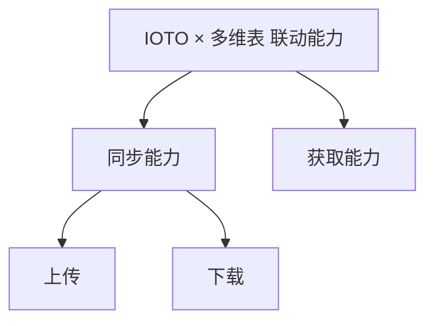

# IOTO 的数据下载能力和获取能力有什么不同

> [!info] 写给正在用 IOTO 对接多维表的你
> 当你搞不清「同步里的**下载**」和「**获取**」该用哪一个时，这篇文档就是给你看的。读完你会明白两者在**数据来源、写入方式、文件类型**上的三个本质区别。

---

## 一句话先记住

> [!quote] 提醒
> 同步的「下载」跟着**当前笔记**走，获取能力跟着**脚本配置**走；下载只写 Markdown，获取能写任意纯文本。

## 先分清 IOTO 的两大类能力

IOTO 在和多维表平台联动时，提供两大类基本能力：**同步能力**与**获取能力**。其中同步能力又细分为「上传」和「下载」两种。

那么「同步里的下载」和「获取」到底有什么不同？核心是下面三点。

## 区别一：数据从哪来、写到哪，由谁决定

**同步的下载能力**会根据「你当前打开的是哪篇笔记」来决定两件事：从哪个多维表取数据，以及取到后写入哪些笔记。它提供的下载范围选项有：

- 下载数据到**当前笔记**
- 下载数据到**当前笔记中的出链**
- 下载数据到**当前笔记及其出链**
- 下载数据到**当前文件夹下的所有笔记**
- 下载数据到**当前文件夹及其子文件夹下的所有笔记**

也就是说，你在不同笔记里触发下载，实际抓取的数据来源和写入目标都会随之变化。

**获取能力**则不同。从哪里取、取到后写到哪里，只由你**获取脚本里配置的「来源文件夹」和「目标文件夹」** 决定，和你是在哪篇笔记里触发它毫无关系。

> [!note] 一句话区分
> 下载能力「随笔记走」，获取能力「随脚本走」。

## 区别二：从数据表取数、写入笔记的方式不同

**同步的下载能力**对字段的控制更细。你可以：

- 指定用哪个字段作为笔记的**标题**
- 指定用哪个字段作为笔记的**内容**
- 指定把哪些字段写入笔记的**不同属性**
- 指定是否把某些字段的内容**附加到笔记内容末尾**

**获取能力**在这方面受限：它只能从**固定的字段**里取标题和内容。如果你想在笔记内容里带上属性，需要先在多维表里把属性**合并进对应的内容字段**。

## 区别三：能写入的文件类型不同

**同步的下载能力**只能把取到的内容写入 **Markdown 笔记**。

**获取能力**则更灵活：它会根据你在多维表里设置的**文件后缀**，把内容写入**任意纯文本格式**的文件。

> [!example] 典型例子
> 你用 IOTO 的「一键部署」功能时，会把 `js`、`css` 等非 Markdown 的纯文本文件下载进 Obsidian——这里用的就是类似「获取能力」的机制。

## 三个区别，一表看懂

| 对比项 | 同步 · 下载能力 | 获取能力 |
| --- | --- | --- |
| 数据来源 / 写入位置由谁决定 | 当前所在笔记（随笔记变化） | 获取脚本中配置的来源与目标文件夹 |
| 取数字段能否自定义 | 可指定标题 / 内容 / 属性字段，可附加到内容末尾 | 仅能从固定字段取标题与内容 |
| 写入文件类型 | 仅 Markdown 笔记 | 任意纯文本格式（依后缀，如 `js` / `css`） |

## 给新手的判断口诀

> [!tip] 该用哪个？
> - 想要「在哪篇笔记点，就从对应的表取、写到对应的笔记」→ 用**同步下载**。
> - 想要「固定从某处取、批量写进指定文件夹，甚至写出 `js` / `css` 等文件」→ 用**获取能力**。